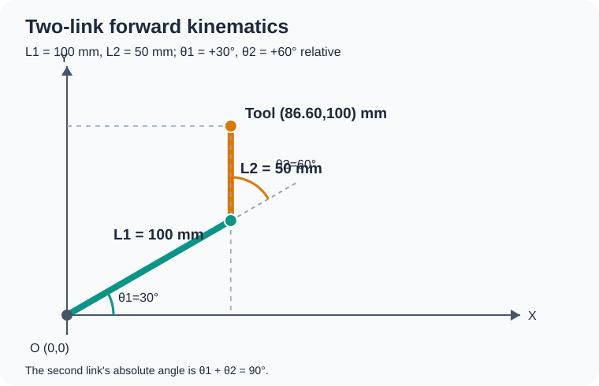

# 4. Roboter-Koordinatensysteme und ebene Kinematik

**Languages:** [en](../../en/notes/04-coordinate-frames.md) · [fr](../../fr/notes/04-coordinate-frames.md) · [de](04-coordinate-frames.md) · [it](../../it/notes/04-coordinate-frames.md) · [es](../../es/notes/04-coordinate-frames.md) · [pt](../../pt/notes/04-coordinate-frames.md) · [zh](../../zh/notes/04-coordinate-frames.md) · [ja](../../ja/notes/04-coordinate-frames.md) · [nb](../../nb/notes/04-coordinate-frames.md) · [ru](../../ru/notes/04-coordinate-frames.md) · [ko](../../ko/notes/04-coordinate-frames.md) · [fi](../../fi/notes/04-coordinate-frames.md) · [pl](../../pl/notes/04-coordinate-frames.md)

**Hier verwendete Einheiten (vor den Beispielen erklärt):** `mm` — Millimeter = 0.001 m; `°` — Grad. [Einheitenverzeichnis](../UNITS.md).

[README](../README.md) · [Trigonometrie](../TRIGONOMETRY.md) · [Mathematische Symbole](../SYMBOLS.md) · [Regelung](03-feedback-control.md)

> **Lehrmodell:** Diese vereinfachte Geometrie darf nicht zum Steuern realer Maschinen verwendet werden.

## Inhalt
1. [Warum Koordinatensysteme?](#section-1)
2. [Punkt drehen und verschieben](#section-2)
3. [Transformationen verketten](#section-3)
4. [Vorwärtskinematik mit zwei Gliedern](#section-4)
5. [Zwei Ellenbogenlagen und Arbeitsraum](#section-5)
6. [Aufgaben mit vollständigen Lösungen](#section-6)
7. [Modellgrenzen und Matrizen](#section-7)

## 1. Warum Koordinatensysteme?

Ein **Koordinatensystem (coordinate frame)** besitzt einen Ursprung und gerichtete Achsen. Das feste **Weltkoordinatensystem (world frame)** W kann an der Basis liegen, das **Werkzeugkoordinatensystem (tool frame)** T bewegt sich mit dem Werkzeug. Ein Punkt hat je nach System andere Koordinaten. Position beschreibt den Punkt, Orientierung die Achsrichtung. Ein Koordinatenwechsel bewegt den Roboter nicht.

Alle Längen haben dieselbe Einheit (hier mm). Positive 2D-Winkel werden von Welt +X gegen den Uhrzeigersinn gemessen. w steht für Welt, l für lokal. Die Glieder gelten als starr.

## 2. Punkt drehen und verschieben

*Welt- und Werkzeugachsen nach +90° Drehung, Punkte P und Q.*

Der Werkzeugursprung T liegt in Welt bei (100 mm, 50 mm), seine Achsen sind um +90° gedreht. Lokal +x zeigt entlang Welt +Y, lokal +y entlang Welt −X. Also wird P=(0 mm, 10 mm) lokal zu (90 mm, 50 mm) in Welt und Q=(20 mm, 0 mm) zu (100 mm, 70 mm).

Für einen lokalen Punkt $(x_l,y_l)$, Weltursprung $(t_x,t_y)$ und Orientierung $\theta$ gilt: **erst drehen, dann verschieben**:

$$
x_w=t_x+x_l\cos\theta-y_l\sin\theta
$$

$$
y_w=t_y+x_l\sin\theta+y_l\cos\theta
$$

Die Vorzeichen von $\sin\theta$ und $\cos\theta$ hängen vom Winkel ab. Für $\theta=0^\circ$ bleibt nur das Addieren der Ursprungsverschiebung. Die Gleichung ist kein Motorbefehl.

## 3. Transformationen verketten

Koordinatensysteme lassen sich verketten: **W → T → S** (Welt → Werkzeug → Sensor). Liegt S bei (20 mm, 0 mm) in T mit parallelen Achsen, liegt sein Weltursprung bei (100 mm, 70 mm). Ein Punkt (0 mm, 10 mm) in S hat die Weltkoordinaten (90 mm, 70 mm). Von Kind- zu Elternsystem umrechnen.

Bei Spaltenvektoren ist $T_{WS}=T_{WT}T_{TS}$; $T_{AB}$ überführt Koordinaten **aus B nach A**. Die Reihenfolge des Matrizenprodukts ist wichtig.

**Vollständige Matrizenrechnung (Spaltenvektoren):** T ist gegenüber W um +90° gedreht und hat den Weltursprung (100 mm, 50 mm). Der Sensorrahmen S ist gegenüber T nicht zusätzlich gedreht und sitzt lokal bei (20 mm, 0 mm), also am Punkt Q der vorherigen Abbildung. Rotationskomponenten sind dimensionslos, Translationskomponenten in mm:

$$
T_{WT}=
\begin{bmatrix}
0 & -1 & 100\\
1 & 0 & 50\\
0 & 0 & 1
\end{bmatrix}
$$

$$
T_{TS}=
\begin{bmatrix}
1 & 0 & 20\\
0 & 1 & 0\\
0 & 0 & 1
\end{bmatrix}
$$

$$
T_{WS}=T_{WT}T_{TS}=
\begin{bmatrix}
0 & -1 & 100\\
1 & 0 & 70\\
0 & 0 & 1
\end{bmatrix}
$$

$$
T_{WS}\begin{bmatrix}0\\10\\1\end{bmatrix}
=\begin{bmatrix}90\\70\\1\end{bmatrix}
$$

Bei der Multiplikation wird der lokale Sensorversatz (20 mm, 0 mm) zunächst in den Weltversatz (0 mm, 20 mm) gedreht und danach zu (100 mm, 50 mm) addiert. Damit liegt der Punkt (0 mm, 10 mm) in S bei (90 mm, 70 mm) in W. Die 20 mm direkt zur Welt-X-Koordinate zu addieren wäre falsch, weil der Versatz **in T** angegeben ist. Die letzte homogene Koordinate 1 ist dimensionslos. Das ist Koordinatenrechnung; [ROS 2 tf2](06-ros2-foundations.md#section-7) veröffentlicht und sucht zeitgestempelte Transformationen, löst aber keine inverse Kinematik.

## 4. Vorwärtskinematik mit zwei Gliedern

*Erster Winkel 30°, zweiter relativer Winkel 60°.*

Ein ebener Roboter hat Glieder $L_1,L_2$. $\theta_1$ wird von Welt +X gemessen. $\theta_2$ wird **relativ zum ersten Glied** gemessen, daher zeigt das zweite Glied absolut in Richtung $\theta_1+\theta_2$. Die Werkzeugkoordinaten ergeben sich aus der Vektorsumme:

$$
X=L_1\cos\theta_1+L_2\cos(\theta_1+\theta_2)
$$

$$
Y=L_1\sin\theta_1+L_2\sin(\theta_1+\theta_2)
$$

Bei L1=100 mm, L2=50 mm, $\theta_1=30^\circ$, $\theta_2=60^\circ$ liegt das Gelenk bei (86.60 mm, 50 mm). Das zweite Glied steht senkrecht und das Werkzeug liegt bei (86.60 mm, 100 mm).

## 5. Zwei Ellenbogenlagen und Arbeitsraum

*Zwei Gelenkkonfigurationen mit demselben Endpunkt.*

**Inverse Kinematik (inverse kinematics)** bestimmt Winkel für eine Zielposition. Zwei 100-mm-Glieder erreichen (100 mm, 100 mm) mit $(\theta_1,\theta_2)=(0^\circ,+90^\circ)$ ebenso wie mit $(+90^\circ,-90^\circ)$. Der zweite Winkel ist jeweils relativ.

*Idealer ringförmiger Arbeitsraum, Radien 50 mm und 150 mm.*

Ohne Anschläge und Kollisionen gilt $|L_1-L_2|\le r\le L_1+L_2$. Bei Gliedlängen 100 mm und 50 mm ergibt sich ein idealer **Ringbereich** von 50 mm bis 150 mm Radius. Reale Grenzen können ihn verkleinern.

## 6. Aufgaben mit vollständigen Lösungen

Alle **sechs Übungsaufgaben sind mit Lösung und Begründung versehen**. Es bleibt keine persönliche Frage offen.

### 6.1. Lokaler Punkt P im gedrehten Rahmen

**Aufgabe.** T liegt in Welt bei (100 mm, 50 mm), um +90° gedreht. Weltkoordinaten von P=(0 mm, 10 mm)?

**Lösung.** Lokal +y zeigt entlang Welt −X; 10 mm von X abziehen.

$$
x_w=100+0\cdot0-10\cdot1=90\ \mathrm{mm}
$$

$$
y_w=50+0\cdot1+10\cdot0=50\ \mathrm{mm}
$$

**Ergebnis:** (90 mm, 50 mm).

### 6.2. Lokaler Punkt Q entlang Werkzeug-x

**Aufgabe.** Gleiches T: Weltkoordinaten von Q=(20 mm, 0 mm)?

**Lösung.** Lokal +x zeigt entlang Welt +Y; 20 mm zu Y addieren.

$$
x_w=100+20\cdot0-0\cdot1=100\ \mathrm{mm}
$$

$$
y_w=50+20\cdot1+0\cdot0=70\ \mathrm{mm}
$$

**Ergebnis:** (100 mm, 70 mm).

### 6.3. Zwei-Glieder-Vorwärtskinematik

**Aufgabe.** L1=100 mm, L2=50 mm, θ1=30°, relatives θ2=60°: Werkzeugposition?

**Lösung.** Der absolute Winkel des zweiten Glieds ist 30°+60°=90°.

$$
X=100\cos30^\circ+50\cos90^\circ=50\sqrt3\approx86.60\ \mathrm{mm}
$$

$$
Y=100\sin30^\circ+50\sin90^\circ=100\ \mathrm{mm}
$$

**Ergebnis:** (86.60 mm, 100 mm).

### 6.4. Zwei inverse Lösungen

**Aufgabe.** Zwei 100-mm-Glieder sollen (100 mm, 100 mm) erreichen. Zwei Winkelpaare?

**Lösung.** Ein Weg führt erst nach rechts und dann nach oben, der andere umgekehrt.

$$
(\theta_1,\theta_2)=(0^\circ,+90^\circ)\ \Longrightarrow\ (X,Y)=(100, 100)\ \mathrm{mm}
$$

$$
(\theta_1,\theta_2)=(+90^\circ,-90^\circ)\ \Longrightarrow\ (X,Y)=(100, 100)\ \mathrm{mm}
$$

### 6.5. Erreichbarkeit ohne Gelenkwinkel

**Aufgabe.** L1=100 mm, L2=50 mm: Sind (0 mm, 120 mm) und (0 mm, 0 mm) erreichbar?

**Lösung.** Die Distanz muss zwischen Längendifferenz und Längensumme liegen.

$$
r_{\min}=|100-50|=50\ \mathrm{mm},\qquad r_{\max}=100+50=150\ \mathrm{mm}
$$

$$
r_{(0, 120)}=\sqrt{0^2+120^2}=120\ \mathrm{mm}
$$

(0 mm, 120 mm) ist **erreichbar**, weil 50 ≤ 120 ≤ 150. (0 mm, 0 mm) ist **nicht erreichbar**, da die Entfernung Null beträgt.

### 6.6. Kosinus des relativen Ellenbogenwinkels

**Aufgabe.** L1=100 mm, L2=50 mm, r=120 mm: cos θ2 berechnen.

**Lösung.** Der Kosinus bestimmt die Größe der Beugung, aber gespiegelte Konfigurationen haben entgegengesetzte Vorzeichen.

$$
\cos\theta_2=\frac{r^2-L_1^2-L_2^2}{2L_1L_2}
=\frac{14400-10000-2500}{10000}=\frac{1900}{10000}=0.19
$$

$$
\theta_2\approx\pm79.05^\circ
$$

Der Innenwinkel des Dreiecks ist $\varphi=180^\circ-|\theta_2|$. Aus dem Radius allein folgt $\theta_1$ nicht. Siehe die Skizze unter [Trigonometrie](../TRIGONOMETRY.md).

## 7. Modellgrenzen und Matrizen

Das starre 2D-Modell lässt Anschläge, Kollisionen, Spiel, Verformung, Encoder-Nullpunkte, Kamerakalibrierung und 3D-Rotationen außer Acht. Ein Encoder misst einen Gelenkwinkel, nicht direkt die Werkzeugposition. Die Formeln dienen nicht der Steuerung realer Maschinen.

**Optionale Matrixschreibweise:** Eine homogene 3×3-Matrix überträgt den Punkt-Spaltenvektor $[x_l,y_l,1]^T$. Ein reiner Richtungs- oder Verschiebungsvektor erhält als dritte Koordinate 0.

$$
T_{WL}=
\begin{bmatrix}
\cos\theta & -\sin\theta & t_x \\
\sin\theta & \cos\theta & t_y \\
0 & 0 & 1
\end{bmatrix},
\qquad
\begin{bmatrix}x_w\\y_w\\1\end{bmatrix}
=T_{WL}\begin{bmatrix}x_l\\y_l\\1\end{bmatrix}
$$

[Trigonometrie](../TRIGONOMETRY.md) · [Mathematische Symbole](../SYMBOLS.md) · [Regelung](03-feedback-control.md)

[Weiter: Rotation, Geschwindigkeit und Singularitäten](05-velocity-jacobian.md)
