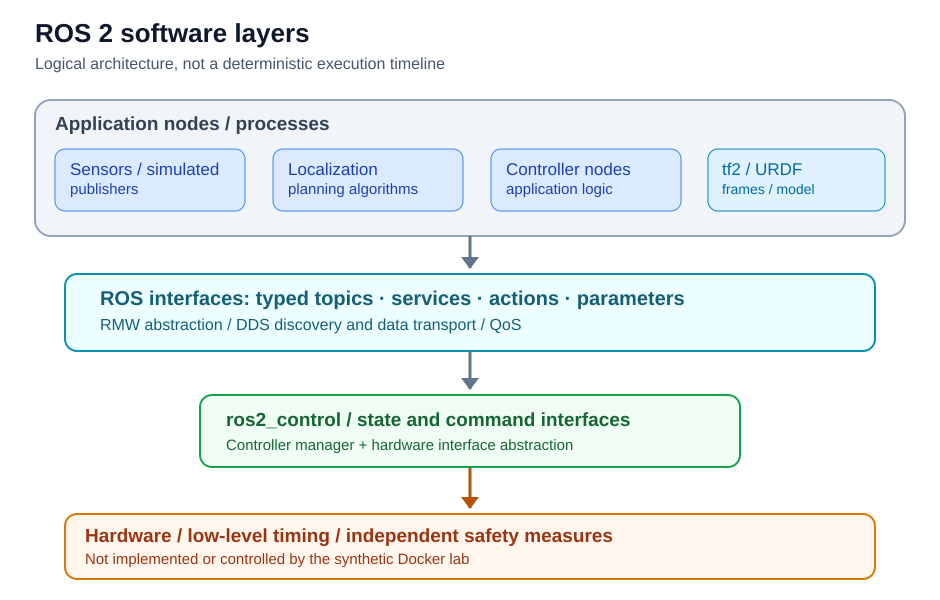

# 6. ROS 2: distributed robotics software, from graph to robot interfaces

**Read this page in:** [en](06-ros2-foundations.md) · [fr](../../fr/notes/06-ros2-foundations.md) · [de](../../de/notes/06-ros2-foundations.md) · [it](../../it/notes/06-ros2-foundations.md) · [es](../../es/notes/06-ros2-foundations.md) · [pt](../../pt/notes/06-ros2-foundations.md) · [zh](../../zh/notes/06-ros2-foundations.md) · [ja](../../ja/notes/06-ros2-foundations.md) · [nb](../../nb/notes/06-ros2-foundations.md) · [ru](../../ru/notes/06-ros2-foundations.md) · [ko](../../ko/notes/06-ros2-foundations.md) · [fi](../../fi/notes/06-ros2-foundations.md) · [pl](../../pl/notes/06-ros2-foundations.md)

**Units used here (defined before the examples):** `m` — metre; `s` — second. [Full unit reference](../UNITS.md).

[Contents](../README.md) · [Coordinate frames](04-coordinate-frames.md) · [Velocity and Jacobian](05-velocity-jacobian.md) · [Runnable Docker lab](../../../ros2/README.md)

> **Scope:** Conceptual and simulation-only software. Neither the commands nor the example are suitable for operating real robots. ROS communication does not replace hardware safety, motion control, kinematics or real-time design.

ROS 2 is a framework and ecosystem for **connecting distributed software components in a robot**. If you know backend systems, think of nodes as processes exposing typed asynchronous streams and request/reply endpoints. This analogy helps, but ROS 2 is not HTTP, a Kubernetes control plane, or an always-present central broker. It uses a *graph* of discoverable endpoints over middleware; typical ROS 2 configurations use DDS/RTPS. Libraries implement the algorithms; ROS provides communication, lifecycle and tooling.




*Application and middleware layers are separate from device timing and safety mechanisms.*

## Learning path

1. [Architecture and ROS graph](#section-1)
2. [Nodes, topics and typed messages](#section-2)
3. [Services, actions and parameters](#section-3)
4. [Packages, workspaces, colcon and ament](#section-4)
5. [CLI: discover and debug the graph](#section-5)
6. [Launch files and configuration](#section-6)
7. [tf2 and coordinate frames](#section-7)
8. [URDF and robot_state_publisher](#section-8)
9. [ros2_control and the hardware boundary](#section-9)
10. [QoS, DDS discovery and Docker networking](#section-10)
11. [Run a small complete application](#section-11)
12. [Glossary, limits and further reading](#section-12)

<a id="section-1"></a>
## Lesson 1. Architecture: the graph is not a central server

**Engineering problem:** A robot combines cameras, localization, planning, visualization and actuation software, often on separate computers. Those pieces need compatible interfaces without being one giant executable.

**ROS** means Robot Operating System, but it is not a kernel or an operating system. ROS 1 typically used a central *master* for name discovery and a different transport architecture. ROS 2 uses a middleware abstraction (**RMW**) over implementations commonly built on **DDS** (*Data Distribution Service*); participants can discover one another without a ROS 1 master. Distributed discovery does not imply that every network works automatically.

A **ROS graph** is the currently discovered set of nodes, topics, services and actions. Nodes are logical computational components; multiple nodes may run in one process, and one node may expose many endpoints. Processes can run on one host or across machines. Namespaces, remapping and ROS domains help isolate groups of nodes. Do not assume discovery is an authorization or security boundary.

**Backend comparison:** A topic resembles typed event streaming, a service resembles RPC, a launch file resembles a process supervisor configuration, and QoS resembles delivery-policy configuration. These comparisons are approximations: DDS discovery and ROS QoS differ from Kafka, HTTP and queue brokers.

<a id="section-2"></a>
## Lesson 2. Nodes, topics and messages

**Engineering problem:** A sensor or simulation produces a sequence of measurements. Several consumers may need them without polling the producer.

A **publisher** sends typed messages on a named **topic**; a **subscriber** receives them asynchronously. Topic names such as `/training/status` are not a unique socket address: discovery matches compatible publishers and subscribers. Type identity must agree, e.g. `std_msgs/msg/String`, which contains one `string data` field. Generated Python and C++ bindings expose the same ROS interface definition; do not exchange arbitrary language runtime objects.

The included exercise runs **two separate processes**. `/sample_source` publishes `sample 1`, `sample 2`, ... and `/sample_monitor` subscribes and increments a counter. Both use depth 10; neither stores a durable history. New subscribers normally observe **future** samples. The monitor's received count can differ from the publisher's sequence number during startup.

**When to choose a topic:** ongoing status, images, joint states, odometry or telemetry. A topic is not the right abstraction for a command that must return one immediate result, or for a long operation that needs cancellation and completion state.

**Worked discovery trace:** Suppose `/sample_source` has already published `sample 1` before `/sample_monitor` is discovered. With the demo's volatile topic history, that earlier sample is not replayed automatically. The monitor may initially answer `received 0 samples`, even while the publisher continues producing data. Once compatible endpoints discover each other, the count can increase. A published sequence number and a subscriber's received count answer different questions; neither is an acknowledged transaction.

**What the CLI proves:** `ros2 topic list -t` shows discovered topic names and types; it does **not** establish that a subscriber is receiving messages. `ros2 topic info /training/status -v` reports discovered endpoints and their offered/requested QoS. Zero discovered subscriptions can mean no subscriber is running **or** discovery has not completed. If endpoints exist but data is absent, check message types and QoS compatibility, then process logs and `ROS_DOMAIN_ID`; the observations are snapshots, not proof of guaranteed delivery. Run commands in the lab container, not a separate host network.

<a id="section-3"></a>
## Lesson 3. Services, actions and parameters

**Engineering problem:** Streaming values, quick queries and long-running operations have different interaction and failure semantics.

| Mechanism | Flow | Use it for | Do not confuse it with |
| --- | --- | --- | --- |
| Topic | Publisher → 0..N subscribers | Repeated state/telemetry | Durable queue or acknowledged transaction |
| Service | Client → request → server → response | Short query or bounded operation | Guaranteed remote commit or long-running job |
| Action | Client → goal; server → feedback/result; optional cancel | Navigation goal or long computation | A simple periodic sensor stream |
| Parameter | Named value owned by a node | Configuration, e.g. sample interval | Shared global distributed database |

Our monitor exposes `/training/count` as `std_srvs/srv/Trigger`. The request has no fields; the response includes a boolean `success` and string `message`, for example `received 12 samples`. Service availability and the returned snapshot are separate concerns. A service can time out; application code must decide whether a retry is safe. For actions, repeated goals and cancellation also need explicit application-level policy.

The publisher declares a `double` parameter `interval_s=1.0`, read at startup. Changing a parameter later does **not** automatically rebuild its timer; applications must implement change handling. Parameters belong to nodes, not a global configuration database.

<a id="section-4"></a>
## Lesson 4. Packages, workspaces, colcon and ament

**Engineering problem:** A robot application combines versioned libraries, node executables, generated message types, launch definitions and runtime dependencies.

A **package** is the unit of building, installing and discovery. A **workspace** usually has `src/`, `build/`, `install/` and `log/`. **colcon** orchestrates building packages. **ament_python** and **ament_cmake** are build-system integrations; neither is the message bus. The installed environment has an **underlay** (ROS distribution) and optionally an **overlay** (your workspace).

In the example, `ros2/demo_pkg/package.xml` declares `rclpy`, `std_msgs`, `std_srvs`, and launch dependencies. `setup.py` exposes `sample_source` and `sample_monitor` console scripts and installs the launch file. In the actual `ros2/Dockerfile`, **image build** (`RUN`) and **container startup** (`CMD`) are different phases. During the image build, only the ROS underlay is sourced before `colcon` compiles the package:

**Image build (`RUN`):**

```bash
source /opt/ros/${ROS_DISTRO}/setup.bash
colcon build --packages-select telemetry_demo
```

**Container startup (`CMD`):**

```bash
source /opt/ros/${ROS_DISTRO}/setup.bash
source /opt/training_ws/install/setup.bash
exec ros2 launch telemetry_demo demo.launch.py
```

When the container starts, a new shell sources the ROS underlay **again**, then the workspace overlay, and starts the launch file. `package.xml` declares package dependencies; `setup.py` installs both Python entry points and the launch file. `build/` and `install/` are generated artifacts, not directories for source edits. A successful build alone does not prove runtime discovery.

Always source **underlay first**, then **overlay**, in a new shell. An installed package that is not discoverable often indicates incorrect sourcing, missing installation of data files or a failed build. The `install` directory is built output; do not put source there.

<a id="section-5"></a>
## Lesson 5. CLI: discover before guessing

**Engineering problem:** In a distributed application you need to learn what is actually running, not merely trust configuration files.

After starting the [Docker lab](../../../ros2/README.md), execute these commands **inside the running container** after sourcing ROS and the workspace:

```bash
ros2 node list
ros2 node info /sample_source
ros2 topic list -t
ros2 topic info /training/status -v
ros2 topic echo /training/status
ros2 interface show std_msgs/msg/String
ros2 service list -t
ros2 service call /training/count std_srvs/srv/Trigger "{}"
ros2 action list
ros2 param list /sample_source
ros2 param get /sample_source interval_s
```

Expected: two application nodes, topic `/training/status [std_msgs/msg/String]`, live string messages, service `/training/count [std_srvs/srv/Trigger]`, a successful response containing a changing count, and `Double value is: 1.0`. The demo contains **no application action**. The CLI may temporarily appear as an additional node. If `ros2 topic echo` waits, that is normal until a new sample arrives; stop it with Ctrl+C.

First debug **names and types**, then **endpoint count and QoS**, then **domain/network discovery**. An empty graph is not evidence that every process is down; you may be in another ROS domain or container network.

<a id="section-6"></a>
## Lesson 6. Launch files

**Engineering problem:** Starting multiple nodes with consistent names, parameters and startup settings should be reproducible.

A Python launch description creates `launch_ros.actions.Node` actions and starts the independent executables. The exercise's `launch/demo.launch.py` starts the producer and monitor, passing `interval_s=1.0` to the producer. Run `ros2 launch telemetry_demo demo.launch.py` in a sourced environment, or use the container's predefined command.

Launch files can include other launch files, expose arguments, set namespaces, remap topics, and set parameters. A **launch** description is **not a guarantee of readiness**: startup order, discovery, initial data and retries still matter. Also distinguish launching two *nodes* from two *processes*: this example creates both.

**Observe readiness rather than assuming it:** `launch_ros.actions.Node` starts the two **processes**, but DDS graph discovery and the first `/training/status` sample occur afterward. Immediately calling `/training/count` may legitimately return `received 0 samples`; a later request can report a larger count. That is not proof of a lost transaction: the service reports only the monitor's received samples. `interval_s=1.0` is set when the publisher's timer is created, not a live retiming mechanism.

<a id="section-7"></a>
## Lesson 7. tf2 and coordinate frames

**Engineering problem:** A camera detects a point in its own coordinates, but navigation and manipulation need the same point in a base or world frame.

A **frame** is a named reference coordinate system, such as `map`, `odom`, `base_link`, or `camera_link`. **tf2** stores time-stamped relationships between frames and answers transform queries at requested times. Transforms include rotation and translation; a valid frame tree has consistent parent–child relationships. Static transforms are appropriate for fixed mountings; moving joints produce dynamic transforms. Time synchronization and lookup/extrapolation errors matter.

For the **mathematics** of mapping a local point to world coordinates, study [coordinate frames](04-coordinate-frames.md). For derivatives and end-effector speed, study [velocity and Jacobian](05-velocity-jacobian.md). **tf2 is infrastructure for publishing and querying transforms; it does not derive forward/inverse kinematics or solve robot planning.** Those calculations happen elsewhere.

**Example frame chain (not a required layout):** `map → odom → base_link → camera_link`. A camera rigidly mounted on the base has a `static` mounting transform; the moving base requires `dynamic` transforms. To interpret a point observed at time *t* in `camera_link` coordinates, tf2 must find the chain to `map` **at that measurement time**. A missing frame, disconnected tree or unavailable timestamp produces a lookup/extrapolation error; blindly using the newest transform can put historical measurements in the wrong place.

**Worked transform direction and inverse.** Let `base_link` (B) be the parent frame and `tool` (T) the child. With no relative rotation and a translation of 0.1 m along the parent's positive X, the tool origin is **ahead of the base origin when expressed in B**. The same physical offset seen from T has the opposite sign:

$$
{}^{B}\mathbf p_{T}=(0.1, 0, 0)\ \mathrm{m},\qquad
{}^{T}\mathbf p_{B}=(-0.1, 0, 0)\ \mathrm{m}\quad (R=I).
$$

That simple sign reversal works only when the two frames have the **same orientation**. In general, coordinates of a point obey the rotation-and-translation rule below. The inverse must undo translation **and** rotation; $R^{T}$ is the inverse of a proper rotation matrix:

$$
\mathbf p_B=R_{BT}\mathbf p_T+\mathbf t_{BT},\qquad
\mathbf p_T=R_{BT}^{T}(\mathbf p_B-\mathbf t_{BT}),\qquad
\mathbf t_{TB}=-R_{BT}^{T}\mathbf t_{BT}.
$$

For example, take a different pose with T rotated +90° about the common Z axis and still translated (0.1 m, 0 m) in B. The origin of B expressed in T is then (0 m, +0.1 m), **not** (−0.1 m, 0 m). The same matrices can transform a point at (0 m, 0.05 m) in T:

$$
R_{BT}=\begin{bmatrix}0 & -1\\1 & 0\end{bmatrix},\quad
\mathbf t_{BT}=\begin{bmatrix}0.1\\0\end{bmatrix}\ \mathrm{m},\quad
\mathbf t_{TB}=\begin{bmatrix}0\\0.1\end{bmatrix}\ \mathrm{m}.
$$

$$
\mathbf p_T=\begin{bmatrix}0\\0.05\end{bmatrix}\ \mathrm{m}
\Longrightarrow
\mathbf p_B=R_{BT}\mathbf p_T+\mathbf t_{BT}
=\begin{bmatrix}0.05\\0\end{bmatrix}\ \mathrm{m}.
$$

Frames and transforms are coordinate descriptions, not commands to move the tool. In ROS 2, translation fields follow the metre convention; the separate [coordinate-frame lesson](04-coordinate-frames.md#section-3) intentionally uses millimetres and must be converted before mixing numerical examples. A static transform describes an unchanging mounting relationship; changing transforms are published by an appropriate state-producing component. Query historical measurements at their timestamps and handle unavailable transform data.

<a id="section-8"></a>
## Lesson 8. URDF and robot_state_publisher

**Engineering problem:** Multiple tools need a common description of a robot's bodies and joints instead of independently hard-coding the mechanism.

**URDF** (*Unified Robot Description Format*) represents links and joints, joint origins/axes, fixed or movable relationships and optional visual/collision/inertial properties. **robot_state_publisher** uses a URDF model plus joint positions (commonly `sensor_msgs/msg/JointState` on `/joint_states`) to publish the frame transforms. Fixed joints can be published as static transforms; movable joints depend on joint state. The TF tree is an output of the model and measurements.

A URDF alone does **not** provide joint measurements, collision checking, feedback control, an inverse kinematics solver or a physical simulation. Coordinate conventions, dimensions (typically metres and radians), joint order and timestamps must agree. Try visualizing a *synthetic* two-link URDF later; the first Docker lab deliberately needs no robot or driver.

**Where the transforms come from:** URDF specifies which joints are `fixed` and which are movable. `robot_state_publisher` uses fixed geometry for `static` transforms and positions supplied on `/joint_states` (`sensor_msgs/msg/JointState`) for `dynamic` transforms of moving joints. The URDF file does **not** sense joint positions or manufacture missing measurements; a missing or outdated joint state cannot be repaired by a correct geometric description. Keep dimensions in metres, angles in radians and timestamps consistent.

<a id="section-9"></a>
## Lesson 9. ros2_control and the hardware boundary

**Engineering problem:** High-level planners should not be hard-wired to each motor driver, and driver update cycles should not depend on ordinary best-effort topic traffic.

**ros2_control** defines controller management, **state interfaces** (e.g. joint position/velocity feedback), **command interfaces** (e.g. position/velocity/effort setpoints) and pluggable hardware abstractions. Typical composition is planner or supervisory node → controller manager/controller → hardware interface → device/plant, with feedback returning via state interfaces. For realistic actuation, safety limits, watchdogs, power electronics, device protocols and low-level timing are separate engineering responsibilities.

A ROS node sending a velocity topic does **not** guarantee deterministic timing, motor-current regulation or safe stopping. Real-time constraints must be designed and verified in the actual control stack, often below the general ROS application. This chapter contains no driver code, real motor commands, tuning instructions or permission to use the example on hardware.

For physical meaning of torque and feedback refer to [first-order dynamics](02-first-order-dynamics.md) and [PID feedback control](03-feedback-control.md).

**What the controller manager does:** `controller_manager` manages controller lifecycles and, through the resource manager, access to state and command interfaces. A controller can read a state interface such as the illustrative `joint1/position`; an active controller may claim a compatible command interface to write a requested value. The measured state is not the requested command, and competing controllers cannot simply claim an already-claimed command interface. Controller activation and resource ownership therefore matter in addition to topic discovery.

**Boundary of this lab:** `/training/status` and `/training/count` demonstrate a topic and a service, not `ros2_control`. Neither node is a controller, and the lab runs no `controller_manager`, hardware interface or closed-loop control. Passing its smoke test does not test controller lifecycle, physical timing or device safety. See the [official ros2_control introduction](https://control.ros.org/jazzy/doc/getting_started/getting_started.html).

**Practical follow-up: headless ros2_control and TF2 with a virtual joint:** [Practical follow-up: headless ros2_control and TF2 with a virtual joint](07-ros2-control-lab.md). The new lab covers URDF, GenericSystem, commands, state, /joint_states, TF2, QoS and ARM64 loader diagnostics; it never drives real hardware.

**Next: full robot architecture.** The [editable five-stage ROS 2 Mermaid map](08-ros2-robot-architecture.md) connects perception, time-aware TF2, planning, trajectory control and feedback. Its hardware path is conceptual.

<a id="section-10"></a>
## Lesson 10. QoS, DDS discovery and Docker

**Engineering problem:** When publishers and subscribers run at different rates or on different computers, you need to choose latency/availability tradeoffs and understand why a graph might be invisible.

**QoS** (*Quality of Service*) policies include reliability (`reliable` versus `best_effort`), durability (`volatile` versus `transient_local`), history and depth. Compatibility is directional: a subscriber requesting stronger delivery guarantees than a publisher offers may get **no messages even though the topic name and type match**. Larger queues can retain more samples but do not create an infinite durable log or exactly-once semantics. A sensor stream may prefer fresh data over retransmission, while a critical command interface requires a deliberately engineered end-to-end protocol.

**DDS discovery** typically involves multicast and interface selection, and data exchange may use dynamic UDP ports. Same-host, same-container discovery is usually simpler than discovery across Docker bridges, Docker Desktop VMs, VPNs, firewalls or multiple hosts. `ROS_DOMAIN_ID` must match; this example uses `42`. **Publishing Docker TCP ports is not a universal DDS networking fix.** RMW/DDS implementations and their environment configuration also affect discovery.

The provided Compose service puts publisher, subscriber and CLI **inside one container**. It publishes no host ports and uses no host network, devices or privileged mode. It does not validate multi-host DDS communication. Diagnose with `ros2 node list`, `ros2 topic info -v`, `docker compose logs demo` and environment variables before changing network settings.

**Worked QoS mismatch:** Suppose a publisher offers `best_effort` but a subscriber requests `reliable`. Their topic name and message type may match, and discovery may show the endpoints, yet the subscriber receives **no data** because its requested guarantee is not offered. Conversely, a `best_effort` subscriber can accept a `reliable` publisher when the other QoS policies are compatible. `volatile` delivery does not replay earlier samples; `transient_local` can offer a limited retained history while a compatible publisher remains available, **not** a persistent shared event log.

**Diagnosis, in order:** Check `ROS_DOMAIN_ID=42` **inside the same container**; run `ros2 node list`, then `ros2 topic info /training/status -v` to inspect endpoints and their QoS, and `docker compose logs demo` to inspect the processes. If the graph is still invisible, examine RMW/DDS selection, container interfaces and firewall/network topology. Publishing TCP ports alone is not a general DDS fix. This lab does not verify cross-host communication.

[Alternative: plain official ROS Docker image (no Compose or custom Dockerfile)](../../../ros2/PLAIN_DOCKER.md)

<a id="section-11"></a>
## Lesson 11. A complete synthetic application

Use the [step-by-step Docker Jazzy exercise](../../../ros2/README.md). It contains the complete source files, `Dockerfile`, `compose.yaml`, package manifest, publisher, subscriber/service, launch description, commands, expected output and troubleshooting. The [separate live Docker smoke-test workflow](../../../.github/workflows/ros2-live-smoke.yml) has successfully run this application **inside one container** on a GitHub Actions runner: it checked the two ROS nodes, received a typed `/training/status` message and called `/training/count` successfully. The ordinary validation job does **not** execute ROS. Neither job verifies multi-host DDS discovery, deterministic timing, hardware or a particular reader's Docker installation.

A compact workflow, from the repository root:

To learn in order, start with the preinstalled standard `demo_nodes_cpp` talker and `demo_nodes_py` listener, then inspect the repository's `telemetry_demo` package, then proceed to `ros2_control`. The Dockerfile installs the standard demos with APT and builds `telemetry_demo` with `colcon`. For interactive work open **one Bash shell** and source the underlay/overlay **once per new shell**; the container `CMD` environment is not inherited by a separate `docker compose exec` process.

On the host, create the container and open an interactive shell:

```bash
cd ros2
docker compose up --build -d
docker compose logs --tail=20 demo
docker compose exec demo bash
```

Inside the container (not on the host), source the environments once and inspect the graph:

```bash
echo "$ROS_DISTRO"
ros2 node list
ros2 service call /training/count std_srvs/srv/Trigger "{}"
exit
```

After `exit`, back on the host, clean up when finished:

```bash
docker compose down
```

The publisher sends incrementing strings; the subscriber counts those it receives; the service returns its current count. No motors, sensors, hardware interfaces or personal configuration are involved.

**CI trust boundary:** The live ROS 2 Docker smoke test now runs automatically only after relevant changes reach `main`, or by `workflow_dispatch` on `main`. It deliberately does **not** run for incoming `pull_request` revisions because the host runner would otherwise execute PR-controlled Bash and Dockerfile inputs. The ordinary isolated Python PR checks do not substitute for a live ROS test; require independent review before merging and verify the live result after merge.

<a id="section-12"></a>
## Glossary and limitations

- **Node / process:** A node is a named logical ROS component; an operating-system process can contain several nodes.
- **ROS graph:** The endpoints currently discovered by participants, not a permanent central registry or authorization system.
- **Topic:** A named asynchronous stream that can have many publishers and subscribers.
- **Message:** A typed data structure on a topic, defined by a ROS interface rather than a Python or C++ object identity.
- **Publisher / subscriber:** A writer and reader of topic messages; discovery and compatible QoS precede delivery.
- **Service:** A typed request and response for a short interaction; timeouts do not prove that the server did nothing.
- **Action:** A goal-oriented interface supporting feedback, result and cancellation; cancellation is a request, not an automatic stop guarantee.
- **Parameter:** A value owned by an individual node; changing it does not automatically update an existing timer.
- **RMW / DDS:** RMW abstracts the middleware implementation; DDS is a common underlying discovery/transport technology, not an authentication mechanism by itself.
- **colcon / ament:** The workspace build orchestrator / ROS package build integration, not communication middleware.
- **Launch:** Description of processes, names and configuration to start; startup does not guarantee graph readiness.
- **tf2:** Infrastructure for time-stamped coordinate-frame transforms, not an inverse-kinematics solver.
- **URDF / robot_state_publisher:** Structural robot description / component publishing transforms using the model and current joint states.
- **ros2_control:** Controller lifecycle and resource-managed state/command interfaces; not exercised by this topic/service lab.
- **QoS:** Requested/offered compatibility, delivery and history policies; not a durable event log or safety certification.

**Checked distro status 2026-11-13:** Jazzy LTS (May 2024–May 2029), Lyrical LTS (May 2026–May 2031). Kilted support ends December 2026; Rolling can change incompatibly. This guide pins the **ROS distro**, not each Docker image layer or apt package revision.

**Primary references:** [official release table](https://github.com/ros2/ros2_documentation/blob/rolling/source/Releases.rst), [ROS 2 Jazzy guides](https://docs.ros.org/en/jazzy/), [QoS settings](https://docs.ros.org/en/jazzy/Concepts/Intermediate/About-Quality-of-Service-Settings.html), [tf2 tutorials](https://docs.ros.org/en/jazzy/Tutorials/Intermediate/Tf2/Tf2-Main.html), [URDF tutorials](https://docs.ros.org/en/jazzy/Tutorials/Intermediate/URDF/URDF-Main.html), [ros2_control docs](https://control.ros.org/jazzy/).
