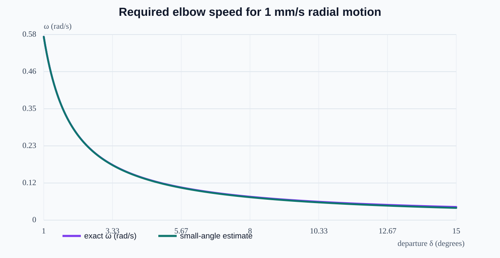

# 5. Rotación, velocidad lineal y singularidades

**Languages:** [en](../../en/notes/05-velocity-jacobian.md) · [fr](../../fr/notes/05-velocity-jacobian.md) · [de](../../de/notes/05-velocity-jacobian.md) · [it](../../it/notes/05-velocity-jacobian.md) · [es](05-velocity-jacobian.md) · [pt](../../pt/notes/05-velocity-jacobian.md) · [zh](../../zh/notes/05-velocity-jacobian.md) · [ja](../../ja/notes/05-velocity-jacobian.md) · [nb](../../nb/notes/05-velocity-jacobian.md) · [ru](../../ru/notes/05-velocity-jacobian.md) · [ko](../../ko/notes/05-velocity-jacobian.md) · [fi](../../fi/notes/05-velocity-jacobian.md) · [pl](../../pl/notes/05-velocity-jacobian.md)

**Unidades empleadas aquí (definidas antes de los ejemplos):** `mm` — milímetro = 0.001 m; `mm/s` — milímetro / segundo — velocidad lineal; `rad` — radián; `rad/s` — radián / segundo — velocidad angular; `mm/rad` — milímetro / radián — coeficiente del jacobiano (longitud por ángulo); `°` — grado. [Glosario de unidades](../UNITS.md).

[README](../README.md) · [Trigonometry](../TRIGONOMETRY.md#unit-circle-values) · [Coordinate frames](04-coordinate-frames.md) · [Calculus foundations](00-calculus-foundations.md)

> Modelo ideal de enseñanza; no usar para controlar maquinaria real.

El extremo de un brazo giratorio sigue un arco de circunferencia. Su velocidad instantánea es tangente al arco, perpendicular al brazo. Primero se explica la geometría; luego, las derivadas y, al final, la matriz jacobiana (Jacobian matrix) opcional.

## Contenido

1. [Rotación y velocidad tangencial](#section-1)
2. [Origen de las derivadas](#section-2)
3. [Ejemplos de velocidades y signos](#section-3)
4. [Dos eslabones: ángulos relativos y absolutos](#section-4)
5. [Singularidades de brazo plegado y extendido](#section-5)
6. [Tres desplazamientos cerca del plegado](#section-6)
7. [Anexo: matriz jacobiana y ejercicios resueltos](#section-7)

## 1. Rotación y velocidad tangencial

Consideremos un eslabón rígido de longitud $L$ que gira alrededor del pivote fijo $O$. Sea $\Delta Q$ el cambio angular **en radianes** durante $\Delta t>0$. Si no cambia el sentido de giro en ese intervalo, el extremo recorre un arco de circunferencia. La **longitud del arco** es exactamente $\Delta s=L|\Delta Q|$. La **distancia orientada a lo largo del arco** es $L\Delta Q$: su signo indica el sentido de giro. No debe confundirse con el desplazamiento recto (la cuerda) entre las dos posiciones del extremo.

$$
\Delta s=L\lvert\Delta Q\rvert,\qquad
\Delta s_{\mathrm{signed}}=L\Delta Q
$$

Al dividir la longitud recorrida entre el tiempo transcurrido obtenemos la **rapidez media**:

$$
\overline{v}=\frac{\Delta s}{\Delta t}
=L\left\lvert\frac{\Delta Q}{\Delta t}\right\rvert
$$

Para hallar la **rapidez instantánea**, tomamos el límite $\Delta t\to0$. La velocidad angular es $\omega=\dot Q=\mathrm{d}Q/\mathrm{d}t$ en rad/s, por lo que la rapidez lineal es $v=L|\omega|$. El vector velocidad es **tangente a la circunferencia**, perpendicular al eslabón. Con $Q=45^\circ$ y giro antihorario ($\omega>0$), la punta se mueve a la izquierda y hacia arriba: componente horizontal negativa y vertical positiva.

$$
v=L\lvert\dot Q\rvert
$$

*Velocidad tangencial y componentes con signo a Q=45°.*

## 2. Origen de las derivadas

Las coordenadas dependen de Q, y Q depende del tiempo. La regla de la cadena (chain rule) multiplica el cambio de posición por radián por los radianes por segundo.

$$
x(t)=L\cdot\cos\bigl(Q(t)\bigr),\qquad y(t)=L\cdot\sin\bigl(Q(t)\bigr)
$$

$$
v_x=\frac{\mathrm{d}x}{\mathrm{d}t}
=\frac{\mathrm{d}x}{\mathrm{d}Q}\cdot\frac{\mathrm{d}Q}{\mathrm{d}t}
=-L\cdot\sin(Q)\cdot\dot{Q}
$$

$$
v_y=\frac{\mathrm{d}y}{\mathrm{d}t}
=\frac{\mathrm{d}y}{\mathrm{d}Q}\cdot\frac{\mathrm{d}Q}{\mathrm{d}t}
=L\cdot\cos(Q)\cdot\dot{Q}
$$

La velocidad angular $\dot Q=\mathrm{d}Q/\mathrm{d}t$ se mide en rad/s y no es el ángulo mismo. Si L está en mm, vx y vy están en mm/s. Las derivadas trigonométricas exigen radianes.

$$
\omega=\dot{Q},\qquad \omega_1=\dot{Q}_1,\qquad \omega_2=\dot{Q}_2
$$

## 3. Ejemplos de velocidades y signos

Con L=150 mm, Q=45° y ω=+0.1 rad/s, las dos componentes tienen igual módulo, hacia la izquierda y arriba. Cambiar el signo de ω invierte ambas. Con Q=0°, vy=15 mm/s y vx=0.

$$
Q=45^\circ:\quad v_x=-150\frac{\sqrt2}{2}\cdot0.1\approx-10.61\ \mathrm{mm/s}
$$

$$
v_y=+150\frac{\sqrt2}{2}\cdot0.1\approx+10.61\ \mathrm{mm/s}
$$

$$
\sqrt{v_x^2+v_y^2}=L\lvert\dot Q\rvert=15\ \mathrm{mm/s}
$$

El punto sobre $Q$ indica la **derivada respecto al tiempo** $\dot Q$, no una multiplicación por el ángulo. Cambiar $\omega$ por $-\omega$ invierte los signos de las dos componentes sin cambiar el módulo $L|\omega|$.

## 4. Dos eslabones: ángulos relativos y absolutos

Q1 es el ángulo absoluto desde +X; Q2, el ángulo relativo del codo. La orientación absoluta del segundo eslabón es Q1+Q2 y su velocidad angular es ω₁+ω₂.

$$
X=L_1\cdot\cos(Q_1)+L_2\cdot\cos(Q_1+Q_2)
$$

$$
Y=L_1\cdot\sin(Q_1)+L_2\cdot\sin(Q_1+Q_2)
$$

$$
v_x=-L_1\cdot\sin(Q_1)\cdot\dot{Q}_1
-L_2\cdot\sin(Q_1+Q_2)\cdot(\dot{Q}_1+\dot{Q}_2)
$$

$$
v_y=L_1\cdot\cos(Q_1)\cdot\dot{Q}_1
+L_2\cdot\cos(Q_1+Q_2)\cdot(\dot{Q}_1+\dot{Q}_2)
$$

Las dos articulaciones contribuyen a la velocidad del extremo: el primer eslabón lleva el factor $\dot Q_1$ y el segundo $\dot Q_1+\dot Q_2$. Emplear solo $\dot Q_2$ en el segundo sería incorrecto, pues su ángulo es relativo al primero.

## 5. Singularidades de brazo plegado y extendido

Para L1=100 mm y L2=50 mm, el alcance ideal va de 50 a 150 mm. Las posiciones totalmente plegada (Q2=180°) y extendida (Q2=0°) son singulares: la velocidad radial instantánea es cero con velocidades articulares finitas.

$$
r^2=L_1^2+L_2^2+2L_1L_2\cos(Q_2)
$$

$$
\lvert L_1-L_2\rvert\le r\le L_1+L_2
$$

$$
\frac{\mathrm{d}r}{\mathrm{d}Q_2}
=-\frac{L_1L_2\sin(Q_2)}{r}
$$

Esta fórmula de derivación solo es válida cuando $r>0$. Si los dos eslabones tienen la misma longitud ($L_1=L_2$), al plegarse exactamente sobre la base ($Q_2=180^\circ$) se obtiene $r=0$ y la fórmula dividiría entre cero. En esa posición, la distancia radial no es derivable respecto a una desviación **con signo** del ángulo del codo. El caso excepcional no afecta al ejemplo de longitudes distintas $L_1=100$ mm y $L_2=50$ mm.

Los límites articulares y las colisiones pueden reducir aún más el espacio de trabajo real. Que un punto sea alcanzable no garantiza la orientación deseada de la herramienta ni espacio libre frente a obstáculos.

## 6. Tres desplazamientos cerca del plegado

Con el primer eslabón fijo, δ es la pequeña desviación en radianes desde el plegado. No es igual el desplazamiento a lo largo del primer eslabón que el cambio de distancia al origen.

$$
\Delta x_{\mathrm{axis}}=L_2\bigl(1-\cos(\delta)\bigr)
\approx\frac{L_2\delta^2}{2}
$$

$$
\Delta y_{\mathrm{perp}}=L_2\cdot\sin(\delta)\approx L_2\delta
$$

$$
\Delta r=\sqrt{(L_1-L_2)^2+2L_1L_2\bigl(1-\cos(\delta)\bigr)}-(L_1-L_2)
$$

$$
L_1>L_2>0:\qquad
\Delta r\approx\frac{L_1L_2}{2(L_1-L_2)}\delta^2
$$

La identidad 1−cosδ=2sin²(δ/2) y sin(δ/2)≈δ/2 explican el cuadrado y el factor 1/2. Aquí el incremento radial es ≈50δ² mm, mientras que el axial es ≈25δ² mm.

Estas aproximaciones solo valen para $\delta$ pequeño medido en radianes. Si $\delta$ se reduce a la mitad, los cambios cuadráticos axial y radial se reducen aproximadamente **a la cuarta parte**, mientras que el desplazamiento transversal se reduce **a la mitad**. Mantener una rapidez radial constante no nula cuando $\delta\to0$ exigiría una velocidad articular sin límite en el modelo inverso ideal; un brazo real puede empezar a desplegarse con velocidad angular finita y rapidez radial inicialmente nula.

$$
1-\cos(\delta)=2\sin^2\left(\frac{\delta}{2}\right)
\approx2\left(\frac{\delta}{2}\right)^2=\frac{\delta^2}{2}
$$

*Desplazamientos axial, transversal y radial cerca del plegado.*

Mantener una velocidad radial no nula cerca del plegado requiere velocidades angulares crecientes cuando δ→0. En el punto exacto, velocidades articulares finitas no producen inmediatamente velocidad radial.

$$
\left.\frac{\mathrm{d}r}{\mathrm{d}\delta}\right|_{L_1=100,L_2=50}
=\frac{5000\sin(\delta)}{r}
\approx100\delta\ \mathrm{mm/rad}
$$

$$
v_r\approx(100\delta)\dot\delta\ \mathrm{mm/s},
\qquad
\dot\delta\approx\frac{1\ \mathrm{mm/s}}{100\ \mathrm{mm/rad}\cdot\delta}
$$

*Velocidad angular requerida cerca de la singularidad.*

## 7. Anexo: matriz jacobiana y ejercicios resueltos

La matriz jacobiana (Jacobian matrix) relaciona velocidades articulares con velocidad del extremo. Su determinante L1L2 sin Q2 se anula con eslabones colineales. El modelo excluye choques y límites articulares.

$$
v_x=J_{11}\cdot\omega_1+J_{12}\cdot\omega_2
$$

$$
v_y=J_{21}\cdot\omega_1+J_{22}\cdot\omega_2
$$

| Coeficiente | Geometría de la transformación de velocidades |
| --- | --- |
| $J_{11}$ | $-L_1\sin(Q_1)-L_2\cdot\sin(Q_1+Q_2)$ |
| $J_{12}$ | $-L_2\cdot\sin(Q_1+Q_2)$ |
| $J_{21}$ | $L_1\cos(Q_1)+L_2\cdot\cos(Q_1+Q_2)$ |
| $J_{22}$ | $L_2\cdot\cos(Q_1+Q_2)$ |

**Derivación del determinante.** Cada coeficiente es una derivada parcial de la coordenada X o Y de la herramienta respecto al ángulo articular Q1 o Q2 en radianes. Con longitudes en mm, su unidad es mm/rad; multiplicado por rad/s da mm/s.

$$
J_{11}=\frac{\partial X}{\partial Q_1},\qquad
J_{12}=\frac{\partial X}{\partial Q_2}
$$

$$
J_{21}=\frac{\partial Y}{\partial Q_1},\qquad
J_{22}=\frac{\partial Y}{\partial Q_2}
$$

$$
\det J=J_{11}J_{22}-J_{12}J_{21}
$$

$$
\det J=L_1L_2\bigl[\sin(Q_1+Q_2)\cos(Q_1)
-\sin(Q_1)\cos(Q_1+Q_2)\bigr]
$$

$$
\det J=L_1L_2\sin\bigl((Q_1+Q_2)-Q_1\bigr)
$$

Al desarrollar los dos productos del determinante, los términos con L2 al cuadrado se cancelan. La identidad de la diferencia de senos elimina Q1.

$$
\det J=L_1L_2\sin(Q_2)
$$

*Las dos contribuciones de las articulaciones se suman como vectores para obtener la velocidad de la herramienta.*

### Ejemplos completamente resueltos

1. Un eslabón de $L=150$ mm apunta a la derecha cuando $Q=0^\circ$. Con $\omega=+0.1$ rad/s, $\sin0^\circ=0$ y $\cos0^\circ=1$, de modo que $v_x=-150\cdot0\cdot0.1=0$ y $v_y=150\cdot1\cdot0.1=+15$ mm/s. La punta sube.
2. Con $Q=45^\circ$ y $\omega=-0.1$ rad/s, se invierte el giro: $v_x=-150\sin45^\circ\cdot(-0.1)\approx+10.61$ mm/s y $v_y=150\cos45^\circ\cdot(-0.1)\approx-10.61$ mm/s. La punta va hacia abajo a la derecha, pero la rapidez sigue siendo $L|\omega|=15$ mm/s.
3. Para $L_1=100$ mm, $L_2=50$ mm, $Q_1=30^\circ$, $Q_2=60^\circ$, $\omega_1=0.1$ rad/s y $\omega_2=0.2$ rad/s, el segundo eslabón tiene orientación absoluta $Q_1+Q_2=90^\circ$ y velocidad angular $\omega_1+\omega_2=0.3$ rad/s. Entonces $v_x=-100\sin30^\circ\cdot0.1-50\sin90^\circ\cdot0.3=-5-15=-20$ mm/s y $v_y=100\cos30^\circ\cdot0.1+50\cos90^\circ\cdot0.3\approx+8.66$ mm/s.
4. Cerca del plegado, para $\delta=0.02$ rad, el cambio axial sobre el eje **fijo** es aproximadamente $25\delta^2=25\cdot0.02^2=0.010$ mm, el transversal $50\delta=1.000$ mm y el radial $50\delta^2=0.020$ mm. Los dos cambios cuadráticos tienen coeficientes distintos.

[Trigonometry](../TRIGONOMETRY.md) · [Coordinate frames](04-coordinate-frames.md) · [Calculus foundations](00-calculus-foundations.md)
