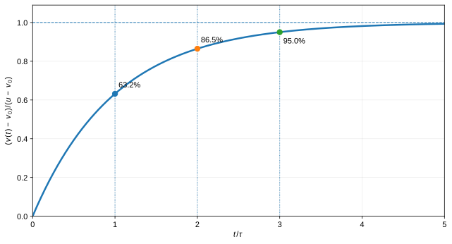

# 2. Ensimmäisen kertaluvun dynamiikka, momentti ja pyörimisenergia

**Kielet:** [en](../../en/notes/02-first-order-dynamics.md) · [fr](../../fr/notes/02-first-order-dynamics.md) · [de](../../de/notes/02-first-order-dynamics.md) · [it](../../it/notes/02-first-order-dynamics.md) · [es](../../es/notes/02-first-order-dynamics.md) · [pt](../../pt/notes/02-first-order-dynamics.md) · [zh](../../zh/notes/02-first-order-dynamics.md) · [ja](../../ja/notes/02-first-order-dynamics.md) · [nb](../../nb/notes/02-first-order-dynamics.md) · [ru](../../ru/notes/02-first-order-dynamics.md) · [ko](../../ko/notes/02-first-order-dynamics.md) · [fi](02-first-order-dynamics.md) · [pl](../../pl/notes/02-first-order-dynamics.md)

**Tämän sivun yksiköt (selitetty ennen esimerkkejä):** `s` — sekunti; `mm/s` — millimetri / sekunti — lineaarinen nopeus; `kg` — kilogramma; `m` — metri; `rad/s` — radiaani / sekunti — kulmanopeus; `N` — newton; `N·m` — newton · metri — vääntömomentti; `J` — joule; `rpm` — kierros minuutissa; `kg·m²` — kilogramma · metri² — hitausmomentti; `N·m·s/rad` — newton · metri · sekunti / radiaani — nopeuteen suhteutettu vahvistus; `%` — prosentti (sadasosa); `rad` — radiaani. [Yksikköluettelo](../UNITS.md).

[Kertaus: differentiaali- ja integraalilaskenta](00-calculus-foundations.md) · [Integraalitaulukko](../INTEGRAL_TABLE.md) · [Sisällysluettelo](../README.md) · [Kaavakooste](../CHEATSHEET.md) · [Harjoitukset](../exercises/README.md) · [Edellinen luku](01-motion-calculus.md)

> **Tarkkuushuomautus:** Alla oleva moottorimalli olettaa ideaalisen verrannollisen momenttiohjauksen ilman kuormaa, kitkaa, viiveitä, jänniterajoja, kyllästymistä tai korkeamman kertaluvun dynamiikkaa. Se ei ole kaikkien moottorien yleispätevä malli.

## Pikakertaus

- **Aikavakio (time constant)** $\tau$ kuvaa, kuinka nopeasti ensimmäisen kertaluvun järjestelmä lähestyy uutta tasapainotilaansa.
- Simulaation aika-askel `dt` vaikuttaa numeeriseen arvioon, mutta **ei** muuta fysikaalisen mallin aikavakiota $\tau$.
- Ideaalisessa pyörivässä järjestelmässä $\tau=J/K$, missä $J$ on hitausmomentti ja $K$ verrannollinen momenttikerroin.
- Sama $J/K$ voi tuottaa saman nopeusvasteen, vaikka tarvittavat momentit ja mekaaniset energiat ovat erilaisia.

## Tämän sivun sisältö

- [1. Ensimmäisen kertaluvun nopeusvaste](#section-1)
- [2. Mistä aikavakio määräytyy?](#section-2)
- [3. Numeerinen aika-askel ja aikavakio](#section-3)
- [4. Aikavakion arviointi mittauksista](#section-4)
- [5. Momentti ja pyörimisenergia](#section-5)
- [6. Kokeile itse](#section-6)
- [7. Lisätiedot (valinnainen)](#section-7)
  - [Mistä 63.2 %, 86.5 % ja 95.0 % tulevat?](#time-constant-derivation)
  - [Eulerin menetelmän lukuarvojen johtaminen](#euler-values-derivation)

[SI-merkinnät ja desimaalipiste](../SYMBOLS.md)

## 1. Ensimmäisen kertaluvun nopeusvaste

Olkoon $u$ vakio tavoitenopeus, $v$ toteutunut nopeus ja $\tau>0$ aikavakio. Nopeusvirhe $\varepsilon(t)=u-v(t)$ merkitään kreikkalaisella epsilon-kirjaimella. Luonnollinen eksponenttifunktio on $\exp(z)=\mathrm{e}^{z}$, missä $\mathrm{e}\approx2.71828$ on **Neperin luku** eikä nopeusvirhe. Käytämme tarkoituksella eri merkkejä sekaannuksen välttämiseksi.

$$
\frac{dv}{dt}=\frac{u-v}{\tau}.
$$

Kun $u$ on vakio ja alkunopeus on $v_0$, tarkka ratkaisu on

$$
v(t)=u+(v_0-u)\exp\!\left(-\frac{t}{\tau}\right).
$$

Yhden aikavakion jälkeen alku- ja loppuarvon välisestä muutoksesta on toteutunut $1-\exp(-1)\approx63.2\ \%$; kahden aikavakion jälkeen 86.5 % ja kolmen jälkeen 95.0 %. Jos $\tau=2\ \mathrm{s}$, noin 63.2 % **muutoksesta** tapahtuu kahdessa sekunnissa. Tämä ei tarkoita, että tavoite saavutettaisiin täsmälleen kahdessa sekunnissa.

[Prosenttiosuuksien johtaminen](#time-constant-derivation).

## 2. Mistä aikavakio määräytyy?

Hyvin yksinkertaistetulle pyörivälle järjestelmälle Newtonin toinen laki pyörimisliikkeessä on

$$
J\frac{d\omega}{dt}=M.
$$

$J$ on hitausmomentti (kg·m²), $\omega$ kulmanopeus (rad/s) ja $M$ **fysikaalinen nettomomentti** (N·m). Säädin laskee sähköisen käyttökomennon, mutta moottori tuottaa fysikaalisen momentin. Ei ole täsmällistä sanoa, että ohjelmisto itse tuottaisi momentin.

Oletetaan, että moottori ja käyttö pystyvät tuottamaan nopeusvirheeseen verrannollisen momentin:

$$
M=K(u-\omega).
$$

Tässä pyörimisliikkeen esimerkissä $u$ tarkoittaa **tavoitekulmanopeutta** yksikössä rad/s, ei luvun 1 lineaarista tavoitenopeutta yksikössä mm/s. Suureilla $u$ ja $\omega$ on oltava samat kulmanopeuden yksiköt; muuten erotus $u-\omega$ ja momenttiyhtälö eivät ole dimensioiltaan oikein.

$K$ on momentin ja nopeusvirheen välinen kerroin, jonka yksikkö on N·m·s/rad. Näillä oletuksilla

$$
\frac{d\omega}{dt}=\frac{K}{J}(u-\omega),\qquad \tau=\frac{J}{K}.
$$

Kun $J$ kaksinkertaistetaan ja $K$ pidetään vakiona, $\tau$ kaksinkertaistuu ja kiihtyvyys samalla nopeusvirheellä pienenee. Kun sekä $J$ että $K$ kaksinkertaistetaan, $\tau$ pysyy samana, mutta samalla virheellä tarvitaan kaksinkertainen momentti. **$J$ ei ole kitkavoima** vaan kulmanopeuden muutoksia vastustavaa hitautta kuvaava suure. Todellinen malli voi tarvita kuormamomentin, kitkan, sähköisen dynamiikan, epälineaariset virtarajat ja lisää tilamuuttujia.

Ideaalisen mallin symbolinen takaisinkytkentä: säädin komentaa käyttöä, mutta moottori tuottaa fysikaalisen momentin.

## 3. Numeerinen aika-askel ja aikavakio

Eksplisiittinen Eulerin menetelmä antaa ensimmäisen kertaluvun yhtälölle

$$
v_{n+1}=v_n+\frac{u-v_n}{\tau}\ dt.
$$

Kun $u=10\ \mathrm{mm/s}$, $v_0=0$ ja $\tau=1\ \mathrm{s}$, nopeus yhden sekunnin kuluttua on

| Menetelmä | $v(1\ \mathrm{s})$ |
| --- | ---: |
| Euler, $dt=0.1\ \mathrm{s}$ | $6.513\ \mathrm{mm/s}$ |
| Euler, $dt=0.01\ \mathrm{s}$ | $6.340\ \mathrm{mm/s}$ |
| Tarkka ratkaisu | $6.321\ \mathrm{mm/s}$ |

Aika-askeleen `dt` muuttaminen muuttaa laskennan päivitystiheyttä; se ei nopeuta mallin moottoria. Numeerinen vakaus ja virhe riippuvat aika-askeleen, aikavakion ja valitun menetelmän suhteesta. [Lukuarvojen laskeminen](#euler-values-derivation).

## 4. Aikavakion arviointi mittauksista

Puhtaassa ensimmäisen kertaluvun askelvasteessa 0:sta 1000 rpm:ään noin 632 rpm:n saavuttaminen hetkellä $t=2\ \mathrm{s}$ viittaa aikavakioon $\tau\approx2\ \mathrm{s}$. Käytä 63.2 %:a **alkuarvon ja lopullisen tasapainoarvon välisestä muutoksesta**, älä välttämättä 63.2 %:a komennon itseisarvosta. Todellisissa mittauksissa voi olla kohinaa, näytteenottovirhettä, viivettä ja ylitystä.

**Mitä koodi todella palauttaa:** Funktio [`estimate_tau`](../../../exercises/02_first_order_response.py) edellyttää mittauksia, joiden aikaleimat ovat **aidosti kasvavassa järjestyksessä** askelmuutoksen alusta alkaen. Se palauttaa sen **ensimmäisen havaitun näytteen aikaleiman**, jolla 63.2 %:n muutoksen kynnys saavutetaan; tunnetun mittausresoluution puolikas huomioidaan pyöristysvarana. Jos kynnys havaitaan ensimmäisen kerran hetkellä 2 s ja edellinen näyte oli hetkellä 1 s, todellinen ylitys on voinut tapahtua **näytteiden välillä**. Siksi 2 s on näytteenoton rajoittama arvio, ei tarkka sovitettu arvo. Virheelliset mittaukset sekä toistuvat tai epäjärjestyksessä olevat ajat hylätään myös kynnyksen jälkeen. Jos kynnystä ei saavuteta, palautetaan `None`.

**Mittausresoluutio vaikuttaa:** Funktion `estimate_tau` parametrin `resolution` on oltava **pienempi kuin nopeuden kokonaismuutoksen itseisarvo**. Jos nopeus muuttuu arvosta 0 arvoon 10 rpm mutta näyttö vaihtuu vain 10 rpm:n askelin, 63.2 %:n kynnyksen ylitysaikaa ei voida luotettavasti arvioida. Funktio hylkää syötteen sen sijaan, että ilmoittaisi virheellisen ylityksen jo ensimmäisessä näytteessä. Riittävälläkin resoluutiolla arvio on näytteenoton rajoittama.

## 5. Momentti ja pyörimisenergia

Kulmakiihtyvyydelle $\alpha=d\omega/dt$ pätee

$$
M=J\alpha,\qquad E=\frac12J\omega^2.
$$

Kun $\omega=10\ \mathrm{rad/s}$ ja $J=2\ \mathrm{kg}\cdot\mathrm{m}^2$, energia on 100 J. Hitausmomentin kaksinkertaistaminen antaa 200 J. Kun $J$ on vakio, kulmanopeuden kaksinkertaistaminen nelinkertaistaa energian. Kyseessä on **mekaaninen liike-energia**, ei virtalähteestä otettu sähköenergia; häviöt ja hyötysuhde vaikuttavat.

## 6. Kokeile itse

Suorita [`02_first_order_response.py`](../../../exercises/02_first_order_response.py) ja [`03_rotation_energy.py`](../../../exercises/03_rotation_energy.py). Valinnaiset kuvaajat syntyvät ohjelmalla [`plot_models.py`](../../../exercises/plot_models.py). Ohjelmat käyttävät synteettisiä lukuja eivätkä sisällä laitteistorajapintoja.

## 7. Lisätiedot (valinnainen)

### Milloin Eulerin laskenta muuttuu epävakaaksi?

Yksinkertaisessa ensimmäisen kertaluvun yhtälössä jokainen Eulerin askel kertoo **jäljellä olevan nopeusvirheen** luvulla $1-dt/\tau$. Suppeneminen edellyttää $0<dt<2\tau$. Kun $\tau<dt<2\tau$, arvio värähtelee tavoitteen molemmin puolin ja lähestyy sitä. Tämä on **numeerisen menetelmän ominaisuus**, ei välttämättä moottorin fysikaalista värähtelyä. Pienempi aika-askel parantaa tarkkuutta.

### Momenttimallin rajoitukset

Yleisemmin

$$
J\frac{d\omega}{dt}=M_{\text{motor}}-M_{\text{load}}-M_{\text{friction}}.
$$

Kaava $\tau=J/K$ edellyttää erityistä oletusta $M_{\text{net}}=K(u-\omega)$. Todellinen käytön kyllästyminen, anturiviiveet, kitka ja sähköiset lisätilat voivat muuttaa vastetta.

### Energia ja teho

Kun $J$ on vakio, pyörimisenergian muutos on $\Delta E=\frac12J(\omega_2^2-\omega_1^2)$ ja hetkellinen **mekaaninen teho** on $P=M\omega$. Näistä kumpikaan ei yksin määritä sähköistä syöttöenergiaa: häviöt ja hyötysuhteet vaikuttavat.

### Mistä 63.2 %, 86.5 % ja 95.0 % tulevat?

Prosenttiosuudet ja eksponenttifunktio seuraavat **samasta yhtälöstä**. Määritellään nopeusvirheeksi $\varepsilon(t)=u-v(t)$, joka ei ole Neperin luku $\mathrm{e}$. Kun $u$ on vakio, $d\varepsilon/dt=-dv/dt$, joten

$$
\varepsilon(t)=u-v(t),\qquad \frac{d\varepsilon}{dt}=-\frac{\varepsilon}{\tau}.
$$

$$
\frac{d\varepsilon}{\varepsilon}=-\frac{dt}{\tau}
\quad\Longrightarrow\quad
\ln\left\lvert\frac{\varepsilon(t)}{\varepsilon(0)}\right\rvert=-\frac{t}{\tau}
\quad\Longrightarrow\quad
\varepsilon(t)=\varepsilon(0)\exp\!\left(-\frac{t}{\tau}\right).
$$

Muuttujien erottelussa jaetaan suureella $\varepsilon$, joten vaihe edellyttää nollasta poikkeavaa alkuvirhettä. Jos $u=v_0$, virhe on koko ajan nolla ja alkuperäisestä differentiaaliyhtälöstä saadaan suoraan vakioratkaisu $v(t)=u$.

$$
f(t)=\frac{v(t)-v_0}{u-v_0}=1-\exp\!\left(-\frac{t}{\tau}\right),\qquad (u\ne v_0).
$$

| Aika | Toteutunut osuus $f(t)$ |
| ---: | ---: |
| $\tau$ | $1-\exp(-1)=0.63212056\ldots\approx63.2\ \%$ |
| $2\tau$ | $1-\exp(-2)=0.86466472\ldots\approx86.5\ \%$ |
| $3\tau$ | $1-\exp(-3)=0.95021293\ldots\approx95.0\ \%$ |

Askelvasteessa 0:sta 1000 rpm:ään osuudet vastaavat noin 632, 865 ja 950 rpm:ää yhden, kahden ja kolmen aikavakion jälkeen. Ideaalinen malli lähestyy tavoitetta asymptoottisesti.

### Eulerin lukuarvojen johtaminen

$$
v_N=u+(v_0-u)\left(1-\frac{dt}{\tau}\right)^N,\qquad N=\frac{t}{dt}.
$$

$$
\begin{aligned}
u&=10,\quad v_0=0,\quad t=\tau=1;\\
v_{dt=0.1}&=10(1-0.9^{10})\approx6.5132;\\
v_{dt=0.01}&=10(1-0.99^{100})\approx6.3397;\\
v_{\mathrm{exact}}&=10(1-\exp(-1))\approx6.3212.
\end{aligned}
$$
