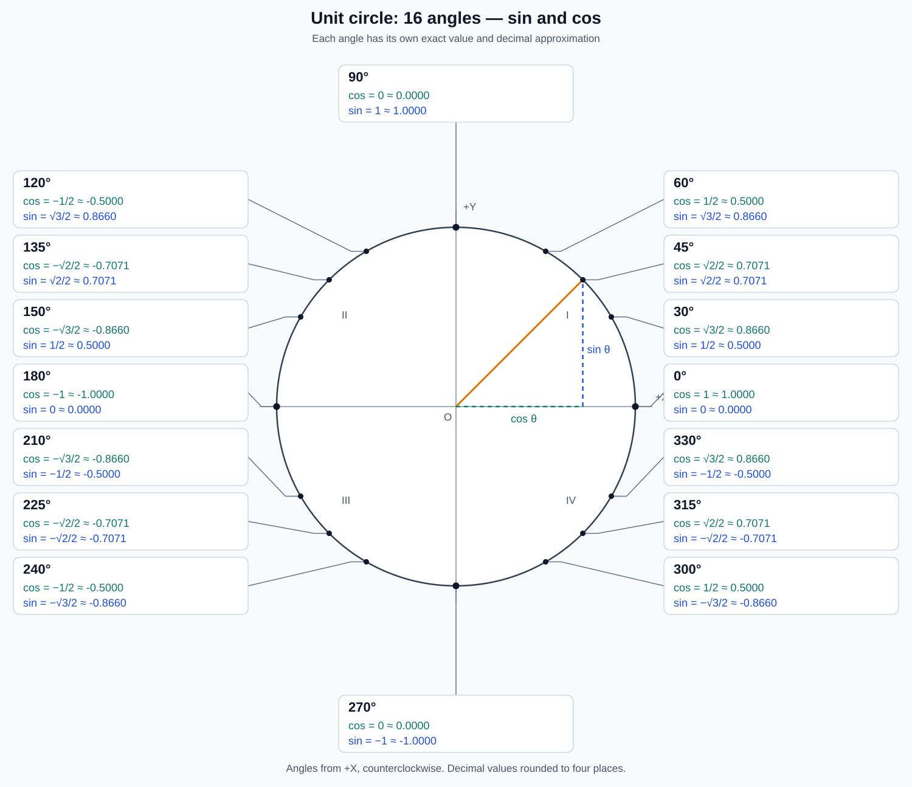
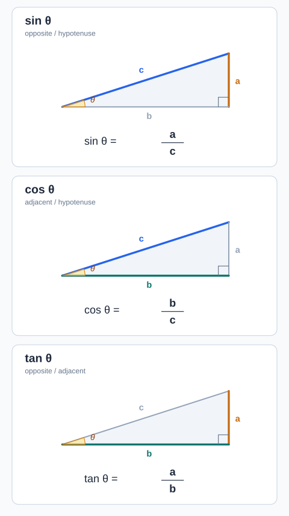

# 三角関数：角度・正弦・余弦・正接・逆正接

**言語:** [en](../en/TRIGONOMETRY.md) · [fr](../fr/TRIGONOMETRY.md) · [de](../de/TRIGONOMETRY.md) · [it](../it/TRIGONOMETRY.md) · [es](../es/TRIGONOMETRY.md) · [pt](../pt/TRIGONOMETRY.md) · [zh](../zh/TRIGONOMETRY.md) · [ja](TRIGONOMETRY.md) · [nb](../nb/TRIGONOMETRY.md) · [ru](../ru/TRIGONOMETRY.md) · [ko](../ko/TRIGONOMETRY.md) · [fi](../fi/TRIGONOMETRY.md) · [pl](../pl/TRIGONOMETRY.md)

**このページの単位（例の前に説明）:** `°` — 度; `rad` — ラジアン; `kg` — キログラム; `m` — メートル; `m/s²` — メートル / 秒² — 加速度; `N·m` — ニュートン · メートル — トルク; `mm` — ミリメートル = 0.001 m; `N` — ニュートン. [単位一覧](UNITS.md).

[README](README.md) · [Calculus](notes/00-calculus-foundations.md) · [Integral table](INTEGRAL_TABLE.md)

## 単位円：正弦と余弦

角度 θ の単位円上の点の座標は **(cos θ, sin θ)** です。角度は +X 軸から反時計回りに測ります。余弦（cosine）が水平座標、正弦（sine）が垂直座標です。1枚の図に16個の代表的な角度の正確な組を示し、1つの表に小数近似、正接と逆正接の主値をまとめます。

*16個の角度と正確な座標組 (cos θ, sin θ) を示す1つの単位円。*

**正確な分数と十進近似値:**

| θ | cos θ (厳密値) | cos θ (小数) | sin θ (厳密値) | sin θ (小数) | tan θ (厳密値) | tan θ (小数) | arctan(tan θ) 主値 |
| --- | --- | ---: | --- | ---: | --- | ---: | --- |
| 0° | $1$ | 1.0000 | $0$ | 0.0000 | $0$ | 0.0000 | $0^\circ$ |
| 30° | $\frac{\sqrt3}{2}$ | 0.8660 | $\frac12$ | 0.5000 | $\frac{\sqrt3}{3}$ | 0.5774 | $30^\circ$ |
| 45° | $\frac{\sqrt2}{2}$ | 0.7071 | $\frac{\sqrt2}{2}$ | 0.7071 | $1$ | 1.0000 | $45^\circ$ |
| 60° | $\frac12$ | 0.5000 | $\frac{\sqrt3}{2}$ | 0.8660 | $\sqrt3$ | 1.7321 | $60^\circ$ |
| 90° | $0$ | 0.0000 | $1$ | 1.0000 | **未定義** | — | — |
| 120° | $-\frac12$ | -0.5000 | $\frac{\sqrt3}{2}$ | 0.8660 | $-\sqrt3$ | -1.7321 | $-60^\circ$ |
| 135° | $-\frac{\sqrt2}{2}$ | -0.7071 | $\frac{\sqrt2}{2}$ | 0.7071 | $-1$ | -1.0000 | $-45^\circ$ |
| 150° | $-\frac{\sqrt3}{2}$ | -0.8660 | $\frac12$ | 0.5000 | $-\frac{\sqrt3}{3}$ | -0.5774 | $-30^\circ$ |
| 180° | $-1$ | -1.0000 | $0$ | 0.0000 | $0$ | 0.0000 | $0^\circ$ |
| 210° | $-\frac{\sqrt3}{2}$ | -0.8660 | $-\frac12$ | -0.5000 | $\frac{\sqrt3}{3}$ | 0.5774 | $30^\circ$ |
| 225° | $-\frac{\sqrt2}{2}$ | -0.7071 | $-\frac{\sqrt2}{2}$ | -0.7071 | $1$ | 1.0000 | $45^\circ$ |
| 240° | $-\frac12$ | -0.5000 | $-\frac{\sqrt3}{2}$ | -0.8660 | $\sqrt3$ | 1.7321 | $60^\circ$ |
| 270° | $0$ | 0.0000 | $-1$ | -1.0000 | **未定義** | — | — |
| 300° | $\frac12$ | 0.5000 | $-\frac{\sqrt3}{2}$ | -0.8660 | $-\sqrt3$ | -1.7321 | $-60^\circ$ |
| 315° | $\frac{\sqrt2}{2}$ | 0.7071 | $-\frac{\sqrt2}{2}$ | -0.7071 | $-1$ | -1.0000 | $-45^\circ$ |
| 330° | $\frac{\sqrt3}{2}$ | 0.8660 | $-\frac12$ | -0.5000 | $-\frac{\sqrt3}{3}$ | -0.5774 | $-30^\circ$ |

90° と 270° では cos θ = 0 のため正接は**未定義**であり、arctan(tan θ) も未定義です。最後の列は (−90°, 90°) の**主値**で、元の角度と異なる場合があります。例えば arctan(tan 135°) = −45°、arctan(tan 225°) = 45°。近似値は小数第4位まで。360° は 0° と同じ値です。

### 便利な三角恒等式

90° の移動で正弦と余弦が入れ替わり、符号が変わる場合もあります。括弧が重要です。cos(θ − 90°) は角度差の余弦であり、cos θ から90を引く意味ではありません。

$$
\cos(90^\circ-\theta)=\sin(\theta),\qquad
\sin(90^\circ-\theta)=\cos(\theta)
$$

$$
\cos(\theta-90^\circ)=\sin(\theta),\qquad
\sin(\theta+90^\circ)=\cos(\theta)
$$

$$
\cos(\theta+90^\circ)=-\sin(\theta),\qquad
\sin(\theta-90^\circ)=-\cos(\theta)
$$

**負の角度と周期性:**

$$
\sin(-\theta)=-\sin(\theta),\qquad
\cos(-\theta)=\cos(\theta)
$$

$$
\tan(-\theta)=-\tan(\theta),\qquad
\tan(\theta)=\frac{\sin(\theta)}{\cos(\theta)}
$$

$$
\sin(\theta+360^\circ)=\sin(\theta),\qquad
\cos(\theta+360^\circ)=\cos(\theta)
$$

$$
\tan(\theta+180^\circ)=\tan(\theta),\qquad
\sin^2(\theta)+\cos^2(\theta)=1
$$

象限ごとの符号（cos、sin、tan の順）：I (+,+,+)、II (−,+,−)、III (−,−,+)、IV (+,−,−)。負角は時計回りです。

逆三角関数を使う際は象限と主値範囲を確認します。

### 逆余弦と角度の推定

0°から180°まで余弦は 1 から −1 へ単調に減少します。したがって arccos(0.19) は 80° より少し小さく、cos 80°≈0.1736、arccos(0.19)≈79.05° です。cos(+θ)=cos(−θ) のため、符号が異なる関節角の解が存在し得ます。arccos の主値は 0°から180°です。

## 図解：対辺・隣辺・斜辺

図の **a** は角 θ の対辺 (opposite)、**b** は隣辺 (adjacent)、**c** は斜辺 (hypotenuse) です。鋭角 θ について $\sin\theta=a/c$、$\cos\theta=b/c$、$\tan\theta=a/b$（ただし $b\ne0$）です。**辺の長さは負になりません**。この図だけでは負の角度や他の象限での符号を説明できません。正の x 軸から測る有向角なら、$\sin(+60^\circ)=+\sqrt3/2$ ですが $\sin(-60^\circ)=-\sqrt3/2$ です。

## 力学の例：レバーに作用する重力トルク

質量 m の荷重が支点から距離 L にあり、レバーが水平から角度 θ だけ上がると、重力トルクの**大きさ**は mgL|cos θ| です。符号は正の回転方向の決め方によります。

$$
|M_g|=mgL|\cos\theta|.
$$

m = 0.5 kg、L = 0.2 m、g = 9.81 m/s²、θ = 60° では 0.4905 N·m、0° で 0.981 N·m、90° でゼロです（理想化した点荷重）。

## 逆問題：傾きから角度を求める

水平に 0.1 m 進む間に 0.05 m 上がる軸の比は 0.5 です。よって θ = arctan(0.5) ≈ 26.565°。入力は角度ではなく比です。

$$
\tan\theta=\frac{0.05\ \mathrm{m}}{0.1\ \mathrm{m}}=0.5,\qquad \theta=\arctan(0.5)\approx26.565^\circ.
$$

換算：θ_rad = θ_deg·π/180。数値計算ライブラリは通常ラジアンを使います。

$$
\theta_{\mathrm{rad}}=\theta_{\mathrm{deg}}\frac{\pi}{180}.
$$

### ベクトルの方向：なぜ `atan2` が必要か

原点から $(x,y)$ に向かうベクトルに対し、普通の逆正接は比 $y/x$ しか見ません。$(1, -1)$ と $(-1, 1)$ は比が同じでも、**異なる象限**を向きます。$x=-1\ \mathrm{mm}$、$y=+1\ \mathrm{mm}$ の場合、比だけでは世界座標での方向を誤ります。

$$
\arctan\left(\frac{y}{x}\right)=\arctan(-1)=-45^\circ,\qquad
\operatorname{atan2}(+1, -1)=+135^\circ.
$$

`atan2(y, x)` は**両成分の符号**を用いて、ゼロでない平面ベクトルの方向を求めます。引数の長さの単位は同じにします。$x=0$ では $y/x$ は定義できませんが、$y\ne0$ なら `atan2` で軸方向を求められます。$(0, 0)$ の方向は未定義であり、$+180^\circ$ と $-180^\circ$ は同じ方向です。[座標系の角度](notes/04-coordinate-frames.md)を求めるときに重要です。

## 余弦定理：二リンクの幾何

基台 O、関節 A、工具 B は三角形を作ります。OA = L1、AB = L2、OB = r（基台から工具への直線距離）です。例は L1 = 100 mm、L2 = 50 mm、r = 120 mm です。三角形の内角 φ は相対関節角 θ2 と異なり、φ = 180° − |θ2| です。図では θ2 が負、鏡映した姿勢では正です。

余弦定理 (law of cosines) は $r^2=L_1^2+L_2^2-2L_1L_2\cos\varphi$ です。$\cos(180^\circ-|\theta_2|)=-\cos\theta_2$ より、$r^2=L_1^2+L_2^2+2L_1L_2\cos\theta_2$、つまり $\cos\theta_2=\frac{r^2-L_1^2-L_2^2}{2L_1L_2}$ です。ここでは $(14400-10000-2500)/10000=0.19$、$|\theta_2|\approx79.05^\circ$。指定された (X,Y) に達するには θ1 も求めます。

[微積分](notes/00-calculus-foundations.md) · [フィードバック制御](notes/03-feedback-control.md)
