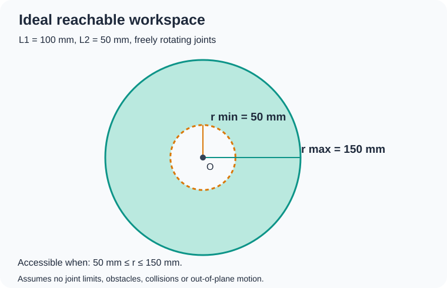

# 4. ロボット座標系と平面運動学

**Languages:** [en](../../en/notes/04-coordinate-frames.md) · [fr](../../fr/notes/04-coordinate-frames.md) · [de](../../de/notes/04-coordinate-frames.md) · [it](../../it/notes/04-coordinate-frames.md) · [es](../../es/notes/04-coordinate-frames.md) · [pt](../../pt/notes/04-coordinate-frames.md) · [zh](../../zh/notes/04-coordinate-frames.md) · [ja](04-coordinate-frames.md) · [nb](../../nb/notes/04-coordinate-frames.md) · [ru](../../ru/notes/04-coordinate-frames.md) · [ko](../../ko/notes/04-coordinate-frames.md) · [fi](../../fi/notes/04-coordinate-frames.md) · [pl](../../pl/notes/04-coordinate-frames.md)

**このページの単位（例の前に説明）:** `mm` — ミリメートル = 0.001 m; `°` — 度. [単位一覧](../UNITS.md).

[README](../README.md) · [三角関数](../TRIGONOMETRY.md) · [数学記号](../SYMBOLS.md) · [フィードバック制御](03-feedback-control.md)

> **教育用モデル:** 簡略化した幾何式を実機ロボットや機械の制御に使用しないでください。

## 目次
1. [座標系が必要な理由](#section-1)
2. [点の回転と平行移動](#section-2)
3. [複数の座標系の合成](#section-3)
4. [二リンクの順運動学](#section-4)
5. [二つの肘姿勢と到達範囲](#section-5)
6. [解答と説明付きの練習問題](#section-6)
7. [モデルの制限と行列表現](#section-7)

## 1. 座標系が必要な理由

**座標系 (coordinate frame)** は原点と向きのある軸で構成されます。**世界座標系 (world frame)** W はロボットの基台などに固定され、**工具座標系 (tool frame)** T は工具とともに移動します。同じ物理点でも座標値は変わります。位置は点を、姿勢は軸の向きを表します。座標の変換だけではロボットは動きません。

長さは同じ単位（ここでは mm）に統一します。二次元の正の角度は世界 +X から反時計回りです。添字 w は世界、l は局所を表します。リンクは剛体と仮定します。

## 2. 点の回転と平行移動

*世界軸と +90° 回転した局所軸、点 P と Q。*

図では工具 T の世界原点は (100 mm, 50 mm)、局所軸は +90° 回転しています。局所 +x は世界 +Y、局所 +y は世界 −X を向きます。したがって局所 P=(0 mm, 10 mm) は世界 (90 mm, 50 mm)、Q=(20 mm, 0 mm) は世界 (100 mm, 70 mm) となります。

局所点 $(x_l,y_l)$、その原点の世界座標 $(t_x,t_y)$、回転角 $\theta$ があるとき、**回転してから平行移動**します。

$$
x_w=t_x+x_l\cos\theta-y_l\sin\theta
$$

$$
y_w=t_y+x_l\sin\theta+y_l\cos\theta
$$

$\sin\theta$ と $\cos\theta$ の符号は有向角によります。$\theta=0^\circ$ では原点のずれを足すだけです。これは座標計算でありモーターへの命令ではありません。

## 3. 複数の座標系の合成

座標系は **W → T → S**（世界 → 工具 → センサー）と連結できます。上の T のまま、S の原点が T 内の (20 mm, 0 mm)、軸が T と平行なら、S の世界原点は (100 mm, 70 mm) です。S の点 (0 mm, 10 mm) は世界で (90 mm, 70 mm) になります。子から親の座標系へ順に変換します。

列ベクトルを使うと $T_{WS}=T_{WT}T_{TS}$ です。$T_{AB}$ は座標を**B から A に変換**します。行列の乗算順序は変更できません。

**行列による計算手順（列ベクトル）：** 工具座標系 T は世界座標系 W に対して +90° 回転し、原点は世界の (100 mm, 50 mm) にあります。センサー座標系 S は T に対して追加の回転がなく、T 内の原点は (20 mm, 0 mm) で、前の図の Q と同じ位置です。回転要素は無次元、並進成分の単位は mm です。

$$
T_{WT}=
\begin{bmatrix}
0 & -1 & 100\\
1 & 0 & 50\\
0 & 0 & 1
\end{bmatrix}
$$

$$
T_{TS}=
\begin{bmatrix}
1 & 0 & 20\\
0 & 1 & 0\\
0 & 0 & 1
\end{bmatrix}
$$

$$
T_{WS}=T_{WT}T_{TS}=
\begin{bmatrix}
0 & -1 & 100\\
1 & 0 & 70\\
0 & 0 & 1
\end{bmatrix}
$$

$$
T_{WS}\begin{bmatrix}0\\10\\1\end{bmatrix}
=\begin{bmatrix}90\\70\\1\end{bmatrix}
$$

積では、T 内のセンサーオフセット (20 mm, 0 mm) をまず世界座標の (0 mm, 20 mm) に回転し、(100 mm, 50 mm) に加えます。したがって S の点 (0 mm, 10 mm) は W で (90 mm, 70 mm) です。20 mm を世界の X に直接加えると誤りです。オフセットは**T で表した値**だからです。最後の 1 は長さではなく無次元の同次座標です。これは座標変換の数学であり、[ROS 2 の tf2](06-ros2-foundations.md#section-7) は時刻付き変換の配信・検索を行いますが、逆運動学を解きません。

## 4. 二リンクの順運動学

*二リンク順運動学：第一関節 30°、第二相対角 60°。*

二リンク平面ロボットの長さを $L_1,L_2$ とします。第一関節角 $\theta_1$ は世界 +X から、第二関節角 $\theta_2$ は**第一リンクからの相対角**です。第二リンクの世界方向は $\theta_1+\theta_2$ となり、工具位置は両リンクのベクトル和です。

$$
X=L_1\cos\theta_1+L_2\cos(\theta_1+\theta_2)
$$

$$
Y=L_1\sin\theta_1+L_2\sin(\theta_1+\theta_2)
$$

L1=100 mm、L2=50 mm、$\theta_1=30^\circ$、$\theta_2=60^\circ$ なら、肘は (86.60 mm, 50 mm) です。第二リンクは世界で 90° の上向きで、工具は (86.60 mm, 100 mm) にあります。

## 5. 二つの肘姿勢と到達範囲

*同じ終点に到達する二つの関節姿勢。*

**逆運動学 (inverse kinematics)** は目標位置から関節角を求めます。各 100 mm の二リンクは $(\theta_1,\theta_2)=(0^\circ,+90^\circ)$ と $(+90^\circ,-90^\circ)$ の両方で (100 mm, 100 mm) に達します。第二角は絶対方向ではなく相対角です。

*理想的な到達円環の内外半径 50 mm と 150 mm。*

自由に回転する二次元関節で衝突がなければ、$|L_1-L_2|\le r\le L_1+L_2$ です。100 mm と 50 mm のリンクなら理想的な**到達範囲 (reachable workspace)** は半径 50–150 mm の円環です。実際の制限で狭くなります。

## 6. 解答と説明付きの練習問題

以下の**六つの練習問題にはすべて解答と説明**があります。特定の読者への未回答の質問ではありません。

### 6.1. 回転した座標系の局所点 P

**問題.** T の世界原点は (100 mm, 50 mm)、+90° 回転。局所 P=(0 mm, 10 mm) の世界座標を求めます。

**解答.** 局所 +y は世界 −X を向くため、X が 10 mm 減ります。

$$
x_w=100+0\cdot0-10\cdot1=90\ \mathrm{mm}
$$

$$
y_w=50+0\cdot1+10\cdot0=50\ \mathrm{mm}
$$

**答え:** (90 mm, 50 mm).

### 6.2. 局所 x 軸上の点 Q

**問題.** 同じ T で Q=(20 mm, 0 mm) の世界座標を求めます。

**解答.** 局所 +x は世界 +Y を向くため、Y だけ 20 mm 増えます。

$$
x_w=100+20\cdot0-0\cdot1=100\ \mathrm{mm}
$$

$$
y_w=50+20\cdot1+0\cdot0=70\ \mathrm{mm}
$$

**答え:** (100 mm, 70 mm).

### 6.3. 二リンクの順運動学

**問題.** L1=100 mm、L2=50 mm、θ1=30°、相対 θ2=60°。工具座標を求めます。

**解答.** 第二リンクの世界方向は 30°+60°=90° です。

$$
X=100\cos30^\circ+50\cos90^\circ=50\sqrt3\approx86.60\ \mathrm{mm}
$$

$$
Y=100\sin30^\circ+50\sin90^\circ=100\ \mathrm{mm}
$$

**答え:** (86.60 mm, 100 mm).

### 6.4. 逆運動学の二つの解

**問題.** 各 100 mm の二リンクが (100 mm, 100 mm) に達する二つの角度の組を求めます。

**解答.** 右に進んでから上、または上に進んでから右です。

$$
(\theta_1,\theta_2)=(0^\circ,+90^\circ)\ \Longrightarrow\ (X,Y)=(100, 100)\ \mathrm{mm}
$$

$$
(\theta_1,\theta_2)=(+90^\circ,-90^\circ)\ \Longrightarrow\ (X,Y)=(100, 100)\ \mathrm{mm}
$$

### 6.5. 関節角なしの到達性確認

**問題.** L1=100 mm、L2=50 mm：目標 (0 mm, 120 mm) と (0 mm, 0 mm) を確認します。

**解答.** 距離がリンク長の差と和の間に入る必要があります。

$$
r_{\min}=|100-50|=50\ \mathrm{mm},\qquad r_{\max}=100+50=150\ \mathrm{mm}
$$

$$
r_{(0, 120)}=\sqrt{0^2+120^2}=120\ \mathrm{mm}
$$

(0 mm, 120 mm) は 50 ≤ 120 ≤ 150 なので**到達可能**です。原点 (0 mm, 0 mm) は距離が 0 なので**到達できません**。

### 6.6. 肘の相対角の余弦

**問題.** L1=100 mm、L2=50 mm、r=120 mm から cos θ2 を計算します。

**解答.** 余弦は曲がりの大きさだけを決め、鏡像の肘姿勢では相対角の符号が反対になります。

$$
\cos\theta_2=\frac{r^2-L_1^2-L_2^2}{2L_1L_2}
=\frac{14400-10000-2500}{10000}=\frac{1900}{10000}=0.19
$$

$$
\theta_2\approx\pm79.05^\circ
$$

三角形の内角は $\varphi=180^\circ-|\theta_2|$ です。距離だけで $\theta_1$ は決まりません。図は次の章を参照： [三角関数](../TRIGONOMETRY.md).

## 7. モデルの制限と行列表現

モデルは剛体の二次元リンク、理想的なエンコーダー、衝突なしを想定します。実際には関節限界、バックラッシュ、変形、原点ずれ、カメラ校正、三次元運動があります。エンコーダーは関節角を測り、工具の世界座標を直接測りません。例は実機制御に使用できません。

**任意の同次行列 3×3** は点の列ベクトル $[x_l,y_l,1]^T$ に回転と並進を一度に適用します。単なる変位ベクトルの最後の成分は 0 です。

$$
T_{WL}=
\begin{bmatrix}
\cos\theta & -\sin\theta & t_x \\
\sin\theta & \cos\theta & t_y \\
0 & 0 & 1
\end{bmatrix},
\qquad
\begin{bmatrix}x_w\\y_w\\1\end{bmatrix}
=T_{WL}\begin{bmatrix}x_l\\y_l\\1\end{bmatrix}
$$

[三角関数](../TRIGONOMETRY.md) · [数学記号](../SYMBOLS.md) · [フィードバック制御](03-feedback-control.md)

[次の章：回転、速度、特異姿勢](05-velocity-jacobian.md)
