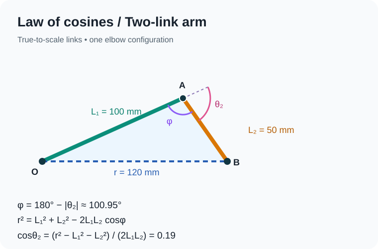

# 삼각함수: 각도, 사인, 코사인, 탄젠트

**Languages:** [en](../en/TRIGONOMETRY.md) · [fr](../fr/TRIGONOMETRY.md) · [de](../de/TRIGONOMETRY.md) · [it](../it/TRIGONOMETRY.md) · [es](../es/TRIGONOMETRY.md) · [pt](../pt/TRIGONOMETRY.md) · [zh](../zh/TRIGONOMETRY.md) · [ja](../ja/TRIGONOMETRY.md) · [nb](../nb/TRIGONOMETRY.md) · [ru](../ru/TRIGONOMETRY.md) · [ko](TRIGONOMETRY.md) · [fi](../fi/TRIGONOMETRY.md) · [pl](../pl/TRIGONOMETRY.md)

**이 페이지의 단위(예제 전에 설명):** `°` — 도; `rad` — 라디안; `kg` — 킬로그램; `m` — 미터; `m/s²` — 미터 / 초² — 가속도; `N·m` — 뉴턴 · 미터 — 토크; `mm` — 밀리미터 = 0.001 m; `N` — 뉴턴. [단위 전체 목록](UNITS.md).

[README](README.md) · [적분](INTEGRAL_TABLE.md) · [기호](SYMBOLS.md)

## 단위원: 사인과 코사인

단위원에서 각도 $\theta$에 해당하는 점의 좌표는 $(\cos\theta,\sin\theta)$입니다. 각도는 +X축에서 반시계 방향으로 증가합니다. 아래 표는 정확한 값과 소수 근삿값을 함께 보여 줍니다.

그림은 16개 각도의 부호가 있는 정확한 좌표쌍을 표시합니다. 표에는 소수 근삿값, 탄젠트 및 아크탄젠트 주값도 포함됩니다. 소수는 네 자리까지 반올림했습니다. 360°에서는 0°와 같은 값이 반복됩니다.

*16개 각도의 단위원과 (cos θ, sin θ) 좌표쌍.*

| θ | cos θ (정확값) | cos θ (소수값) | sin θ (정확값) | sin θ (소수값) | tan θ (정확값) | tan θ (소수값) | arctan(tan θ), 주값 |
| --- | --- | ---: | --- | ---: | --- | ---: | --- |
| 0° | $1$ | 1.0000 | $0$ | 0.0000 | $0$ | 0.0000 | $0^\circ$ |
| 30° | $\frac{\sqrt3}{2}$ | 0.8660 | $\frac12$ | 0.5000 | $\frac{\sqrt3}{3}$ | 0.5774 | $30^\circ$ |
| 45° | $\frac{\sqrt2}{2}$ | 0.7071 | $\frac{\sqrt2}{2}$ | 0.7071 | $1$ | 1.0000 | $45^\circ$ |
| 60° | $\frac12$ | 0.5000 | $\frac{\sqrt3}{2}$ | 0.8660 | $\sqrt3$ | 1.7321 | $60^\circ$ |
| 90° | $0$ | 0.0000 | $1$ | 1.0000 | **정의되지 않음** | — | — |
| 120° | $-\frac12$ | -0.5000 | $\frac{\sqrt3}{2}$ | 0.8660 | $-\sqrt3$ | -1.7321 | $-60^\circ$ |
| 135° | $-\frac{\sqrt2}{2}$ | -0.7071 | $\frac{\sqrt2}{2}$ | 0.7071 | $-1$ | -1.0000 | $-45^\circ$ |
| 150° | $-\frac{\sqrt3}{2}$ | -0.8660 | $\frac12$ | 0.5000 | $-\frac{\sqrt3}{3}$ | -0.5774 | $-30^\circ$ |
| 180° | $-1$ | -1.0000 | $0$ | 0.0000 | $0$ | 0.0000 | $0^\circ$ |
| 210° | $-\frac{\sqrt3}{2}$ | -0.8660 | $-\frac12$ | -0.5000 | $\frac{\sqrt3}{3}$ | 0.5774 | $30^\circ$ |
| 225° | $-\frac{\sqrt2}{2}$ | -0.7071 | $-\frac{\sqrt2}{2}$ | -0.7071 | $1$ | 1.0000 | $45^\circ$ |
| 240° | $-\frac12$ | -0.5000 | $-\frac{\sqrt3}{2}$ | -0.8660 | $\sqrt3$ | 1.7321 | $60^\circ$ |
| 270° | $0$ | 0.0000 | $-1$ | -1.0000 | **정의되지 않음** | — | — |
| 300° | $\frac12$ | 0.5000 | $-\frac{\sqrt3}{2}$ | -0.8660 | $-\sqrt3$ | -1.7321 | $-60^\circ$ |
| 315° | $\frac{\sqrt2}{2}$ | 0.7071 | $-\frac{\sqrt2}{2}$ | -0.7071 | $-1$ | -1.0000 | $-45^\circ$ |
| 330° | $\frac{\sqrt3}{2}$ | 0.8660 | $-\frac12$ | -0.5000 | $-\frac{\sqrt3}{3}$ | -0.5774 | $-30^\circ$ |

$90^\circ$와 $270^\circ$에서는 $\cos\theta=0$이므로 탄젠트가 정의되지 않습니다. $\arctan(\tan\theta)$는 원래 각도가 아니라 $(-90^\circ,90^\circ)$ 범위의 주값을 반환합니다.

예를 들어 $\arctan(\tan135^\circ)=-45^\circ$이고 $\arctan(\tan225^\circ)=45^\circ$입니다. 탄젠트가 정의되지 않는 두 각도에서는 역탄젠트 값도 정의되지 않습니다.

## 주요 항등식

90°만큼 이동하면 사인과 코사인이 서로 바뀌며 경우에 따라 부호가 변합니다. 괄호에 주의하세요. $\cos(\theta-90^\circ)$는 각도를 먼저 뺀 후 코사인을 구한다는 뜻입니다.

$$
\cos(90^\circ-\theta)=\sin(\theta),\qquad
\sin(90^\circ-\theta)=\cos(\theta)
$$

$$
\cos(\theta-90^\circ)=\sin(\theta),\qquad
\sin(\theta+90^\circ)=\cos(\theta)
$$

$$
\cos(\theta+90^\circ)=-\sin(\theta),\qquad
\sin(\theta-90^\circ)=-\cos(\theta)
$$

$$
\sin(-\theta)=-\sin(\theta),\qquad
\cos(-\theta)=\cos(\theta)
$$

$$
\tan(-\theta)=-\tan(\theta),\qquad
\tan(\theta)=\frac{\sin(\theta)}{\cos(\theta)}
$$

$$
\sin(\theta+360^\circ)=\sin(\theta),\qquad
\cos(\theta+360^\circ)=\cos(\theta)
$$

$$
\tan(\theta+180^\circ)=\tan(\theta),\qquad
\sin^2(\theta)+\cos^2(\theta)=1
$$

사분면별 부호(코사인, 사인, 탄젠트 순서): I (+,+,+), II (−,+,−), III (−,−,+), IV (+,−,−). 음의 각도는 시계 방향으로 측정합니다. 역삼각함수의 각도를 추정할 때는 단위원의 부호와 해당 함수의 단조 구간을 확인하세요.

## 역코사인과 각도 추정

$0^\circ$부터 $180^\circ$까지 코사인은 1에서 −1로 감소합니다. $\arccos(0.19)\approx79.05^\circ$입니다. 코사인은 짝함수이므로 $\cos(79.05^\circ)=\cos(-79.05^\circ)$입니다.

$\cos80^\circ\approx0.1736$이므로 $\arccos(0.19)$는 80°보다 조금 작은 약 79.05°입니다. 코사인은 짝함수이지만 아크코사인의 주값은 0°–180°에 있습니다. 따라서 로봇 팔꿈치의 상대각은 ±79.05°인 두 자세가 가능할 수 있습니다.

## 직각삼각형의 변

직각삼각형에서 $a$는 대변, $b$는 인접변, $c$는 빗변입니다. 예각 $\theta$에 대해 다음과 같습니다.

$$
\sin\theta=\frac{a}{c},\qquad \cos\theta=\frac{b}{c},\qquad \tan\theta=\frac{a}{b}\quad(b\ne0).
$$

변의 길이는 음수가 아닙니다. 이 직각삼각형 그림만으로는 음의 각도나 다른 사분면에서의 사인과 코사인의 부호를 알 수 없습니다. +X축에서 측정한 방향각에 대해 $\sin(+60^\circ)=+\sqrt3/2$이지만 $\sin(-60^\circ)=-\sqrt3/2$입니다.

## 기계 예제: 레버에 작용하는 중력 토크

질량 $m$이 회전축에서 거리 $L$에 있고 레버가 수평선과 각도 $\theta$를 이룰 때, 이상적인 점질량 모델에서 중력 토크의 크기는 다음과 같습니다.

$$
|M_g|=mgL|\cos\theta|.
$$

$m=0.5\ \mathrm{kg}$, $L=0.2\ \mathrm{m}$, $g=9.81\ \mathrm{m/s^2}$일 때 $\theta=60^\circ$에서 토크 크기는 $0.4905\ \mathrm{N\cdot m}$입니다. 실제 부호는 회전 방향 정의에 따라 달라집니다. 같은 모델에서 0°일 때 토크 크기는 0.981 N·m이고 90°일 때는 0입니다.

## 기하학에서 각도 구하기

수평 이동 거리가 $0.1\ \mathrm{m}$이고 높이 변화가 $0.05\ \mathrm{m}$라면 기울기는 $0.5$입니다.

$$
\theta=\arctan\left(\frac{0.05}{0.1}\right)\approx26.565^\circ,\qquad
\theta_{\mathrm{rad}}=\theta_{\mathrm{deg}}\frac{\pi}{180}.
$$

삼각함수를 프로그래밍할 때 각도가 라디안인지 확인하세요. 아래 수치는 학습용입니다.

같은 각도를 라디안으로 나타내면 다음과 같습니다.

$$
\arctan(0.5)\approx26.565^\circ,\qquad \arctan(0.5)\approx0.46365\ \mathrm{rad}.
$$

### 벡터의 방향: `atan2`가 필요한 이유

원점에서 $(x,y)$로 향하는 벡터에 대해 일반적인 역탄젠트는 비율 $y/x$만 사용합니다. $(1, -1)$과 $(-1, 1)$은 비율이 같지만 **서로 다른 사분면**을 가리킵니다. $x=-1\ \mathrm{mm}$, $y=+1\ \mathrm{mm}$이면 비율만으로 계산한 세계 좌표계 방향은 틀립니다.

$$
\arctan\left(\frac{y}{x}\right)=\arctan(-1)=-45^\circ,\qquad
\operatorname{atan2}(+1, -1)=+135^\circ.
$$

`atan2(y, x)`는 **두 성분의 부호**를 모두 반영하여 0이 아닌 평면 벡터의 방향을 구합니다. 두 인수의 길이 단위는 같아야 합니다. $x=0$이면 $y/x$는 정의되지 않지만 $y\ne0$이면 `atan2`로 축 방향을 구할 수 있습니다. $(0, 0)$의 방향은 정의되지 않으며 $+180^\circ$와 $-180^\circ$는 같은 방향입니다. [좌표계의 방향각](notes/04-coordinate-frames.md)을 구할 때 중요합니다.

## 코사인 법칙: 두 링크의 기하학

베이스 O, 팔꿈치 A, 툴 B는 삼각형을 이룹니다. OA=$L_1$, AB=$L_2$, OB=$r$은 베이스와 툴 사이의 직선거리입니다. 그림에서는 $L_1=100$ mm, $L_2=50$ mm, $r=120$ mm입니다. 삼각형의 내각 $\varphi$는 팔꿈치의 상대 관절각 $\theta_2$와 다르며 $\varphi=180^\circ-|\theta_2|$입니다. 그림은 음의 $\theta_2$를 나타내고, 거울상 자세에서는 양의 $\theta_2$가 됩니다.

$$
r^2=L_1^2+L_2^2-2L_1L_2\cos\varphi
=L_1^2+L_2^2+2L_1L_2\cos\theta_2
$$

$$
\cos\theta_2=\frac{r^2-L_1^2-L_2^2}{2L_1L_2}
=\frac{14400-10000-2500}{10000}=0.19
$$

따라서 $|\theta_2|\approx79.05^\circ$입니다. 지정한 $(X,Y)$에 도달하려면 첫 관절각 $\theta_1$도 별도로 구해야 합니다.

[미적분학](notes/00-calculus-foundations.md) · [피드백 제어](notes/03-feedback-control.md)
