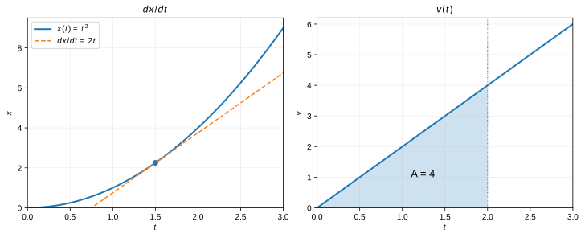

# 0. 미적분 기초: 실용적인 도함수, 극한과 적분

**언어:** [en](../../en/notes/00-calculus-foundations.md) · [fr](../../fr/notes/00-calculus-foundations.md) · [de](../../de/notes/00-calculus-foundations.md) · [it](../../it/notes/00-calculus-foundations.md) · [es](../../es/notes/00-calculus-foundations.md) · [pt](../../pt/notes/00-calculus-foundations.md) · [zh](../../zh/notes/00-calculus-foundations.md) · [ja](../../ja/notes/00-calculus-foundations.md) · [nb](../../nb/notes/00-calculus-foundations.md) · [ru](../../ru/notes/00-calculus-foundations.md) · [ko](00-calculus-foundations.md) · [fi](../../fi/notes/00-calculus-foundations.md) · [pl](../../pl/notes/00-calculus-foundations.md)

**자연지수함수**는 $\exp(x)=\mathrm{e}^{x}$ 이며, **오일러 수**는 $\mathrm{e}\approx2.71828$ 입니다. 연속적인 증가와 감소를 나타내며 $\exp(0)=1$, $\exp(-1)\approx0.3679$ 입니다. 자연로그 $\ln$ 은 역함수로서 $\ln(\exp(x))=x$ 입니다. [기호 안내](../SYMBOLS.md)를 참고하세요.

**이 페이지의 단위(예제 전에 설명):** `s` — 초; `mm` — 밀리미터 = 0.001 m; `mm/s` — 밀리미터 / 초 — 선속도; `mm/s²` — 밀리미터 / 초² — 가속도; `kg·m²` — 킬로그램 · 미터² — 관성 모멘트; `rad/s` — 라디안 / 초 — 각속도; `rad/s²` — 라디안 / 초² — 각가속도; `N·m` — 뉴턴 · 미터 — 토크; `W` — 와트; `rpm` — 분당 회전수; `N/m` — 뉴턴 / 미터 — 강성; `mm³/s` — 밀리미터³ / 초 — 체적 유량; `%` — 퍼센트(100분의 1); `m` — 미터; `kg` — 킬로그램; `N` — 뉴턴; `J` — 줄; `rad` — 라디안. [단위 전체 목록](../UNITS.md).

[목차](../README.md) · [적분표](../INTEGRAL_TABLE.md) · [삼각함수](../TRIGONOMETRY.md) · [운동](01-motion-calculus.md) · [동역학](02-first-order-dynamics.md) · [기호](../SYMBOLS.md)

> **교육용 근사 모델:** 모델과 단위를 독립적으로 검증하세요. 예제 코드를 실제 장비에 연결하지 마세요.

도함수는 어떤 양이 **지금** 얼마나 빠르게 변하는지 나타냅니다. 이차 도함수는 변화 속도가 얼마나 빨리 변하는지를 나타냅니다. 적분은 작은 변화를 누적하고, 극한은 순간 변화율을 정의합니다. 로그를 이용하면 지수 응답이 특정 값에 도달하는 시간을 계산할 수 있습니다.

이 수학 도구는 기계의 이송축, 서보 드라이브, 로봇 관절, 스프링 및 센서에 공통으로 사용됩니다. 먼저 공학적 질문과 변화하는 양, 단위를 정한 다음 알맞은 규칙을 선택하세요.

## 목차

- [1. 측정된 변화에서 수학 모델로](#section-1)
- [2. 극한과 일차 도함수](#section-2)
- [3. 움직이는 축의 일차·이차 도함수](#section-3)
- [4. 연쇄 법칙과 회전 에너지](#section-4)
- [5. 지수함수, 로그와 정착 시간](#section-5)
- [6. 적분: 변위와 기계적 일](#section-6)
- [7. 추가 예제: 팽창하는 구](#section-7)
- [8. 단위, 검산과 다음 단계](#section-8)

## 1. 측정된 변화에서 수학 모델로

| 물리적 질문 | 수학적 도구 |
| --- | --- |
| 이송축은 **지금** 얼마나 빨리 움직이는가? | 일차 도함수 $dx/dt$ |
| 속도는 얼마나 빨리 변하는가? | 이차 도함수 $d^2x/dt^2$ |
| 응답은 언제 90 %에 도달하는가? | 자연로그 $\ln$ |
| 2초 동안 변위는 얼마인가? | 정적분 $\int v\ \mathrm{d}t$ |
| 가변 힘이 한 일은 얼마인가? | 적분 $\int F\ \mathrm{d}x$ |

## 2. 극한과 일차 도함수

두 측정값의 유한차분은 일정 구간의 **평균 변화율**입니다. 도함수는 구간 길이가 0에 접근할 때 이 비율의 극한입니다.

$$
v(t)=\frac{dx}{dt}=\lim_{h\to0}\frac{x(t+h)-x(t)}{h}.
$$

위치가 $x(t)=at^2$이고 $a=2\ \mathrm{mm/s^2}$일 때, 극한을 계산하기 전에 분자를 전개합니다.

$$
\frac{x(t+h)-x(t)}h=\frac{a[(t+h)^2-t^2]}h=a(2t+h)\longrightarrow 2at.
$$

$h=0$을 대입하기 **전에** $h$를 약분합니다. $t=1\ \mathrm{s}$에서 순간 속도는 $4\ \mathrm{mm/s}$입니다. 극한을 구한다는 것은 정의되지 않은 $0/0$을 직접 계산한다는 뜻이 아닙니다.

**자주 사용하는 미분 규칙** (계수 $c$, 지수 $n$은 상수이며 삼각함수의 인수는 라디안):

| 규칙 | 공식 |
| --- | --- |
| 상수 | $\frac{d}{dt}c=0$ |
| 거듭제곱 | $\frac{d}{dt}t^n=n t^{n-1}$ |
| 계수와 합 | $(cf+g)'=cf'+g'$ |
| 곱 | $(fg)'=f'g+fg'$ |
| 몫 ($g\ne0$) | $\left(\frac{f}{g}\right)'=\frac{f'g-fg'}{g^2}$ |
| 연쇄 | $\frac{d}{dt}f(g(t))=f'(g(t))g'(t)$ |
| 지수함수 | $\frac{d}{dt}\exp(t)=\exp(t)$ |
| 자연로그 ($t>0$) | $\frac{d}{dt}\ln t=\frac1t$ |
| 사인·코사인 | $\frac{d}{dt}\sin t=\cos t$, $\frac{d}{dt}\cos t=-\sin t$ |

## 3. 움직이는 축의 일차·이차 도함수

이송대의 초기 위치는 2 mm, 초기 속도는 3 mm/s, 일정한 가속도는 4 mm/s²입니다. 위치 함수는 다음과 같습니다.

$$
x(t)=2\ \mathrm{mm}+(3\ \mathrm{mm/s})t+(2\ \mathrm{mm/s^2})t^2.
$$

**일차 도함수(속도):** 항별로 미분합니다. 상수 2 mm는 사라지고, $t$ 항은 3 mm/s가 되며, $t^2$ 항은 $t$에 비례하는 항이 됩니다.

$$
v(t)=\frac{dx}{dt}=3\ \mathrm{mm/s}+(4\ \mathrm{mm/s^2})t.
$$

**이차 도함수(가속도):** 속도를 다시 미분합니다. 2초 후 위치는 16 mm, 속도는 11 mm/s, 가속도는 여전히 4 mm/s²입니다.

$$
a(t)=\frac{d^2x}{dt^2}=\frac{dv}{dt}=4\ \mathrm{mm/s^2}.
$$

이차 도함수의 물리적 단위는 길이를 시간의 제곱으로 나눈 값입니다. 일차 도함수를 **제곱한 값이 아닙니다**.

## 4. 연쇄 법칙과 회전 에너지

회전하는 플라이휠에는 운동 에너지가 저장됩니다. 각속도 $\omega$가 시간에 따라 변하면 에너지 $E$도 각속도를 통해 변합니다. 이것이 **연쇄 법칙**입니다.

$$
E(\omega)=\frac12J\omega^2,\quad \omega=\omega(t),
$$

$$
\frac{dE}{dt}=\frac{dE}{d\omega}\frac{d\omega}{dt}=J\omega\alpha=M\omega=P.
$$

$J=0.01\ \mathrm{kg\cdot m^2}$, $\omega=10\ \mathrm{rad/s}$, $\alpha=2\ \mathrm{rad/s^2}$라면 모터 토크는 $J\alpha=0.02\ \mathrm{N\cdot m}$이고 순간 기계 출력은 $0.2\ \mathrm{W}$입니다. $P=M\omega$는 연쇄 법칙의 실용적인 결과입니다.

## 5. 지수함수, 로그와 정착 시간

단순한 일차 드라이브 모델에서 속도는 최종값에 지수적으로 접근합니다. 시정수 $\tau$의 단위는 초입니다.

$$
\omega(t)=\omega_\infty\bigl(1-\exp(-t/\tau)\bigr),\quad t\ge0,\ \tau>0.
$$

이 식은 **초기 각속도가 0**, 즉 $\omega(0)=0$이고 목표값 $\omega_\infty$가 일정하다고 가정합니다. 초기 각속도가 $\omega_0$로 0이 아니면 일반적인 일차 응답은 다음과 같습니다.

$$
\omega(t)=\omega_\infty+(\omega_0-\omega_\infty)\exp(-t/\tau).
$$

**초기 속도가 0이 아닌 계산 예:** $\omega_0=200\ \mathrm{rpm}$, $\omega_\infty=1000\ \mathrm{rpm}$, $\tau=0.5\ \mathrm{s}$라고 합시다. 시정수 하나만큼 지난 $t=0.5\ \mathrm{s}$에서:

$$
\omega(\tau)=1000+(200-1000)\exp(-1)\approx705.7\ \mathrm{rpm}.
$$

이는 최종값 1000 rpm의 63.2 %가 아니라 **변화량 800 rpm의 63.2 %**입니다. $t=0$에서 200 rpm이고 시간이 충분히 흐르면 1000 rpm에 가까워집니다. 이 계산은 수학적 예시이며 모터 명령이 아닙니다.

지수함수는 초기 오차 중 남아 있는 비율을 나타냅니다. 특정 비율이 남는 **시점**을 구하려면 $\exp$의 역함수인 자연로그 $\ln$을 사용합니다. 로그의 인수 0.1에는 단위가 없습니다.

$$
\exp(-t/\tau)=0.1
\quad\Longrightarrow\quad
-\frac{t}{\tau}=\ln(0.1)
\quad\Longrightarrow\quad
t=-\tau\ln(0.1)=\tau\ln(10)\approx2.303\tau.
$$

최종 변화량의 90 %에 도달했다면 초기 오차의 10 %가 남습니다. $\tau=0.5\ \mathrm{s}$이면 이상적인 모델에서 약 1.151초가 걸립니다. 실제 드라이브에는 추가 제한과 지연이 있을 수 있습니다.

$z>0$에서 $\ln z$의 도함수는 $1/z$입니다. $z=z(t)$이면 연쇄 법칙에 따라 $dz/dt$를 곱합니다. 차원이 있는 물리량에 직접 로그를 적용하지 말고 무차원 비율을 먼저 만드세요.

$$
\ln(1)=0,\quad \ln(\mathrm{e})=1,\quad \ln(\mathrm{e}^{z})=z,\quad \frac{d}{dz}\ln z=\frac1z\ (z>0).
$$

## 6. 적분: 변위와 기계적 일

**부정적분**은 모든 원시함수를 구하며 미지의 적분상수 $C$가 포함됩니다. **정적분**은 지정된 구간에서 누적된 순변화를 구합니다.

$$
\int 4t\ \mathrm{d}t=2t^2+C,\qquad \int t^n\ \mathrm{d}t=\frac{t^{n+1}}{n+1}+C\ (n\ne-1).
$$

**운동 예제.** 이송대의 초기 위치는 $x_0=2\ \mathrm{mm}$이고 속도는 $v(t)=3\ \mathrm{mm/s}+(4\ \mathrm{mm/s^2})t$로 선형 증가합니다. 0–2초의 변위를 구합니다.

$$
\Delta x=\int_0^{2\ \mathrm{s}}\left(3\ \mathrm{mm/s}+(4\ \mathrm{mm/s^2})t\right)\mathrm{d}t
$$

$$
=\left[(3\ \mathrm{mm/s})t+(2\ \mathrm{mm/s^2})t^2\right]_0^{2\ \mathrm{s}}=6\ \mathrm{mm}+8\ \mathrm{mm}=14\ \mathrm{mm}.
$$

변위는 14 mm입니다. 초기 위치를 더하면 $x(2)=16\ \mathrm{mm}$입니다. 음의 속도는 부호 있는 변위에 음의 값으로 기여하지만, 이동 거리 자체가 음수가 되지는 않습니다.

**스프링의 일 예제.** 강성이 $k=200\ \mathrm{N/m}$인 이상적인 선형 스프링을 $x=0$에서 $x=0.01\ \mathrm{m}$까지 늘립니다. 힘은 늘어난 길이에 따라 증가하므로 각 미소 변위에 해당하는 힘을 곱한 뒤 적분합니다.

$$
F(x)=kx,\qquad W=\int_0^{0.01\ \mathrm{m}}kx\ \mathrm{d}x
=\left[\frac{kx^2}{2}\right]_0^{0.01\ \mathrm{m}}
=\frac{200\ \mathrm{N/m}}2(0.01\ \mathrm{m})^2=0.01\ \mathrm{J}.
$$

일은 0.01 J입니다. 최종 힘 $F=2\ \mathrm{N}$이 전체 구간에서 일정하다고 가정하면 잘못된 값인 0.02 J가 나옵니다. 실제로 힘은 일정하지 않았습니다.

## 7. 추가 예제: 팽창하는 구

**선택 학습: 연쇄 법칙.** 구의 부피는 반지름에 의존하며 반지름도 시간에 따라 변할 수 있습니다. 이는 플라이휠의 에너지가 각속도에 의존하는 것과 같은 수학적 구조입니다.

$$
V(r)=\frac43\pi r^3,\qquad \frac{dV}{dt}=\frac{dV}{dr}\frac{dr}{dt}=4\pi r^2\frac{dr}{dt}.
$$

$r=10\ \mathrm{mm}$, $dr/dt=1\ \mathrm{mm/s}$이면 순간 부피 증가율은 $400\pi\approx1256.64\ \mathrm{mm^3/s}$입니다. $r(t)=10\ \mathrm{mm}+(1\ \mathrm{mm/s^2})t^2$라면 2초 후 $r=14\ \mathrm{mm}$, $dr/dt=4\ \mathrm{mm/s}$이고 부피 증가율은 $3136\pi\approx9852.03\ \mathrm{mm^3/s}$입니다.

## 8. 단위, 검산과 다음 단계

**검산:** 위치의 도함수 단위는 m/s, 이차 도함수는 m/s²입니다. 힘 N을 거리 m에 대해 적분하면 N·m = J가 됩니다. 부정적분에는 상수 $C$가 필요합니다. 도함수는 한 순간의 국소 변화율이고 정적분은 구간 전체의 누적 변화입니다. 수학의 $dt$는 미분 요소이지만 오일러 방법의 코드에서 `dt`는 유한한 샘플 간격입니다.

**직접 풀어 보기:** (1) $x(t)=5\ \mathrm{mm}+(2\ \mathrm{mm/s})t+(1\ \mathrm{mm/s^2})t^2$일 때 3초에서 속도와 가속도를 구하세요. (2) $\tau=1\ \mathrm{s}$인 이상적인 일차 응답이 변화량의 90 %에 도달하는 데 걸리는 시간은? (3) 일정한 속도 $v=4\ \mathrm{mm/s}$를 2초 동안 적분하세요. **정답:** 8 mm/s와 2 mm/s², 약 2.303 s, 8 mm.

**풀이 과정:**

1. $v(t)=\frac{dx}{dt}=2\ \mathrm{mm/s}+2(1\ \mathrm{mm/s^2})t$; $v(3\ \mathrm{s})=2+2\cdot3=8\ \mathrm{mm/s}$. $a(t)=\frac{dv}{dt}=2\ \mathrm{mm/s^2}$.
2. $f(t)=1-\exp(-t/\tau)=0.9$; $\exp(-t/\tau)=0.1$; $t=-\tau\ln(0.1)=\tau\ln(10)$. $\tau=1\ \mathrm{s}$; $t\approx2.303\ \mathrm{s}$.
3. $\Delta x=\int_0^{2\ \mathrm{s}}(4\ \mathrm{mm/s})\ \mathrm{d}t=(4\ \mathrm{mm/s})(2\ \mathrm{s})=8\ \mathrm{mm}$.

[적분 공식표](../INTEGRAL_TABLE.md) · [삼각함수](../TRIGONOMETRY.md) · [다음: 운동](01-motion-calculus.md) · [Python 연습](../exercises/README.md)
