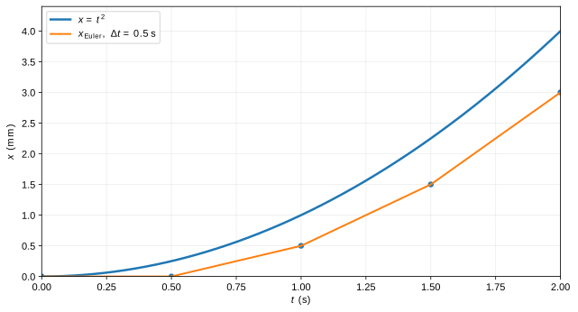

# 1. 운동, 미분과 적분

**다른 언어:** [en](../../en/notes/01-motion-calculus.md) · [fr](../../fr/notes/01-motion-calculus.md) · [de](../../de/notes/01-motion-calculus.md) · [it](../../it/notes/01-motion-calculus.md) · [es](../../es/notes/01-motion-calculus.md) · [pt](../../pt/notes/01-motion-calculus.md) · [zh](../../zh/notes/01-motion-calculus.md) · [ja](../../ja/notes/01-motion-calculus.md) · [nb](../../nb/notes/01-motion-calculus.md) · [ru](../../ru/notes/01-motion-calculus.md) · [ko](01-motion-calculus.md) · [fi](../../fi/notes/01-motion-calculus.md) · [pl](../../pl/notes/01-motion-calculus.md)

**이 페이지의 단위(예제 전에 설명):** `s` — 초; `mm` — 밀리미터 = 0.001 m; `mm/s` — 밀리미터 / 초 — 선속도; `mm/s²` — 밀리미터 / 초² — 가속도; `%` — 퍼센트(100분의 1). [단위 전체 목록](../UNITS.md).

**미적분 복습:** [0. 미적분 기초](00-calculus-foundations.md) · [적분 공식표](../INTEGRAL_TABLE.md)

[목차](../README.md) · [공식 요약](../CHEATSHEET.md) · [연습](../exercises/README.md) · [다음 장](02-first-order-dynamics.md)

> **정확도 안내:** 아래는 단순화된 1차원 모델입니다. 실제로 적용하기 전에 단위, 좌표계 규약, 수치 정확도를 확인하세요.

## 빠른 복습

- **이동 거리**는 경로의 총길이이며, **변위**는 최종 위치에서 초기 위치를 뺀 값입니다.
- **속력**은 음수가 아니지만, **속도**에는 방향이 있으므로 선택한 축에서 음수가 될 수 있습니다.
- 위치를 시간에 대해 미분하면 순간 속도를 얻습니다. 부호 있는 속도를 적분하면 변위를 얻습니다.
- **명시적 오일러 적분**은 짧은 시간 간격 동안 도함수가 일정하다고 근사합니다.

## 이 페이지의 내용

- [1. 이동 거리, 변위, 속력과 속도](#section-1)
- [2. 도함수: 순간 속도](#section-2)
- [3. 적분: 변위와 이동 거리](#section-3)
- [4. 수치 적분](#section-4)
- [5. 직접 실험](#section-5)
- [6. 추가 설명(선택)](#section-6)
  - [2t^2의 도함수가 4t인 이유](#power-rule-derivation)
  - [변위 표의 값이 계산되는 과정](#motion-values-derivation)

[SI 단위 표기와 소수점](../SYMBOLS.md)

## 1. 이동 거리, 변위, 속력과 속도

공식의 유도, 단위 및 수치적 한계는 [추가 설명](#section-6)을 참고하세요.

가상의 축이 처음 2초 동안 $+3\ \mathrm{mm/s}$로 움직이고 다음 2초 동안 $-3\ \mathrm{mm/s}$로 움직인다고 합시다. 변위는 $+6-6=0\ \mathrm{mm}$이지만 이동 거리는 $6+6=12\ \mathrm{mm}$입니다. 두 구간 모두 속력은 $3\ \mathrm{mm/s}$이고, 부호 있는 속도의 방향만 바뀝니다.

시간 구간 $[t_1,t_2]$에서

$$
\text{평균 속도}=\frac{x(t_2)-x(t_1)}{t_2-t_1},\qquad
\text{평균 속력}=\frac{\text{총 이동 거리}}{t_2-t_1}.
$$

2차원 또는 3차원에서 속도는 벡터입니다. 물체가 일정한 속력으로 원을 돌아도 방향이 변하므로 속도 벡터는 변합니다. 한 바퀴를 돌아 출발점으로 돌아왔다면 평균 속도 벡터는 0입니다.

**전체 4초 구간**에서 부호 있는 평균 속도와 평균 속력은 **서로 다른 값**입니다. 축은 시작점으로 돌아왔지만 총 12 mm를 이동했습니다.

$$
\overline{v}_x=\frac{0\ \mathrm{mm}}{4\ \mathrm{s}}=0\ \mathrm{mm/s}
$$

$$
\overline{\lvert v\rvert}=\frac{12\ \mathrm{mm}}{4\ \mathrm{s}}=3\ \mathrm{mm/s}
$$

따라서 평균 속력은 **평균 속도 벡터의 크기와 항상 같지는 않습니다**. 원을 한 바퀴 돌고 출발점으로 돌아와도 평균 속도 벡터는 0이지만 이동 거리와 평균 속력은 양수입니다.

## 2. 도함수: 순간 속도

미분 가능한 위치 함수 $x(t)$에 대해

$$
v(t)=\frac{dx}{dt}.
$$

시간 $t$의 단위가 초이고 $x(t)=2t^2\ \mathrm{mm}$이면 $v(t)=4t\ \mathrm{mm/s}$입니다. **왜 4인가요?** 거듭제곱 미분 법칙에 따라 $d(t^2)/dt=2t$이므로 $2t^2$를 미분하면 $2\cdot2t=4t$입니다. [단위까지 포함한 유도](#power-rule-derivation). $t=1\ \mathrm{s}$에서 순간 속도는 $4\ \mathrm{mm/s}$입니다.

전진 유한차분 근사는

$$
v(t)\approx\frac{x(t+\Delta t)-x(t)}{\Delta t}.
$$

$t=1\ \mathrm{s}$에서 $\Delta t=1;\ 0.1;\ 0.01\ \mathrm{s}$를 사용하면 각각 $6;\ 4.2;\ 4.02\ \mathrm{mm/s}$입니다. 이 예제에서는 간격이 작아질수록 실제 도함수에 접근하지만, 매우 작은 간격에서는 부동소수점 반올림 오차가 정확도를 제한합니다.

**시간 간격이 너무 작으면 왜 틀리는가:** $t=1\ \mathrm{s}$에서 $x(t)=2t^2$의 정확한 미분값은 $4\ \mathrm{mm/s}$입니다. 하지만 $dt=1e-17\ \mathrm{s}$이면 Python `float`에서 `t + dt`가 다시 `t`로 반올림됩니다. 계산된 두 위치가 같아지므로 차분은 잘못된 속도 0을 반환할 수 있습니다. 더 작은 수치 범위에서는 미분값이 0이 아닌데도 위치 두 값이 모두 언더플로로 0이 될 수 있습니다. 연습 함수 [`forward_derivative`](../../../exercises/01_motion_and_integral.py)는 이런 경우 잘못된 0 대신 `ValueError`를 발생시킵니다. 유한차분 계산 자체는 유지하되, 간격을 무한히 줄이기보다 부동소수점으로 구분할 수 있는 값을 선택해야 합니다.

## 3. 적분: 변위와 이동 거리

부호 있는 1차원 속도 $v(t)$에 대해

$$
x(t_2)-x(t_1)=\int_{t_1}^{t_2}v(t)\ \mathrm{d}t,\qquad
s=\int_{t_1}^{t_2}|v(t)|\ \mathrm{d}t.
$$

첫 번째 적분은 음수 또는 0이 될 수 있지만 두 번째는 음수가 될 수 없습니다. 첫 번째 적분은 속도-시간 그래프 아래의 부호 있는 면적입니다. **이 적분 예제는 2절과 별개의 예제입니다.** 앞에서 사용한 위치 $x(t)=2t^2$의 도함수는 $v(t)=4t$이지만, 아래 적분 예제에서는 의도적으로 $v(t)=2t$를 사용합니다. 이에 대응하는 위치는 $x(t)=t^2+C$입니다(단위는 일관되게 적용). $0\le t\le2\ \mathrm{s}$에서 $v(t)=2t\ \mathrm{mm/s}$라면 변위는 $4\ \mathrm{mm}$입니다.

## 4. 수치 적분

정확한 변위와 구간 왼쪽 끝값을 사용하는 오일러 근사의 비교(가상 데이터).

명시적 오일러 방법은 각 구간의 **시작점**에서 계산한 도함수를 사용합니다.

$$
x_{n+1}=x_n+v(t_n)\ \Delta t.
$$

$0$초에서 $2$초까지 $v(t)=2t\ \mathrm{mm/s}$라면

| 시간 간격 $\Delta t$ | 오일러 변위 |
| ---: | ---: |
| $0.5\ \mathrm{s}$ | $3.000\ \mathrm{mm}$ |
| $0.1\ \mathrm{s}$ | $3.800\ \mathrm{mm}$ |
| $0.01\ \mathrm{s}$ | $3.980\ \mathrm{mm}$ |
| 정확한 적분 | $4.000\ \mathrm{mm}$ |

이 예제에서는 구간 안에서 속도가 증가하므로 오일러 방법이 실제 변위를 과소평가합니다. 양 끝값의 평균을 사용하는 사다리꼴 법칙은 속도가 선형일 때 정확하지만, 비선형 속도에 대해서는 항상 정확하지 않습니다.

[3, 3.8, 3.98의 계산 과정](#motion-values-derivation).

## 5. 직접 실험

[`01_motion_and_integral.py`](../../../exercises/01_motion_and_integral.py)를 실행하세요. $\Delta t$를 줄였을 때 결과가 어떻게 변하는지 확인하고, 출발점으로 돌아오는 왕복 운동의 변위는 0이지만 이동 거리는 양수인 이유를 설명해 보세요.

예제는 가상 데이터로 구성되어 있으며 실제 장비를 제어하지 않습니다.

## 6. 추가 설명(선택)

### 단위와 계수의 의미

$t$가 초 단위일 때 $x(t)=2t^2$ mm라고 쓰는 것은 간략한 표기입니다. 실제로 계수의 단위는 $2\ \mathrm{mm/s^2}$입니다. 따라서 $v(t)=4t$의 단위는 mm/s가 됩니다. 공식에 숫자를 대입하기 전에 단위를 확인하세요.

### 유한차분과 수치 오차

유한차분은 0이 아닌 간격에서 도함수를 **추정**하며 정확한 순간 값과 같지 않습니다. 매끄러운 함수에서는 간격을 줄이면 절단 오차가 줄지만, 너무 작은 간격은 부동소수점 상쇄 오차나 측정 잡음을 키울 수 있습니다. 오일러 적분은 구간 시작값을 사용하므로 증가하는 선형 속도에서는 적분을 과소평가합니다.

### 여러 차원의 운동

위치 벡터가 $\mathbf r(t)$이면 속도 벡터는 $\mathbf v(t)=d\mathbf r/dt$입니다. 속력은 크기 $\|\mathbf v\|$이며 경로 길이는 $s=\int\|\mathbf v(t)\|dt$입니다.

### $2t^2$의 도함수가 $4t$인 이유

$$
x(t)=at^2,\qquad
\frac{dx}{dt}=\lim_{h\to0}\frac{a(t+h)^2-at^2}{h}
=\lim_{h\to0}a(2t+h)=2at.
$$

$$
a=2\ \mathrm{mm/s^2},\qquad
v(t)=2at=(4\ \mathrm{mm/s^2})t.
$$

### 변위 표의 값이 계산되는 과정

$$
a=2\ \mathrm{mm/s^2},\qquad v(t)=at,\qquad 0\le t\le2\ \mathrm{s}.
$$

$$
\Delta x=\int_{0}^{2\ \mathrm{s}}at\ \mathrm{d}t
=\left[\frac{at^2}{2}\right]_{0}^{2\ \mathrm{s}}
=4\ \mathrm{mm}.
$$

$\sum$는 그리스 대문자 **시그마**로, 여러 항을 **합한다**는 뜻입니다. $\sum_{n=0}^{N-1}(2nh)h$에서는 $n=0;1;\ldots;N-1$로 총 $N$개 항을 더합니다. Python의 `for` 루프로 항을 하나씩 누적하는 것과 같습니다. 예를 들어 $\sum_{n=1}^{3}n=1+2+3=6$입니다. [기호 설명](../SYMBOLS.md).

$$
h=\frac{dt}{1\ \mathrm{s}},\qquad N=\frac{2}{h}.
$$

$$
x_{\mathrm{Euler}}(2\ \mathrm{s})
=\left[\sum_{n=0}^{N-1}(2nh)h\right]\ \mathrm{mm}
=\left[h^2N(N-1)\right]\ \mathrm{mm}
=(4-2h)\ \mathrm{mm}.
$$

여기서 `h`는 초 단위 시간 간격 `dt`의 **수치값**입니다. 예를 들어 `dt = 0.5 s`이면 `h = 0.5`입니다. `N`은 구간 수입니다. 계산 결과는 무차원 숫자가 아니라 **밀리미터 단위의 거리**입니다.

`dt`가 각각 0.5초, 0.1초, 0.01초이면 변위는 3 mm, 3.8 mm, 3.98 mm입니다. 이 계산에서는 무차원 구간 수 $N=(2\ \mathrm{s})/dt$가 정수라고 가정합니다.

[SI 단위와 표기법](../SYMBOLS.md#si-notation) · [Σ 합산 기호](../SYMBOLS.md#summation)

속도(velocity)는 부호가 있는 위치 변화율이며 속력(speed)은 그 크기입니다.
