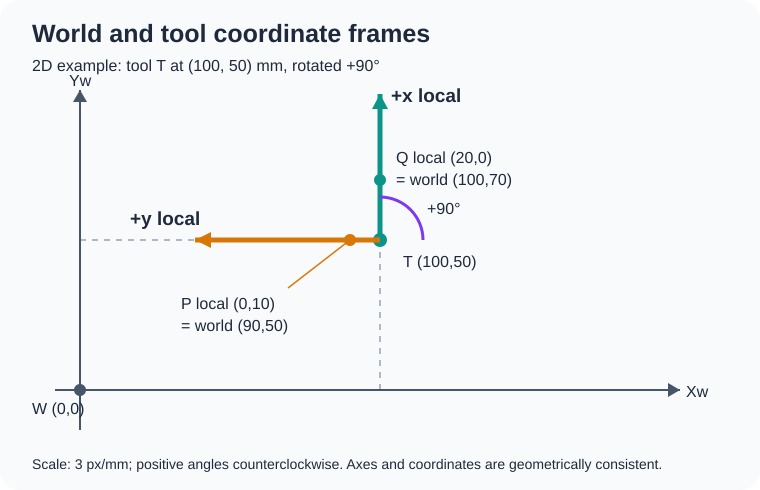

# 4. 로봇 좌표계와 평면 운동학

**언어:** [en](../../en/notes/04-coordinate-frames.md) · [fr](../../fr/notes/04-coordinate-frames.md) · [de](../../de/notes/04-coordinate-frames.md) · [it](../../it/notes/04-coordinate-frames.md) · [es](../../es/notes/04-coordinate-frames.md) · [pt](../../pt/notes/04-coordinate-frames.md) · [zh](../../zh/notes/04-coordinate-frames.md) · [ja](../../ja/notes/04-coordinate-frames.md) · [nb](../../nb/notes/04-coordinate-frames.md) · [ru](../../ru/notes/04-coordinate-frames.md) · [ko](04-coordinate-frames.md) · [fi](../../fi/notes/04-coordinate-frames.md) · [pl](../../pl/notes/04-coordinate-frames.md)

**이 페이지의 단위(예제 전에 설명):** `mm` — 밀리미터 = 0.001 m; `°` — 도. [단위 전체 목록](../UNITS.md).

[목차](../README.md) · [삼각함수](../TRIGONOMETRY.md) · [수학 기호](../SYMBOLS.md) · [피드백 제어](03-feedback-control.md)

> **교육용 모델:** 이 단순화된 기하학을 실제 기계 제어에 사용하지 마세요.

## 내용
1. [좌표계가 중요한 이유](#section-1)
2. [점의 회전과 평행이동](#section-2)
3. [좌표계의 연쇄 변환](#section-3)
4. [두 링크의 순기구학](#section-4)
5. [두 가지 팔꿈치 해와 도달 가능한 작업 공간](#section-5)
6. [풀이가 포함된 예제](#section-6)
7. [모델의 한계와 행렬 표기](#section-7)

## 1. 좌표계가 중요한 이유

좌표계(frame)는 원점과 방향이 정해진 축으로 구성됩니다. **월드 좌표계** W는 로봇 베이스에 고정될 수 있지만 **툴 좌표계** T는 공구와 함께 움직입니다. 같은 점이라도 어떤 좌표계를 사용하는지에 따라 좌표값이 달라집니다. **위치**는 점을, **자세(방향)**는 축의 방향을 나타냅니다. 좌표를 변환한다고 해서 로봇 자체가 움직이는 것은 아닙니다.

모든 길이는 동일한 단위(여기서는 mm)를 사용합니다. 양의 각도는 월드 +X축에서 반시계 방향으로 측정합니다. 아래첨자 w와 l은 각각 월드와 로컬을 뜻합니다. 강체의 2차원 근사 모델을 사용합니다.

## 2. 점의 회전과 평행이동

*월드 축과 +90° 회전한 툴 축, 로컬 점 P와 Q.*

그림에서 툴 원점 T의 월드 좌표는 (100 mm, 50 mm)이며 로컬 축은 +90° 회전했습니다. 로컬 +x축은 월드 +Y를, 로컬 +y축은 월드 −X를 가리킵니다. 따라서 T에서 P=(0 mm, 10 mm)는 월드에서 (90 mm, 50 mm), Q=(20 mm, 0 mm)는 (100 mm, 70 mm)입니다.

$(t_x,t_y)$를 월드에서 본 로컬 원점의 위치, $\theta$를 로컬 축의 회전각, $(x_l,y_l)$을 로컬에서 본 점의 좌표라고 합시다. **먼저 회전한 다음 평행이동**합니다.

$$
x_w=t_x+x_l\cos\theta-y_l\sin\theta
$$

$$
y_w=t_y+x_l\sin\theta+y_l\cos\theta
$$

$\sin\theta$와 $\cos\theta$의 부호는 각도의 방향 규약에 따라 달라집니다. $\theta=0^\circ$이면 원점의 이동량만 더하면 됩니다. 이 식은 점의 **좌표**를 변환하며 모터 명령을 만드는 식이 아닙니다.

## 3. 좌표계의 연쇄 변환

좌표계는 **W → T → S**(월드 → 툴 → 센서)처럼 연결할 수 있습니다. 앞의 T를 그대로 사용합시다. S의 원점이 T에서 (20 mm, 0 mm)이고 축 방향은 T와 같다면 S 원점의 월드 좌표는 (100 mm, 70 mm)입니다. S에서 측정한 점 (0 mm, 10 mm)의 월드 좌표는 (90 mm, 70 mm)입니다. 자식 좌표계에서 부모 좌표계로 순서대로 변환하세요.

열벡터를 사용할 때 $T_{WS}=T_{WT}T_{TS}$입니다. $T_{AB}$는 **B에서 표현한 좌표를 A로 변환**합니다. 행렬 곱셈은 일반적으로 교환법칙이 성립하지 않습니다.

**행렬 계산 전체 과정(열벡터):** 도구 좌표계 T는 W에 대해 +90° 회전되어 있고 월드 원점은 (100 mm, 50 mm)입니다. 센서 좌표계 S는 T에 대한 추가 회전이 없으며 원점은 T에서 (20 mm, 0 mm), 즉 앞 그림의 Q와 같은 위치입니다. 회전 성분은 무차원이고 이동 성분은 mm 단위입니다.

$$
T_{WT}=
\begin{bmatrix}
0 & -1 & 100\\
1 & 0 & 50\\
0 & 0 & 1
\end{bmatrix}
$$

$$
T_{TS}=
\begin{bmatrix}
1 & 0 & 20\\
0 & 1 & 0\\
0 & 0 & 1
\end{bmatrix}
$$

$$
T_{WS}=T_{WT}T_{TS}=
\begin{bmatrix}
0 & -1 & 100\\
1 & 0 & 70\\
0 & 0 & 1
\end{bmatrix}
$$

$$
T_{WS}\begin{bmatrix}0\\10\\1\end{bmatrix}
=\begin{bmatrix}90\\70\\1\end{bmatrix}
$$

행렬을 곱할 때 센서의 로컬 이동량 (20 mm, 0 mm)을 먼저 월드 방향의 (0 mm, 20 mm)으로 회전한 후 (100 mm, 50 mm)에 더합니다. 따라서 S에서 (0 mm, 10 mm)인 점은 W에서 (90 mm, 70 mm)입니다. 20 mm를 월드 X에 직접 더하면 잘못된 결과입니다. 그 이동량은 **T 기준**으로 표현되어 있기 때문입니다. 동차좌표의 마지막 1은 길이가 아닌 무차원 값입니다. 이는 좌표 변환 계산이며 [ROS 2 tf2](06-ros2-foundations.md#section-7)는 타임스탬프가 있는 변환을 발행하고 조회하지만 역기구학을 풀지는 않습니다.

## 4. 두 링크의 순기구학

*첫 관절 30°, 상대적인 두 번째 관절 60°; 두 번째 링크는 수직.*

평면 로봇 팔의 링크 길이를 $L_1,L_2$라고 합시다. 첫 관절 각도 $\theta_1$은 월드 +X축을 기준으로 하고, 두 번째 관절 각도 $\theta_2$는 **첫 번째 링크를 기준으로 한 상대각**입니다. 따라서 두 번째 링크의 월드 절대각은 $\theta_1+\theta_2$입니다. 말단 위치는 두 링크 벡터의 합입니다.

$$
X=L_1\cos\theta_1+L_2\cos(\theta_1+\theta_2)
$$

$$
Y=L_1\sin\theta_1+L_2\sin(\theta_1+\theta_2)
$$

$L_1=100$ mm, $L_2=50$ mm, $\theta_1=30^\circ$, $\theta_2=60^\circ$이면 팔꿈치 위치는 (86.60 mm, 50 mm)입니다. 두 번째 링크는 절대각 90°로 위를 향하므로 말단은 (86.60 mm, 100 mm)에 있습니다.

## 5. 두 가지 팔꿈치 해와 도달 가능한 작업 공간

*서로 다른 관절각 조합 두 개가 같은 목표점에 도달합니다.*

역기구학은 목표 위치를 만족하는 관절각을 찾습니다. 각각 길이 100 mm인 두 링크는 $(\theta_1,\theta_2)=(0^\circ,+90^\circ)$ 또는 $(+90^\circ,-90^\circ)$로 (100 mm, 100 mm)에 도달할 수 있습니다. 두 값 모두 **관절각**이며 $\theta_2$는 절대각이 아닌 상대각입니다.

*반지름 50 mm와 150 mm 사이의 이상적인 환형 작업 공간.*

관절이 2차원에서 자유롭게 회전하고 충돌이 없다면 목표점의 반지름 $r$은 $|L_1-L_2|\le r\le L_1+L_2$를 만족해야 합니다. 링크 길이가 100 mm와 50 mm이면 반지름 50–150 mm 사이의 환형 영역에 도달할 수 있습니다. 실제 로봇의 관절 제한과 장애물은 도달 가능 영역을 더 좁힙니다.

## 6. 풀이가 포함된 예제

다음 **여섯 개의 독립적인 예제에는 모두 문제, 풀이 및 설명**이 포함됩니다. 특정 독자에게 개인적으로 질문하는 형식이 아닙니다.

### 6.1. 회전 좌표계의 로컬 점 P

**문제.** T의 월드 위치가 (100 mm, 50 mm)이고 +90° 회전했습니다. 로컬 P=(0 mm, 10 mm)의 월드 좌표를 구하세요.

**풀이.** 로컬 +y는 월드 −X를 향하므로 X에서 10 mm를 뺍니다.

$$
x_w=100+0\cdot0-10\cdot1=90\ \mathrm{mm}
$$

$$
y_w=50+0\cdot1+10\cdot0=50\ \mathrm{mm}
$$

**답:** (90 mm, 50 mm).

### 6.2. 툴 x축 위의 로컬 점 Q

**문제.** 같은 툴 좌표계에서 Q=(20 mm, 0 mm)의 월드 좌표를 구하세요.

**풀이.** 로컬 +x는 월드 +Y를 향하므로 Y에 20 mm를 더합니다.

$$
x_w=100+20\cdot0-0\cdot1=100\ \mathrm{mm}
$$

$$
y_w=50+20\cdot1+0\cdot0=70\ \mathrm{mm}
$$

**답:** (100 mm, 70 mm).

### 6.3. 두 링크의 순기구학

**문제.** $L_1=100$ mm, $L_2=50$ mm, $\theta_1=30^\circ$, 상대각 $\theta_2=60^\circ$일 때 말단 위치를 구하세요.

**풀이.** 두 번째 링크의 월드 각도는 60°가 아니라 30°+60°=90°입니다.

$$
X=100\cos30^\circ+50\cos90^\circ=50\sqrt3\approx86.60\ \mathrm{mm}
$$

$$
Y=100\sin30^\circ+50\sin90^\circ=100\ \mathrm{mm}
$$

**답:** (86.60 mm, 100 mm).

### 6.4. 한 목표점에 대한 두 가지 자세

**문제.** 100 mm 링크 두 개로 (100 mm, 100 mm)에 도달하는 관절각 조합 두 개를 구하세요.

**풀이.** 한 자세는 오른쪽으로 이동한 뒤 위로 향하고, 다른 자세는 위로 이동한 뒤 오른쪽으로 향합니다.

$$
(\theta_1,\theta_2)=(0^\circ,+90^\circ)\ \Longrightarrow\ (X,Y)=(100, 100)\ \mathrm{mm}
$$

$$
(\theta_1,\theta_2)=(+90^\circ,-90^\circ)\ \Longrightarrow\ (X,Y)=(100, 100)\ \mathrm{mm}
$$

### 6.5. 각도를 구하지 않고 도달 가능성 판단하기

**문제.** $L_1=100$ mm, $L_2=50$ mm일 때 (0 mm, 120 mm)와 (0 mm, 0 mm)에 도달할 수 있나요?

**풀이.** 원점에서 각 목표점까지의 거리를 두 링크 길이의 차와 합에 비교합니다.

$$
r_{\min}=|100-50|=50\ \mathrm{mm},\qquad r_{\max}=100+50=150\ \mathrm{mm}
$$

$$
r_{(0, 120)}=\sqrt{0^2+120^2}=120\ \mathrm{mm}
$$

50 ≤ 120 ≤ 150이므로 (0 mm, 120 mm)는 **도달 가능**합니다. 원점 (0 mm, 0 mm)은 반지름이 0이므로 **도달 불가능**합니다.

### 6.6. 팔꿈치 각도의 코사인 법칙

**문제.** $L_1=100$ mm, $L_2=50$ mm, $r=120$ mm일 때 $\cos\theta_2$를 계산하세요.

**풀이.** 코사인 값은 굽힘 각도의 크기를 결정합니다. 서로 거울상인 두 팔꿈치 자세에서는 상대각의 부호가 반대입니다.

$$
\cos\theta_2=\frac{r^2-L_1^2-L_2^2}{2L_1L_2}
=\frac{14400-10000-2500}{10000}=\frac{1900}{10000}=0.19
$$

$$
\theta_2\approx\pm79.05^\circ
$$

삼각형의 내각은 $\varphi=180^\circ-|\theta_2|$입니다. 반지름만으로는 $\theta_1$을 결정할 수 없습니다. [삼각함수](../TRIGONOMETRY.md)의 그림을 참고하세요.

## 7. 모델의 한계와 행렬 표기

이상적인 강체 평면 모델에는 관절 제한, 충돌, 백래시, 탄성 변형, 엔코더 영점 오차, 카메라 보정, 3차원 운동이 포함되지 않습니다. 관절 엔코더는 월드 좌표를 직접 측정하지 않고 **관절각**을 측정합니다. 센서 관측값은 보정된 좌표계를 통해 변환해야 합니다. 어떤 계산도 실제 장비를 움직이라는 명령이 아닙니다.

선택 학습: 동차 좌표 행렬을 사용하면 열벡터 $[x_l,y_l,1]^T$를 3×3 변환 행렬로 월드 좌표에 표현할 수 있습니다. 자유 변위 벡터는 세 번째 성분이 0이므로 평행이동의 영향을 받지 않습니다.

$$
T_{WL}=
\begin{bmatrix}
\cos\theta & -\sin\theta & t_x \\
\sin\theta & \cos\theta & t_y \\
0 & 0 & 1
\end{bmatrix},
\qquad
\begin{bmatrix}x_w\\y_w\\1\end{bmatrix}
=T_{WL}\begin{bmatrix}x_l\\y_l\\1\end{bmatrix}
$$

[삼각함수](../TRIGONOMETRY.md) · [수학 기호](../SYMBOLS.md) · [피드백 제어](03-feedback-control.md)

[다음: 회전, 속도와 특이점](05-velocity-jacobian.md)
