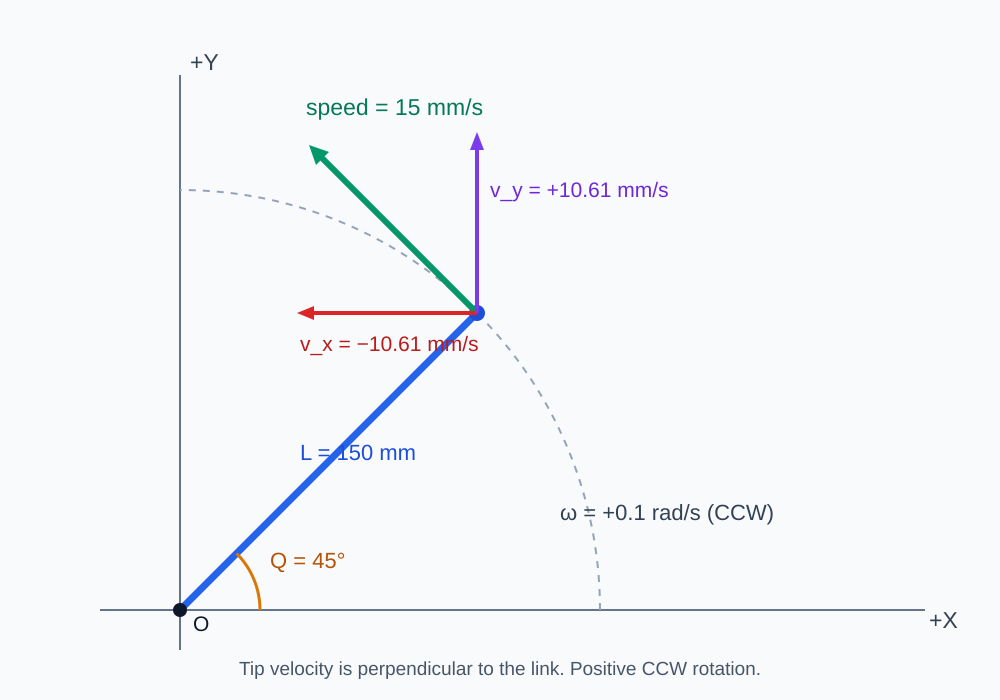

# 5. 회전, 선속도 및 특이점

**언어:** [en](../../en/notes/05-velocity-jacobian.md) · [fr](../../fr/notes/05-velocity-jacobian.md) · [de](../../de/notes/05-velocity-jacobian.md) · [it](../../it/notes/05-velocity-jacobian.md) · [es](../../es/notes/05-velocity-jacobian.md) · [pt](../../pt/notes/05-velocity-jacobian.md) · [zh](../../zh/notes/05-velocity-jacobian.md) · [ja](../../ja/notes/05-velocity-jacobian.md) · [nb](../../nb/notes/05-velocity-jacobian.md) · [ru](../../ru/notes/05-velocity-jacobian.md) · [ko](05-velocity-jacobian.md) · [fi](../../fi/notes/05-velocity-jacobian.md) · [pl](../../pl/notes/05-velocity-jacobian.md)

**이 페이지의 단위(예제 전에 설명):** `mm` — 밀리미터 = 0.001 m; `mm/s` — 밀리미터 / 초 — 선속도; `rad` — 라디안; `rad/s` — 라디안 / 초 — 각속도; `mm/rad` — 밀리미터 / 라디안 — 야코비 행렬 계수(각도당 길이); `°` — 도. [단위 전체 목록](../UNITS.md).

[목차](../README.md) · [삼각함수](../TRIGONOMETRY.md#unit-circle-values) · [좌표계](04-coordinate-frames.md) · [미적분 기초](00-calculus-foundations.md)

> 이상적인 가상 모델입니다. 실제 장비 제어에 사용하지 마세요.

회전하는 링크의 말단은 원호를 따라 이동합니다. 순간 속도는 링크 방향이 아니라 **원호의 접선 방향**입니다. 이 장에서는 기하학에서 출발해 시간 미분을 유도한 다음, 선택 학습으로 야코비안 행렬을 설명합니다. 미분할 때 관절각은 라디안을 사용하지만 시각적 이해를 위해 도 단위의 예제도 포함합니다.

## 내용

1. [회전하는 링크에서 접선 속도까지](#section-1)
2. [도함수가 나오는 과정](#section-2)
3. [속도와 부호를 계산하는 예제](#section-3)
4. [회전하는 두 링크: 상대각과 절대각](#section-4)
5. [접힌 자세와 펼친 자세의 특이점](#section-5)
6. [접힌 자세 근처의 서로 다른 세 가지 변위](#section-6)
7. [선택 학습: 야코비안과 풀이가 포함된 확인 문제](#section-7)

## 1. 회전하는 링크에서 접선 속도까지

길이 $L$인 강체 링크가 고정된 회전점 $O$를 중심으로 회전한다고 합시다. 시간 간격 $\Delta t>0$ 동안 각도가 $\Delta Q$만큼 바뀌며, 각도는 **라디안**으로 측정합니다. 이 구간에서 회전 방향이 바뀌지 않으면 말단은 원호를 따라 움직입니다. 이동한 **원호 길이**는 정확히 $\Delta s=L|\Delta Q|$입니다. 회전 방향의 부호를 포함한 **부호 있는 원호 거리**는 $L\Delta Q$입니다. 이는 시작점과 끝점을 잇는 직선 변위(현)와 구별해야 합니다.

$$
\Delta s=L\lvert\Delta Q\rvert,\qquad
\Delta s_{\mathrm{signed}}=L\Delta Q
$$

이 원호 길이를 경과 시간으로 나누면 해당 구간의 **평균 속력**을 얻습니다.

$$
\overline{v}=\frac{\Delta s}{\Delta t}
=L\left\lvert\frac{\Delta Q}{\Delta t}\right\rvert
$$

**순간 속력**은 $\Delta t\to0$ 극한으로 구합니다. 각속도는 $\omega=\dot Q=\mathrm{d}Q/\mathrm{d}t$이며 단위는 rad/s입니다. 따라서 말단의 선속력은 $v=L|\omega|$입니다. 속도 벡터는 **원의 접선 방향**, 즉 링크에 수직입니다. $Q=45^\circ$이고 반시계 방향 회전($\omega>0$)이면 말단은 왼쪽 위로 움직입니다. 수평 속도 성분은 음수, 수직 성분은 양수입니다.

$$
v=L\lvert\dot Q\rvert
$$

*강체 링크의 말단 접선 속도: Q=45°, 반시계 회전, 각 성분의 부호.*

## 2. 도함수가 나오는 과정

말단 좌표는 각도에 따라 달라지고, 각도는 다시 시간에 따라 달라집니다. 이들은 **서로 다른 두 의존 관계**입니다. 연쇄 법칙은 라디안당 좌표 변화율에 초당 회전한 라디안 수를 곱합니다. 사인과 코사인의 도함수는 각도를 라디안으로 측정할 때 다음과 같습니다.

$$
x(t)=L\cdot\cos\bigl(Q(t)\bigr),\qquad y(t)=L\cdot\sin\bigl(Q(t)\bigr)
$$

$$
v_x=\frac{\mathrm{d}x}{\mathrm{d}t}
=\frac{\mathrm{d}x}{\mathrm{d}Q}\cdot\frac{\mathrm{d}Q}{\mathrm{d}t}
=-L\cdot\sin(Q)\cdot\dot{Q}
$$

$$
v_y=\frac{\mathrm{d}y}{\mathrm{d}t}
=\frac{\mathrm{d}y}{\mathrm{d}Q}\cdot\frac{\mathrm{d}Q}{\mathrm{d}t}
=L\cdot\cos(Q)\cdot\dot{Q}
$$

각속도 $\dot Q=\mathrm{d}Q/\mathrm{d}t$의 단위는 rad/s입니다. 각도 $Q$ 자체와 혼동하지 마세요. $L$을 mm로 표시하면 $v_x,v_y$의 단위는 mm/s입니다. 삼각함수의 미분에는 라디안을 사용합니다.

$$
\omega=\dot{Q},\qquad \omega_1=\dot{Q}_1,\qquad \omega_2=\dot{Q}_2
$$

## 3. 속도와 부호를 계산하는 예제

$Q=45^\circ$, $L=150$ mm, $\omega=+0.1$ rad/s라면 말단은 왼쪽 위로 이동하고 두 성분의 속력은 같습니다. 회전 방향을 −0.1 rad/s로 바꾸면 두 성분의 부호가 반대가 되지만 속력의 크기는 변하지 않습니다. $Q=0^\circ$에서는 수평 속도가 0이고 수직 속도는 +15 mm/s입니다. 점 표기 $\dot Q$는 시간 미분이며 각도와의 곱셈이 아닙니다.

$$
Q=45^\circ:\quad v_x=-150\frac{\sqrt2}{2}\cdot0.1\approx-10.61\ \mathrm{mm/s}
$$

$$
v_y=+150\frac{\sqrt2}{2}\cdot0.1\approx+10.61\ \mathrm{mm/s}
$$

$$
\sqrt{v_x^2+v_y^2}=L\lvert\dot Q\rvert=15\ \mathrm{mm/s}
$$

## 4. 회전하는 두 링크: 상대각과 절대각

평면 두 링크 로봇에서 첫 링크의 월드 각도는 $Q_1$이고 두 번째 관절의 각도 $Q_2$는 **상대각**입니다. 따라서 두 번째 링크의 월드 방향은 $Q_1+Q_2$, 절대 각속도는 $\omega_1+\omega_2$입니다. 순기구학 위치를 미분하면 두 관절의 기여가 모두 나타납니다.

$$
X=L_1\cdot\cos(Q_1)+L_2\cdot\cos(Q_1+Q_2)
$$

$$
Y=L_1\cdot\sin(Q_1)+L_2\cdot\sin(Q_1+Q_2)
$$

$$
v_x=-L_1\cdot\sin(Q_1)\cdot\dot{Q}_1
-L_2\cdot\sin(Q_1+Q_2)\cdot(\dot{Q}_1+\dot{Q}_2)
$$

$$
v_y=L_1\cdot\cos(Q_1)\cdot\dot{Q}_1
+L_2\cdot\cos(Q_1+Q_2)\cdot(\dot{Q}_1+\dot{Q}_2)
$$

## 5. 접힌 자세와 펼친 자세의 특이점

제약이 없는 이상적인 링크에서 $L_1=100$ mm, $L_2=50$ mm이면 원점에서 말단까지의 거리 $r$은 완전히 접힌 $Q_2=\pm180^\circ$에서 50 mm, 완전히 펼친 $Q_2=0^\circ$에서 150 mm입니다. 두 링크가 일직선인 두 자세에서 관절 회전이 만드는 순간 속도는 링크의 직선 방향에 수직입니다. 따라서 **유한한 관절 속도만으로 그 순간 임의의 반지름 방향 속도를 만들 수 없습니다.** 실제 관절 제한과 충돌은 작업 공간을 줄일 수 있습니다. 위치에 도달할 수 있다고 해서 툴 방향이나 장애물 여유 공간까지 보장되는 것은 아닙니다.

$$
r^2=L_1^2+L_2^2+2L_1L_2\cos(Q_2)
$$

$$
\lvert L_1-L_2\rvert\le r\le L_1+L_2
$$

$$
\frac{\mathrm{d}r}{\mathrm{d}Q_2}
=-\frac{L_1L_2\sin(Q_2)}{r}
$$

이 미분식은 $r>0$일 때만 사용할 수 있습니다. 길이가 같은 두 링크가 베이스까지 완전히 접히면 ($L_1=L_2$, $Q_2=180^\circ$) $r=0$이 되어 식에서 0으로 나누게 됩니다. 이 지점에서 반지름 거리는 부호 있는 팔꿈치 각도 변화에 대해 미분 가능하지 않습니다. 아래의 길이가 서로 다른 링크 예제에는 영향을 주지 않습니다.

## 6. 접힌 자세 근처의 서로 다른 세 가지 변위

첫 링크를 수평으로 고정하고 두 번째 링크가 처음에는 뒤쪽을 향한다고 합시다. $\delta\ge0$은 완전히 접힌 자세에서 벗어난 작은 각도(라디안)입니다. 첫 링크의 **고정된 축을 따른 종방향 변위**와 베이스에서 말단까지의 **반지름 변화량**은 서로 다릅니다. 정확한 식은 다음과 같습니다.

$$
\Delta x_{\mathrm{axis}}=L_2\bigl(1-\cos(\delta)\bigr)
\approx\frac{L_2\delta^2}{2}
$$

$$
\Delta y_{\mathrm{perp}}=L_2\cdot\sin(\delta)\approx L_2\delta
$$

$$
\Delta r=\sqrt{(L_1-L_2)^2+2L_1L_2\bigl(1-\cos(\delta)\bigr)}-(L_1-L_2)
$$

$$
L_1>L_2>0:\qquad
\Delta r\approx\frac{L_1L_2}{2(L_1-L_2)}\delta^2
$$

제곱과 계수 1/2는 $1-\cos\delta=2\sin^2(\delta/2)$와 작은 각도 근사 $\sin(\delta/2)\approx\delta/2$에서 나옵니다. 이 길이가 서로 다른 링크에서는 반지름 변화량의 계수가 다릅니다. $\Delta r\approx50\delta^2$ mm이지만 고정축 종방향 변위는 약 $25\delta^2$ mm입니다. $\delta$를 절반으로 줄이면 두 이차 변위는 각각 1/4로 줄고 횡방향 변위는 절반이 됩니다. 이러한 근사는 $\delta$가 작을 때만 유효합니다.

$$
1-\cos(\delta)=2\sin^2\left(\frac{\delta}{2}\right)
\approx2\left(\frac{\delta}{2}\right)^2=\frac{\delta^2}{2}
$$

*접힌 팔이 펴질 때의 세 가지 변위. 그래프에는 도 단위 각도를 표시하지만 근사는 라디안으로 계산합니다.*

접힌 경계 근처에서 0이 아닌 일정한 바깥쪽 반지름 속도 $v_r$를 요구하면 $\delta$가 0에 가까워질수록 팔꿈치 각속도가 커져야 합니다. 정확히 $\delta=0$에서는 모든 유한한 관절 속도에 대해 1차 반지름 속도가 0입니다. 이상적인 역속도 요구량은 발산합니다. 실제 로봇은 유한한 각속도로 펼칠 수 있지만 처음에는 반지름 속도가 0이고 점차 증가합니다.

$$
\left.\frac{\mathrm{d}r}{\mathrm{d}\delta}\right|_{L_1=100,L_2=50}
=\frac{5000\sin(\delta)}{r}
\approx100\delta\ \mathrm{mm/rad}
$$

$$
v_r\approx(100\delta)\dot\delta\ \mathrm{mm/s},
\qquad
\dot\delta\approx\frac{1\ \mathrm{mm/s}}{100\ \mathrm{mm/rad}\cdot\delta}
$$

*반지름 방향 속도 1 mm/s를 유지하기 위해 필요한 팔꿈치 각속도. 특이 경계를 나타냅니다.*

## 7. 선택 학습: 야코비안과 풀이가 포함된 확인 문제

야코비안 행렬은 툴 좌표를 관절각으로 미분한 값들을 모은 것입니다. **순간 관절 속도를 툴 속도로 변환**하며 관절 위치를 절대 좌표로 변환하는 행렬이 아닙니다. 이상적인 평면 모델에서 행렬식은 $\sin Q_2=0$일 때, 즉 완전히 펴거나 접었을 때 정확히 0입니다. 그 근처에서는 역속도 계산의 조건수가 나빠집니다. 실제 시스템에는 관절 제한, 툴 오프셋, 백래시, 탄성 및 충돌도 있습니다. 이 모델은 학습용으로만 사용하세요.

$$
v_x=J_{11}\cdot\omega_1+J_{12}\cdot\omega_2
$$

$$
v_y=J_{21}\cdot\omega_1+J_{22}\cdot\omega_2
$$

| 계수 | 속도 변환의 기하학적 의미 |
| --- | --- |
| $J_{11}$ | $-L_1\sin(Q_1)-L_2\cdot\sin(Q_1+Q_2)$ |
| $J_{12}$ | $-L_2\cdot\sin(Q_1+Q_2)$ |
| $J_{21}$ | $L_1\cos(Q_1)+L_2\cdot\cos(Q_1+Q_2)$ |
| $J_{22}$ | $L_2\cdot\cos(Q_1+Q_2)$ |

**행렬식의 유도.** 각 계수는 공구 좌표 X 또는 Y를 라디안 단위 관절각 Q1 또는 Q2로 편미분한 값입니다. 링크 길이가 mm이면 계수의 단위는 mm/rad이고, 관절 각속도 rad/s를 곱하면 mm/s가 됩니다.

$$
J_{11}=\frac{\partial X}{\partial Q_1},\qquad
J_{12}=\frac{\partial X}{\partial Q_2}
$$

$$
J_{21}=\frac{\partial Y}{\partial Q_1},\qquad
J_{22}=\frac{\partial Y}{\partial Q_2}
$$

$$
\det J=J_{11}J_{22}-J_{12}J_{21}
$$

$$
\det J=L_1L_2\bigl[\sin(Q_1+Q_2)\cos(Q_1)
-\sin(Q_1)\cos(Q_1+Q_2)\bigr]
$$

$$
\det J=L_1L_2\sin\bigl((Q_1+Q_2)-Q_1\bigr)
$$

행렬식의 두 곱을 전개하면 L2의 제곱을 포함한 항이 서로 상쇄됩니다. 이어서 사인 차 공식을 사용하면 Q1이 없어집니다.

$$
\det J=L_1L_2\sin(Q_2)
$$

*두 관절의 속도 기여분을 벡터로 더하면 공구 속도가 됩니다.*

### 풀이가 포함된 확인 문제

1. 길이 150 mm인 강체 링크가 오른쪽을 향합니다($Q=0^\circ$). $\omega=+0.1$ rad/s일 때 $v_x=0$, $v_y=150\cdot0.1=+15$ mm/s입니다. 말단은 위로 이동합니다.
2. $Q=45^\circ$, $\omega=-0.1$ rad/s(시계 방향)이면 $v_x=-150\sin45^\circ(-0.1)=+10.61$ mm/s, $v_y=150\cos45^\circ(-0.1)=-10.61$ mm/s입니다. 말단은 오른쪽 아래로 움직이고 속력은 여전히 15 mm/s입니다.
3. $L_1=100$ mm, $L_2=50$ mm, $Q_1=30^\circ$, $Q_2=60^\circ$, $\omega_1=0.1$ rad/s, $\omega_2=0.2$ rad/s일 때 두 번째 링크의 절대 각속도는 0.3 rad/s입니다. 따라서 $v_x=-100\sin30^\circ\cdot0.1-50\sin90^\circ\cdot0.3=-20$ mm/s, $v_y=100\cos30^\circ\cdot0.1+50\cos90^\circ\cdot0.3\approx+8.66$ mm/s입니다.
4. 접힌 위치에서 $\delta=0.02$ rad만큼 벗어나면 고정축 종방향 변화는 약 $25\cdot0.02^2=0.010$ mm, 횡방향 변위는 약 $50\cdot0.02=1.000$ mm, 베이스에서 말단까지의 반지름 증가는 약 $50\cdot0.02^2=0.020$ mm입니다. 두 이차항의 계수를 혼동하지 마세요.

[삼각함수](../TRIGONOMETRY.md) · [좌표계](04-coordinate-frames.md) · [미적분 기초](00-calculus-foundations.md)
