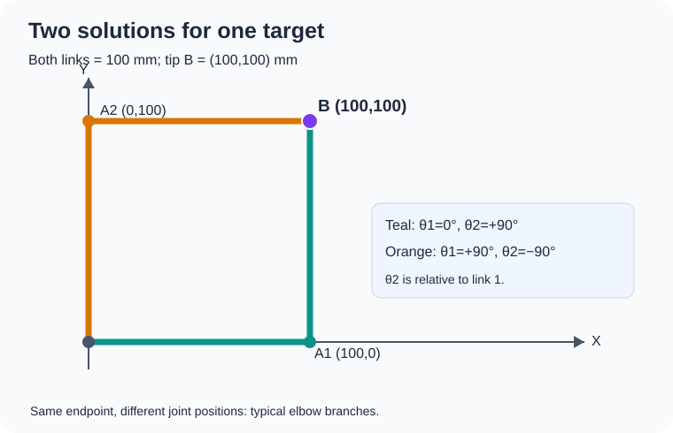

# 4. Układy współrzędnych robota i kinematyka płaska

**Języki:** [en](../../en/notes/04-coordinate-frames.md) · [fr](../../fr/notes/04-coordinate-frames.md) · [de](../../de/notes/04-coordinate-frames.md) · [it](../../it/notes/04-coordinate-frames.md) · [es](../../es/notes/04-coordinate-frames.md) · [pt](../../pt/notes/04-coordinate-frames.md) · [zh](../../zh/notes/04-coordinate-frames.md) · [ja](../../ja/notes/04-coordinate-frames.md) · [nb](../../nb/notes/04-coordinate-frames.md) · [ru](../../ru/notes/04-coordinate-frames.md) · [ko](../../ko/notes/04-coordinate-frames.md) · [fi](../../fi/notes/04-coordinate-frames.md) · [pl](04-coordinate-frames.md)

**Jednostki tej lekcji (przed przykładami):** `mm` — milimetr (długość; 0.001 m); `°` — stopień kąta płaskiego. [Pełny słownik jednostek](../UNITS.md).

[Spis treści](../README.md) · [Trygonometria](../TRIGONOMETRY.md) · [Symbole matematyczne](../SYMBOLS.md) · [Sterowanie ze sprzężeniem zwrotnym](03-feedback-control.md)

> **Model edukacyjny:** nie wykorzystuj tej uproszczonej geometrii do sterowania rzeczywistymi maszynami.

## Spis treści
1. [Dlaczego układy współrzędnych są ważne](#section-1)
2. [Obrót i przesunięcie punktu](#section-2)
3. [Łączenie transformacji układów](#section-3)
4. [Kinematyka prosta ramienia z dwoma członami](#section-4)
5. [Dwa położenia łokcia i przestrzeń osiągalna](#section-5)
6. [Sześć przykładów z pełnymi rozwiązaniami](#section-6)
7. [Ograniczenia i zapis macierzowy](#section-7)

## 1. Dlaczego układy współrzędnych są ważne

**Układ współrzędnych (coordinate frame)** składa się z początku i skierowanych osi. **Układ świata** W może być nieruchomy względem podstawy robota, a **układ narzędzia** T przemieszcza się wraz z narzędziem. Współrzędne tego samego punktu zależą od wybranego układu. **Położenie** opisuje punkt, a **orientacja** — kierunki osi. Samo przeliczenie współrzędnych nie powoduje ruchu robota.

Wszystkie długości podajemy w tych samych jednostkach (tu mm). Kąty dodatnie mierzymy przeciwnie do ruchu wskazówek zegara od osi +X układu świata. Indeksy `w` i `l` oznaczają world (świat) i local (lokalny). Przyjmujemy sztywny model dwuwymiarowy.

## 2. Obrót i przesunięcie punktu

*Układ świata i układ narzędzia po obrocie +90°, punkty P i Q.*

Na rysunku początek układu narzędzia T ma współrzędne (100 mm, 50 mm) w świecie, a osie lokalne są obrócone o +90°. Dodatnia lokalna oś x wskazuje światową +Y, a lokalna y — światową −X. Wobec tego punkt P=(0 mm, 10 mm) w T ma w świecie współrzędne (90 mm, 50 mm), a Q=(20 mm, 0 mm) w T odpowiada (100 mm, 70 mm).

Niech $(t_x,t_y)$ oznacza początek układu lokalnego w świecie, $\theta$ jego orientację, a $(x_l,y_l)$ współrzędne punktu lokalnego. **Najpierw obróć punkt, następnie dodaj przesunięcie:**

$$
x_w=t_x+x_l\cos\theta-y_l\sin\theta
$$

$$
y_w=t_y+x_l\sin\theta+y_l\cos\theta
$$

Znaki $\sin\theta$ i $\cos\theta$ zależą od zwrotu kąta. Przy $\theta=0^\circ$ równania dodają po prostu przesunięcie początku. Przeliczają współrzędne punktu, nie polecenia silnikowe.

## 3. Łączenie transformacji układów

Łańcuch transformacji może wyglądać jak **W → T → S** (świat → narzędzie → czujnik). Pozostawmy T jak wyżej. Układ S ma początek (20 mm, 0 mm) w T oraz osie równoległe do osi T. Początek S w świecie wynosi (100 mm, 70 mm). Punkt (0 mm, 10 mm) w S ma współrzędne (90 mm, 70 mm) w W. Przekształcamy kolejno z układu podrzędnego do nadrzędnego.

Dla wektorów kolumnowych $T_{WS}=T_{WT}T_{TS}$, przy czym $T_{AB}$ przekształca współrzędne **z układu B do A**. Mnożenie macierzy na ogół nie jest przemienne.

**Pełne obliczenie macierzowe (wektory kolumnowe):** Układ T jest obrócony o +90° i przesunięty w świecie o (100 mm, 50 mm). Czujnik S nie ma dodatkowego obrotu, a jego początek jest w punkcie (20 mm, 0 mm) w T — tym samym co Q na poprzednim rysunku. Wyrazy macierzy obrotu są bezwymiarowe, a składniki translacji wyrażone w mm:

$$
T_{WT}=
\begin{bmatrix}
0 & -1 & 100\\
1 & 0 & 50\\
0 & 0 & 1
\end{bmatrix}
$$

$$
T_{TS}=
\begin{bmatrix}
1 & 0 & 20\\
0 & 1 & 0\\
0 & 0 & 1
\end{bmatrix}
$$

$$
T_{WS}=T_{WT}T_{TS}=
\begin{bmatrix}
0 & -1 & 100\\
1 & 0 & 70\\
0 & 0 & 1
\end{bmatrix}
$$

$$
T_{WS}\begin{bmatrix}0\\10\\1\end{bmatrix}
=\begin{bmatrix}90\\70\\1\end{bmatrix}
$$

Iloczyn macierzy najpierw obraca przesunięcie czujnika do osi świata: lokalne (20 mm, 0 mm) staje się (0 mm, 20 mm), po czym dodajemy (100 mm, 50 mm). Punkt (0 mm, 10 mm) w S daje więc (90 mm, 70 mm) w świecie. Dodanie 20 mm bezpośrednio do X świata byłoby błędem, bo przesunięcie zostało podane **w układzie T**. Ostatnia współrzędna 1 oznacza bezwymiarową konwencję współrzędnych jednorodnych, nie długość. Jest to matematyka współrzędnych; [ROS 2 tf2](06-ros2-foundations.md#section-7) rozpowszechnia i udostępnia transformaty ze znacznikami czasu, ale sam nie rozwiązuje kinematyki odwrotnej.

## 4. Kinematyka prosta ramienia z dwoma członami

*Pierwszy przegub 30°, drugi względny 60°, drugi człon pionowo.*

Ramię płaskie ma długości członów $L_1,L_2$. Kąt pierwszego przegubu $\theta_1$ mierzymy od światowej +X, a $\theta_2$ — **względem pierwszego członu**. Drugi człon ma więc bezwzględny kąt w świecie $\theta_1+\theta_2$. Położenie końcówki jest sumą wektorów:

$$
X=L_1\cos\theta_1+L_2\cos(\theta_1+\theta_2)
$$

$$
Y=L_1\sin\theta_1+L_2\sin(\theta_1+\theta_2)
$$

Dla L1=100 mm, L2=50 mm, $\theta_1=30^\circ$ i $\theta_2=60^\circ$ łokieć ma współrzędne (86.60 mm, 50 mm), a drugi człon jest pionowy (kąt bezwzględny 90°). Końcówka leży w (86.60 mm, 100 mm).

## 5. Dwa rozwiązania łokcia i przestrzeń osiągalna

*Dwie konfiguracje łokcia osiągające ten sam punkt docelowy.*

**Kinematyka odwrotna (inverse kinematics)** szuka kątów dla zadanego położenia. Dla członów o długości 100 mm zarówno $(\theta_1,\theta_2)=(0^\circ,+90^\circ)$, jak i $(+90^\circ,-90^\circ)$ prowadzą do punktu (100 mm, 100 mm). Są to kąty przegubów; $\theta_2$ pozostaje względny.

*Idealna przestrzeń osiągalna: pierścień o promieniach 50–150 mm.*

Dla swobodnie obracających się przegubów 2D bez kolizji odległość promieniowa $r$ spełnia $|L_1-L_2|\le r\le L_1+L_2$. Przy długościach 100 mm i 50 mm jest to pierścień od 50 mm do 150 mm. Ograniczenia kątów i przeszkody mogą dodatkowo zmniejszyć przestrzeń osiągalną.

## 6. Przykłady z pełnymi rozwiązaniami

Poniższe **sześć niezależnych przykładów** zawiera rozwiązania i wyjaśnienia. Nie są to osobiste pytania do czytelnika.

### 6.1. Punkt P w obróconym układzie lokalnym

**Zadanie:** T ma początek w (100 mm, 50 mm) świata i obrót +90°. Wyznacz współrzędne światowe lokalnego P=(0 mm, 10 mm).

**Rozwiązanie:** lokalna oś +y wskazuje światową −X; odejmujemy 10 mm tylko od współrzędnej X.

$$
x_w=100+0\cdot0-10\cdot1=90\ \mathrm{mm}
$$

$$
y_w=50+0\cdot1+10\cdot0=50\ \mathrm{mm}
$$

**Odpowiedź:** (90 mm, 50 mm).

### 6.2. Punkt Q na osi x narzędzia

**Zadanie:** W tym samym układzie narzędzia wyznacz współrzędne światowe Q=(20 mm, 0 mm).

**Rozwiązanie:** lokalna oś +x wskazuje światową +Y, zatem dodajemy 20 mm wyłącznie do Y.

$$
x_w=100+20\cdot0-0\cdot1=100\ \mathrm{mm}
$$

$$
y_w=50+20\cdot1+0\cdot0=70\ \mathrm{mm}
$$

**Odpowiedź:** (100 mm, 70 mm).

### 6.3. Kinematyka prosta ramienia z dwoma członami

**Zadanie:** L1=100 mm, L2=50 mm, θ1=30° i względny θ2=60°. Oblicz położenie końcówki.

**Rozwiązanie:** kąt drugiego członu w świecie to 30°+60°=90°, a nie 60°.

$$
X=100\cos30^\circ+50\cos90^\circ=50\sqrt3\approx86.60\ \mathrm{mm}
$$

$$
Y=100\sin30^\circ+50\sin90^\circ=100\ \mathrm{mm}
$$

**Odpowiedź:** (86.60 mm, 100 mm).

### 6.4. Dwie konfiguracje dla jednego punktu

**Zadanie:** Dwa człony po 100 mm sięgają do (100 mm, 100 mm). Znajdź dwie pary kątów.

**Rozwiązanie:** w pierwszej konfiguracji ramię idzie w prawo, potem w górę; w drugiej — w górę, potem w prawo.

$$
(\theta_1,\theta_2)=(0^\circ,+90^\circ)\ \Longrightarrow\ (X,Y)=(100, 100)\ \mathrm{mm}
$$

$$
(\theta_1,\theta_2)=(+90^\circ,-90^\circ)\ \Longrightarrow\ (X,Y)=(100, 100)\ \mathrm{mm}
$$

### 6.5. Osiągalność bez rozwiązywania kątów

**Zadanie:** L1=100 mm, L2=50 mm. Czy punkty (0 mm, 120 mm) i (0 mm, 0 mm) są osiągalne?

**Rozwiązanie:** porównaj odległość do różnicy i sumy długości członów.

$$
r_{\min}=|100-50|=50\ \mathrm{mm},\qquad r_{\max}=100+50=150\ \mathrm{mm}
$$

$$
r_{(0, 120)}=\sqrt{0^2+120^2}=120\ \mathrm{mm}
$$

Punkt (0 mm, 120 mm) jest **osiągalny**, ponieważ 50 ≤ 120 ≤ 150. Punkt (0 mm, 0 mm) jest **nieosiągalny**, ponieważ jego promień wynosi zero.

### 6.6. Prawo cosinusów dla kąta łokcia

**Zadanie:** L1=100 mm, L2=50 mm, r=120 mm. Oblicz cos θ2.

**Rozwiązanie:** cosinus wyznacza moduł zgięcia, ale dwa lustrzane położenia łokcia dają przeciwne znaki kąta względnego.

$$
\cos\theta_2=\frac{r^2-L_1^2-L_2^2}{2L_1L_2}
=\frac{14400-10000-2500}{10000}=\frac{1900}{10000}=0.19
$$

$$
\theta_2\approx\pm79.05^\circ
$$

Wewnętrzny kąt trójkąta to $\varphi=180^\circ-|\theta_2|$. Sam promień nie określa kąta $\theta_1$. Porównaj rysunek w [trygonometrii](../TRIGONOMETRY.md).

## 7. Ograniczenia modelu i zapis macierzowy

Idealny płaski model sztywnego ramienia pomija ograniczenia przegubów, kolizje, luz, podatność, przesunięcia zer enkoderów, kalibrację kamer i ruch 3D. Enkodery mierzą kąty przegubów, a nie bezpośrednie współrzędne w świecie. Obserwacje czujników muszą być przeliczane przez skalibrowane układy. Żadne obliczenie nie jest poleceniem ruchu maszyny.

**Opcjonalny zapis macierzą jednorodną:** dla wektorów kolumnowych macierz 3×3 przekształca lokalny punkt $[x_l,y_l,1]^T$ do świata. Wektor przemieszczenia ma trzecią współrzędną 0, dlatego translacja go nie zmienia.

$$
T_{WL}=
\begin{bmatrix}
\cos\theta & -\sin\theta & t_x \\
\sin\theta & \cos\theta & t_y \\
0 & 0 & 1
\end{bmatrix},
\qquad
\begin{bmatrix}x_w\\y_w\\1\end{bmatrix}
=T_{WL}\begin{bmatrix}x_l\\y_l\\1\end{bmatrix}
$$

[Trygonometria](../TRIGONOMETRY.md) · [Symbole](../SYMBOLS.md) · [Sterowanie PID](03-feedback-control.md)

[Następny temat: obrót, prędkość i osobliwości](05-velocity-jacobian.md)
