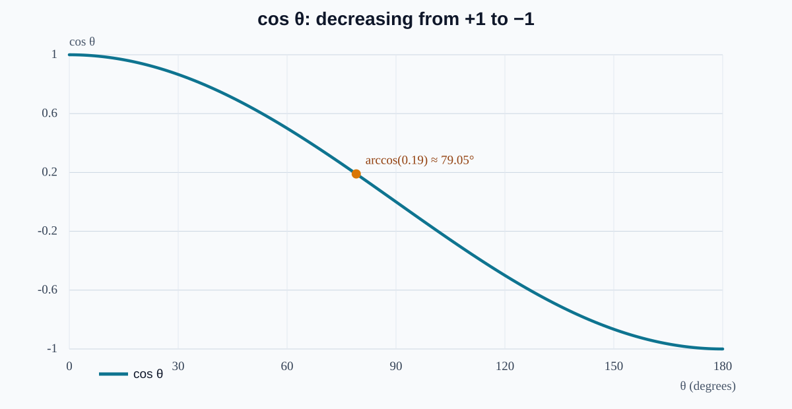

# Trigonometria: ângulos, seno, cosseno, tangente e arcotangente

**Idiomas:** [en](../en/TRIGONOMETRY.md) · [fr](../fr/TRIGONOMETRY.md) · [de](../de/TRIGONOMETRY.md) · [it](../it/TRIGONOMETRY.md) · [es](../es/TRIGONOMETRY.md) · [pt](TRIGONOMETRY.md) · [zh](../zh/TRIGONOMETRY.md) · [ja](../ja/TRIGONOMETRY.md) · [nb](../nb/TRIGONOMETRY.md) · [ru](../ru/TRIGONOMETRY.md) · [ko](../ko/TRIGONOMETRY.md) · [fi](../fi/TRIGONOMETRY.md) · [pl](../pl/TRIGONOMETRY.md)

**Unidades aqui utilizadas (explicadas antes dos exemplos):** `°` — grau; `rad` — radiano; `kg` — quilograma; `m` — metro; `m/s²` — metro / segundo² — aceleração; `N·m` — newton · metro — binário (torque); `mm` — milímetro = 0.001 m; `N` — newton. [Glossário de unidades](UNITS.md).

[README](README.md) · [Calculus](notes/00-calculus-foundations.md) · [Integral table](INTEGRAL_TABLE.md)

## Círculo unitário: seno e cosseno

Um ponto do círculo unitário de ângulo θ tem coordenadas **(cos θ, sin θ)**. Os ângulos partem de +X no sentido anti-horário. Cosseno (cosine) é horizontal, seno (sine) é vertical. Um único diagrama apresenta 16 pares exatos, e uma tabela única acrescenta aproximações, tangente e arcotangente principal.

*Um círculo unitário com 16 ângulos e pares exatos (cos θ, sin θ).*

**Frações exatas e aproximações decimais:**

| θ | cos θ (exato) | cos θ (decimal) | sin θ (exato) | sin θ (decimal) | tan θ (exato) | tan θ (decimal) | arctan(tan θ), principal |
| --- | --- | ---: | --- | ---: | --- | ---: | --- |
| 0° | $1$ | 1.0000 | $0$ | 0.0000 | $0$ | 0.0000 | $0^\circ$ |
| 30° | $\frac{\sqrt3}{2}$ | 0.8660 | $\frac12$ | 0.5000 | $\frac{\sqrt3}{3}$ | 0.5774 | $30^\circ$ |
| 45° | $\frac{\sqrt2}{2}$ | 0.7071 | $\frac{\sqrt2}{2}$ | 0.7071 | $1$ | 1.0000 | $45^\circ$ |
| 60° | $\frac12$ | 0.5000 | $\frac{\sqrt3}{2}$ | 0.8660 | $\sqrt3$ | 1.7321 | $60^\circ$ |
| 90° | $0$ | 0.0000 | $1$ | 1.0000 | **indefinido** | — | — |
| 120° | $-\frac12$ | -0.5000 | $\frac{\sqrt3}{2}$ | 0.8660 | $-\sqrt3$ | -1.7321 | $-60^\circ$ |
| 135° | $-\frac{\sqrt2}{2}$ | -0.7071 | $\frac{\sqrt2}{2}$ | 0.7071 | $-1$ | -1.0000 | $-45^\circ$ |
| 150° | $-\frac{\sqrt3}{2}$ | -0.8660 | $\frac12$ | 0.5000 | $-\frac{\sqrt3}{3}$ | -0.5774 | $-30^\circ$ |
| 180° | $-1$ | -1.0000 | $0$ | 0.0000 | $0$ | 0.0000 | $0^\circ$ |
| 210° | $-\frac{\sqrt3}{2}$ | -0.8660 | $-\frac12$ | -0.5000 | $\frac{\sqrt3}{3}$ | 0.5774 | $30^\circ$ |
| 225° | $-\frac{\sqrt2}{2}$ | -0.7071 | $-\frac{\sqrt2}{2}$ | -0.7071 | $1$ | 1.0000 | $45^\circ$ |
| 240° | $-\frac12$ | -0.5000 | $-\frac{\sqrt3}{2}$ | -0.8660 | $\sqrt3$ | 1.7321 | $60^\circ$ |
| 270° | $0$ | 0.0000 | $-1$ | -1.0000 | **indefinido** | — | — |
| 300° | $\frac12$ | 0.5000 | $-\frac{\sqrt3}{2}$ | -0.8660 | $-\sqrt3$ | -1.7321 | $-60^\circ$ |
| 315° | $\frac{\sqrt2}{2}$ | 0.7071 | $-\frac{\sqrt2}{2}$ | -0.7071 | $-1$ | -1.0000 | $-45^\circ$ |
| 330° | $\frac{\sqrt3}{2}$ | 0.8660 | $-\frac12$ | -0.5000 | $-\frac{\sqrt3}{3}$ | -0.5774 | $-30^\circ$ |

A tangente é **indefinida** a 90° e 270°, porque cos θ = 0; arctan(tan θ) também. A última coluna indica o **valor principal** entre −90° e 90°, nem sempre igual ao ângulo original: arctan(tan 135°) = −45° e arctan(tan 225°) = 45°. Decimais arredondados a quatro casas. Em 360° repetem-se os valores de 0°.

### Identidades trigonométricas úteis

Deslocar 90° troca seno e cosseno e, às vezes, inverte o sinal. Os parênteses são essenciais: cos(θ − 90°) significa o cosseno da diferença e não cos θ menos 90.

$$
\cos(90^\circ-\theta)=\sin(\theta),\qquad
\sin(90^\circ-\theta)=\cos(\theta)
$$

$$
\cos(\theta-90^\circ)=\sin(\theta),\qquad
\sin(\theta+90^\circ)=\cos(\theta)
$$

$$
\cos(\theta+90^\circ)=-\sin(\theta),\qquad
\sin(\theta-90^\circ)=-\cos(\theta)
$$

**Ângulos negativos e periodicidade:**

$$
\sin(-\theta)=-\sin(\theta),\qquad
\cos(-\theta)=\cos(\theta)
$$

$$
\tan(-\theta)=-\tan(\theta),\qquad
\tan(\theta)=\frac{\sin(\theta)}{\cos(\theta)}
$$

$$
\sin(\theta+360^\circ)=\sin(\theta),\qquad
\cos(\theta+360^\circ)=\cos(\theta)
$$

$$
\tan(\theta+180^\circ)=\tan(\theta),\qquad
\sin^2(\theta)+\cos^2(\theta)=1
$$

Sinais por quadrante (cos, sin, tan): I (+,+,+), II (−,+,−), III (−,−,+), IV (+,−,−). Ângulos negativos giram no sentido horário.

Em funções inversas, verifica o quadrante e o intervalo do valor principal.

### Arccosseno e estimativa do ângulo

Entre 0° e 180° o cosseno diminui de 1 para −1. Portanto arccos(0.19) é pouco menor que 80°: cos 80°≈0.1736 e arccos(0.19)≈79.05°. Como cos(+θ)=cos(−θ), podem existir duas configurações articulares com sinais opostos. O valor principal de arccos situa-se entre 0° e 180°.

## Esquema: cateto oposto, adjacente e hipotenusa

Na figura, **a** é o cateto oposto ao ângulo θ, **b** o adjacente e **c** a hipotenusa. Para um ângulo agudo, $\sin\theta=a/c$, $\cos\theta=b/c$ e $\tan\theta=a/b$ (com $b\ne0$). Os **comprimentos dos lados são não negativos**; esta figura não mostra por si só o sinal das funções para ângulos negativos ou outros quadrantes. Para um ângulo orientado desde o eixo x positivo, $\sin(+60^\circ)=+\sqrt3/2$, mas $\sin(-60^\circ)=-\sqrt3/2$.

## Mecânica: binário gravitacional numa alavanca

Para uma massa m à distância L do eixo e uma alavanca a θ acima da horizontal, o **módulo** do binário é mgL|cos θ|. O sinal depende da convenção de rotação.

$$
|M_g|=mgL|\cos\theta|.
$$

Com m = 0.5 kg, L = 0.2 m, g = 9.81 m/s² e θ = 60°, o valor é 0.4905 N·m; a 0° é 0.981 N·m e a 90° é zero (carga pontual ideal).

## Exemplo inverso: determinar o ângulo

Um eixo sobe 0.05 m numa corrida horizontal de 0.1 m: razão 0.5. Logo θ = arctan(0.5) ≈ 26.565°. O argumento não são graus.

$$
\tan\theta=\frac{0.05\ \mathrm{m}}{0.1\ \mathrm{m}}=0.5,\qquad \theta=\arctan(0.5)\approx26.565^\circ.
$$

Conversão: θ_rad = θ_deg·π/180. Bibliotecas numéricas costumam exigir radianos.

$$
\theta_{\mathrm{rad}}=\theta_{\mathrm{deg}}\frac{\pi}{180}.
$$

### Direção de um vetor: por que usar `atan2`

Para um vetor da origem até $(x,y)$, a arcotangente comum utiliza apenas a razão $y/x$. Os vetores $(1, -1)$ e $(-1, 1)$ têm a mesma razão, mas apontam para **quadrantes diferentes**. Com $x=-1\ \mathrm{mm}$ e $y=+1\ \mathrm{mm}$, a razão isolada fornece a direção global errada:

$$
\arctan\left(\frac{y}{x}\right)=\arctan(-1)=-45^\circ,\qquad
\operatorname{atan2}(+1, -1)=+135^\circ.
$$

`atan2(y, x)` utiliza os sinais de **ambas as componentes** para determinar a direção de um vetor não nulo. Os dois argumentos devem usar a mesma unidade de comprimento. Para $x=0$, a razão $y/x$ não existe, mas `atan2` ainda fornece a direção do eixo quando $y\ne0$. Em $(0, 0)$ a direção é indefinida; $+180^\circ$ e $-180^\circ$ representam a mesma direção. Esta distinção importa para os [ângulos entre referenciais](notes/04-coordinate-frames.md).

## Lei dos cossenos: geometria de dois elos

A base O, a articulação A e a ferramenta B formam um triângulo: OA = L1, AB = L2 e OB = r, distância direta da base à ferramenta. A figura usa L1 = 100 mm, L2 = 50 mm, r = 120 mm. O ângulo interior φ é diferente do ângulo relativo θ2: φ = 180° − |θ2|. A figura mostra θ2 negativo; a configuração refletida tem θ2 positivo.

A lei dos cossenos é $r^2=L_1^2+L_2^2-2L_1L_2\cos\varphi$. Como $\cos(180^\circ-|\theta_2|)=-\cos\theta_2$, resulta $r^2=L_1^2+L_2^2+2L_1L_2\cos\theta_2$, portanto $\cos\theta_2=\frac{r^2-L_1^2-L_2^2}{2L_1L_2}$. Aqui $(14400-10000-2500)/10000=0.19$ e $|\theta_2|\approx79.05^\circ$. Para alcançar um ponto (X,Y) ainda precisamos de θ1.

[Cálculo](notes/00-calculus-foundations.md) · [Controle por realimentação](notes/03-feedback-control.md)
