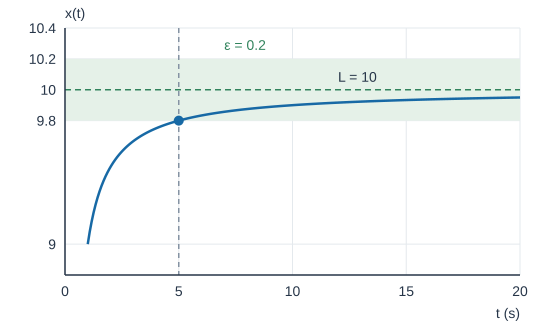
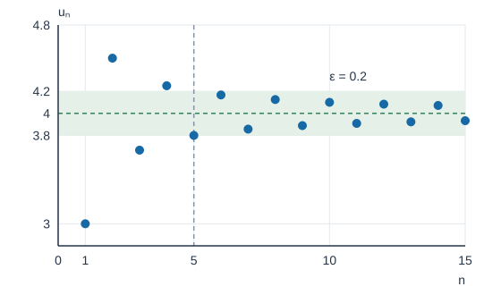
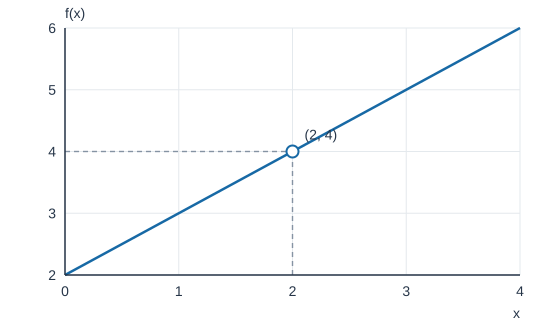
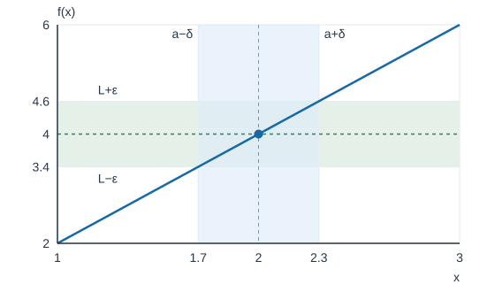
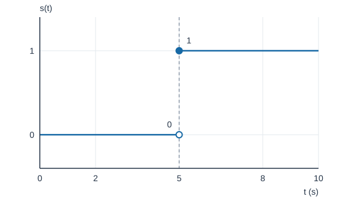
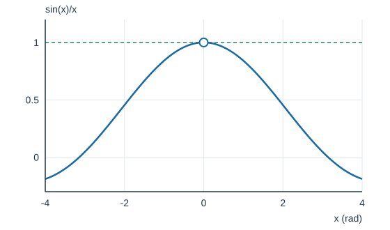
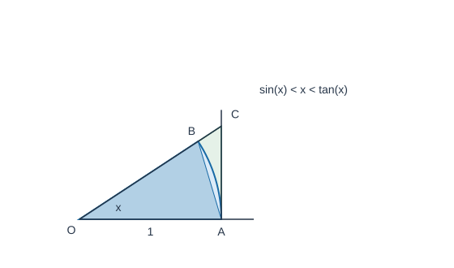
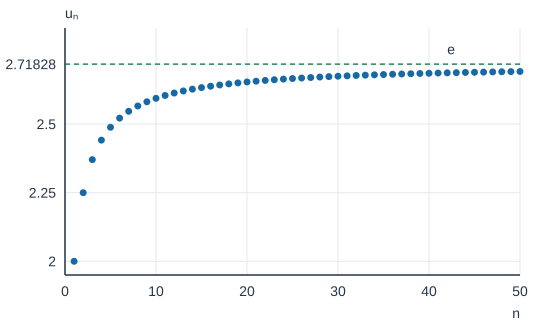
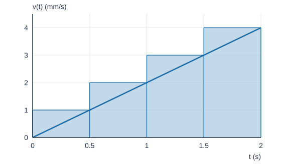

# Пределы и непрерывность функций

[Содержание курса](../README.md) · [Основы анализа](00-calculus-foundations.md) · [Обозначения](../SYMBOLS.md) · [Тригонометрия](../TRIGONOMETRY.md)

Предел (limit) описывает, к чему приближается величина при заданном изменении другой величины. Он позволяет описать установившееся положение, проверить непрерывность модели и определить мгновенную скорость или накопленное перемещение.

> **Учебные модели:** Все примеры идеализированы. Проверяйте расчёты и единицы независимо; не применяйте их для управления реальным оборудованием.

## Содержание

- [1. Приближение к числу](#section-1)
- [2. Предел переменной величины](#section-2)
- [3. Предел функции: аргумент и результат](#section-3)
- [4. Окрестность и определение предела](#section-4)
- [5. Бесконечность и ограниченность](#section-5)
- [6. Бесконечно малые величины](#section-6)
- [7. Односторонние пределы](#section-7)
- [8. Правила вычисления](#section-8)
- [9. Неопределённости](#section-9)
- [10. Замечательные пределы](#section-10)
- [11. Число Эйлера и экспонента](#section-11)
- [12. Непрерывность](#section-12)
- [13. Сравнение бесконечно малых](#section-13)
- [14. Производная и интеграл](#section-14)
- [15. Упражнения с решениями](#section-15)

## 1. Приближение к числу

Представим идеализированную систему, выход которой меняется со временем и постепенно приближается к значению 10. Пусть $t>0$ — числовое значение времени в секундах, а $x(t)$ — безразмерный выход системы:

$$
x(t)=10-\frac{1}{t}.
$$

| $t$ (s) | $x(t)$ | Отклонение от 10 |
| --- | --- | --- |
| 1 | 9 | 1 |
| 2 | 9.5 | 0.5 |
| 5 | 9.8 | 0.2 |
| 10 | 9.9 | 0.1 |
| 100 | 9.99 | 0.01 |

При любом конечном положительном $t$ выход меньше 10. Но чем больше $t$, тем меньше разность. Будем считать ответ установившимся в выбранном диапазоне, если отклонение по модулю меньше допустимой погрешности $\varepsilon>0$ (греческая буква эпсилон). Модуль $|z|$ означает расстояние числа $z$ от нуля.

$$
|x(t)-10|=\left|-\frac{1}{t}\right|=\frac{1}{t}.
$$

Требование $|x(t)-10|<\varepsilon$ превращается в

$$
\frac{1}{t}<\varepsilon
$$

и, поскольку $t$ и $\varepsilon$ положительны,

$$
t>\frac{1}{\varepsilon}.
$$

Например, при $\varepsilon=0.2$ необходимо $t>5$, а при $\varepsilon=0.1$ — $t>10$. Равенство на границе не удовлетворяет строгому неравенству. После указанного момента **все** последующие значения остаются внутри диапазона, а не только первое попавшее туда значение.

*При $\varepsilon=0.2$ выход при $t=5$ находится на нижней границе, а при всех $t>5$ — внутри полосы.*

Можно потребовать любую положительную точность, даже меньшую, чем способен измерить реальный датчик. В математической модели соответствующий момент всегда найдётся. Поэтому пишут:

$$
\lim_{t\to+\infty}x(t)=10.
$$

Символ $\lim$ обозначает предел, стрелка $\to$ — приближение, $\infty$ — бесконечность. Бесконечность не является числом, которое можно подставить вместо времени. Запись говорит о поведении функции при сколь угодно больших положительных значениях $t$.

Это не доказательство устойчивости реального устройства: речь идёт только о заданной функции.

## 2. Предел переменной величины

Измерения часто поступают последовательно. Пусть $n=1, 2, 3,\ldots$ — номер измерения, а $u_n$ — его значение. Такое упорядоченное множество значений называют последовательностью (sequence).

Например:

$$
u_n=4+\frac{(-1)^n}{n}.
$$

Первые значения: $3$, $4.5$, $3.666\ldots$, $4.25$. Знак отклонения чередуется, но его модуль равен $1/n$.

*Точки соответствуют отдельным измерениям. Для $n>5$ отклонение меньше 0.2.*

Число $L$ называют пределом последовательности, если для любого $\varepsilon>0$ существует номер $N$ такой, что при каждом $n\ge N$ выполняется $|u_n-L|<\varepsilon$.

$$
\lim_{n\to\infty}u_n=L.
$$

В нашем примере $L=4$. При $\varepsilon=0.01$ достаточно взять $N=101$: тогда для каждого $n\ge101$ выполняется $1/n\le1/101<0.01$.

Последовательность не обязана всё время возрастать или убывать. Но существовать может только один конечный предел: если предполагаемые пределы различны, можно выбрать две непересекающиеся полосы вокруг них, и поздние члены не смогут одновременно находиться в обеих.

Последовательность $(-1)^n$ предела не имеет: значения $-1$ и $1$ продолжают чередоваться без уменьшения отклонения. А последовательность $n$ не имеет конечного предела: она неограниченно растёт.

Полезный факт: возрастающая последовательность, ограниченная сверху, имеет конечный предел; убывающая и ограниченная снизу — тоже. Этот факт пригодится при введении числа $\mathrm{e}$.

## 3. Предел функции: аргумент и результат

Функция $f(x)$ сопоставляет каждому допустимому аргументу $x$ значение. В отличие от номера измерения, аргумент может принимать любые действительные значения из области определения функции (domain).

В записи

$$
\lim_{x\to a}f(x)=L
$$

число $a$ — точка, около которой исследуют аргумент, а $L$ — результат исследования. Их не следует путать. Мы выбираем функцию и способ приближения аргумента, но не назначаем предел по желанию.

| Условие | Что исследуется |
| --- | --- |
| $t\to+\infty$ | Поведение системы в течение длительного времени |
| $t\to5$ | Поведение около момента 5 s |
| $\Delta t\to0$ | Поведение при уменьшении интервала времени $\Delta t$ |

Для функции из раздела 1 предел при $t\to5$ равен $10-1/5=9.8$, а при $t\to+\infty$ — 10. Это два разных вопроса об одной функции.

### Значение в точке и предел

Рассмотрим новую, безразмерную функцию:

$$
f(x)=\frac{x^2-4}{x-2}.
$$

При $x=2$ числитель и знаменатель равны нулю. Деление на ноль не определено. Но для любого $x\ne2$ числитель можно разложить как разность квадратов:

$$
x^2-4=x^2-2^2=(x-2)(x+2).
$$

Подставим разложение:

$$
f(x)=\frac{(x-2)(x+2)}{x-2}.
$$

Пока $x\ne2$, множитель $x-2$ ненулевой и его можно сократить:

$$
f(x)=x+2,\qquad x\ne2.
$$

| $x$ | $f(x)$ |
| --- | --- |
| 1.9 | 3.9 |
| 1.99 | 3.99 |
| 2 | Не определено |
| 2.01 | 4.01 |
| 2.1 | 4.1 |

*Незаполненный кружок означает, что исходная функция в этой точке не имеет значения.*

При приближении с обеих сторон значения стремятся к 4:

$$
\lim_{x\to2}\frac{x^2-4}{x-2}=\lim_{x\to2}(x+2)=4.
$$

Мы не вычисляли $0/0$. Мы вычислили поведение функции в соседних точках. Если отдельно назначить $f(2)=7$, предел останется 4; изменится только значение в самой точке.

## 4. Окрестность и определение предела

Окрестность (neighborhood) числа $a$ радиуса $\delta>0$ (греческая буква дельта) — интервал от $a-\delta$ до $a+\delta$ без границ. Условие принадлежности этому интервалу записывается $|x-a|<\delta$.

Если исключить и сам центр, получим проколотую окрестность: $0<|x-a|<\delta$.

Для предела функции важны две окрестности: горизонтальная вокруг аргумента $a$ и вертикальная вокруг результата $L$. Вторая задаётся погрешностью $\varepsilon$, которую выбирают произвольно. Первая должна быть достаточно узкой, чтобы все допустимые аргументы в ней давали результаты внутри второй.

$$
\lim_{x\to a}f(x)=L
$$

означает: для каждого $\varepsilon>0$ найдётся число $\delta>0$ такое, что для всех $x$ из области определения при $0<|x-a|<\delta$ выполняется

$$
|f(x)-L|<\varepsilon.
$$

Предполагается, что в сколь угодно малой окрестности $a$ есть допустимые аргументы, отличные от $a$; для обычного двустороннего подхода — с обеих сторон.

*Для $f(x)=2x$ при $\varepsilon=0.6$ достаточно $\delta=0.3$. Внутри вертикальной полосы график находится строго внутри горизонтальной.*

Проверим это для любого $\varepsilon$, а не только для одного рисунка. При $a=2$, $L=4$:

$$
|f(x)-4|=|2x-4|=2|x-2|.
$$

Выберем $\delta=\varepsilon/2$. Тогда при $0<|x-2|<\delta$:

$$
2|x-2|<2\delta=\varepsilon.
$$

Это доказательство предела. Численные примеры и график помогают предположить его значение, а определение позволяет проверить, что оно действительно является пределом.

Для модели раздела 1 аналогичную роль играет порог времени $T=1/\varepsilon$: после него выполняется условие для всех $t>T$.

## 5. Бесконечность и ограниченность

У пределов нужно отдельно различать поведение аргумента и результата.

- $x\to+\infty$ или $x\to-\infty$: аргумент становится больше любого положительного порога или меньше любого отрицательного порога. Монотонность при этом не обязательна.
- $f(x)\to+\infty$ или $f(x)\to-\infty$: выход становится соответственно больше любого положительного порога или меньше любого отрицательного порога.
- $|f(x)|\to\infty$: модуль выхода неограниченно растёт, но знак не обязательно постоянен.

Например, при $x\to+\infty$ функция $1/x$ стремится к нулю, а функция $x^2$ — к $+\infty$. При $x\to0$ функция $1/x^2$ тоже стремится к $+\infty$. Для любого порога $M>0$ достаточно взять $0<|x|<1/\sqrt{M}$, тогда $1/x^2>M$. Такой результат называют бесконечным пределом; конечного числового предела здесь нет.

Функция ограничена (bounded) в некоторой области, если существует конечное число $B>0$, для которого $|f(x)|\le B$ во всей этой области. Например, $|\sin(x)|\le1$. Ограниченность сама по себе не гарантирует предела: $\sin(x)$ при $x\to+\infty$ продолжает колебаться между $-1$ и $1$.

Если конечный предел $L$ существует, функция ограничена достаточно близко к точке или достаточно далеко по направлению к бесконечности: достаточно выбрать $\varepsilon=1$, тогда $|f(x)|<|L|+1$.

## 6. Бесконечно малые величины

Бесконечно малая величина (infinitesimal) — переменная величина или функция, предел которой равен нулю при указанном изменении аргумента.

Например, $1/t$ при $t\to+\infty$ и $x-2$ при $x\to2$. Это не одно и то же, что небольшая постоянная: число 0.001 само по себе не стремится к нулю.

Если $\alpha(x)=f(x)-L$, то утверждения

$$
f(x)=L+\alpha(x),\qquad \lim_{x\to a}\alpha(x)=0
$$

и $\lim_{x\to a}f(x)=L$ равносильны. Здесь $\alpha$ (альфа) обозначает отклонение. Поэтому анализ конечного предела часто сводится к анализу ошибки, стремящейся к нулю.

Сумма конечного числа бесконечно малых величин и произведение бесконечно малой на ограниченную величину тоже бесконечно малы. В частности, произведение двух бесконечно малых стремится к нулю. Обратная величина $1/\alpha(x)$ при $\alpha(x)\to0$ и $\alpha(x)\ne0$ неограниченно растёт по модулю; знак нужно исследовать отдельно.

## 7. Односторонние пределы

При приближении к моменту переключения результат до события и после него может отличаться. Пусть идеализированный сигнал $s(t)$ равен 0 при $t<5$ и 1 при $t\ge5$.

Запись $t\to5^-$ означает приближение слева (left-hand limit), то есть со значениями $t<5$. Запись $t\to5^+$ означает приближение справа (right-hand limit), со значениями $t>5$.

$$
\lim_{t\to5^-}s(t)=0,\qquad \lim_{t\to5^+}s(t)=1.
$$

*В момент 5 s по определению сигнала значение равно 1. Левый и правый пределы не совпадают.*

При наличии допустимых аргументов с обеих сторон конечный двусторонний предел существует тогда и только тогда, когда оба односторонних предела существуют и равны. Значение функции в самой точке для этого не требуется.

Для $\sqrt{x}$ при $x=0$ в действительных числах доступен только подход справа: $\lim_{x\to0^+}\sqrt{x}=0$.

Ещё один пример: $1/x$ при $x\to0^+$ стремится к $+\infty$, а при $x\to0^-$ — к $-\infty$. Общего знакового бесконечного предела нет, хотя $|1/x|$ стремится к бесконечности.

## 8. Правила вычисления

Пусть при одном и том же приближении аргумента пределы функций $f$ и $g$ существуют и конечны, равны соответственно $A$ и $B$, а $c$ — постоянное число.

| Операция | Результат | Условие |
| --- | --- | --- |
| Постоянная | $\lim c=c$ | — |
| Сумма / разность | $\lim(f\pm g)=A\pm B$ | Оба предела конечны |
| Умножение на число | $\lim(cf)=cA$ | $A$ конечен |
| Произведение | $\lim(fg)=AB$ | Оба предела конечны |
| Частное | $\lim\frac{f}{g}=\frac{A}{B}$ | $B\ne0$ |
| Натуральная степень $n$ | $\lim f^n=A^n$ | $n=1, 2,\ldots$ |
| Квадратный корень | $\lim\sqrt{f}=\sqrt{A}$ | $f\ge0$ в рассматриваемой области |

Эти правила позволяют по частям вычислять пределы сложных выражений. Например:

$$
\lim_{x\to3}(2x^2-4x+1)
=2\cdot3^2-4\cdot3+1
=18-12+1=7.
$$

Если $f(x)\le g(x)$ в рассматриваемой области и оба предела конечны, то $A\le B$. Строгое неравенство между функциями может перейти в равенство между пределами.

**Теорема о зажатой функции (squeeze theorem).** Если $p(x)\le f(x)\le q(x)$ достаточно близко к точке и $\lim p=\lim q=L$, то $\lim f=L$. Например, при $x\ne0$:

$$
-x^2\le x^2\sin(1/x)\le x^2.
$$

Обе границы стремятся к нулю при $x\to0$. Поэтому средняя функция тоже стремится к нулю, хотя синус бесконечно часто меняет знак.

## 9. Неопределённости: как вычислять, когда подстановка не помогает

Выражения $0/0$, $\infty/\infty$, $0\cdot\infty$, $\infty-\infty$ и $1^\infty$ называют неопределёнными формами (indeterminate forms). Они описывают поведение отдельных частей выражения, но не задают результат. Например, при $x\to0$ отношения $x/x$, $x^2/x$ и $x/x^3$ имеют одну форму $0/0$, но их пределы равны соответственно 1, 0 и $+\infty$.

### Сокращение ненулевого множителя: форма 0/0

В разделе 3 мы разложили числитель на множители. Сокращать можно только при ненулевом знаменателе. После упрощения исследуется новая запись той же функции вне исключённой точки.

### Умножение на сопряжённое выражение: форма 0/0

Найдём предел при $x\to0$:

$$
\lim_{x\to0}\frac{\sqrt{1+x}-1}{x}.
$$

В небольшой окрестности нуля $1+x>0$. Умножим числитель и знаменатель на ненулевое сопряжённое выражение $\sqrt{1+x}+1$:

$$
\frac{\sqrt{1+x}-1}{x}=
\frac{(\sqrt{1+x}-1)(\sqrt{1+x}+1)}
{x(\sqrt{1+x}+1)}.
$$

В числителе получим $(1+x)-1=x$. При $x\ne0$ сокращаем его:

$$
\frac{x}{x(\sqrt{1+x}+1)}
=\frac{1}{\sqrt{1+x}+1}.
$$

Теперь знаменатель стремится к 2, откуда предел равен $1/2$.

### Деление на старшую степень: форма бесконечность/бесконечность

$$
\lim_{x\to+\infty}\frac{3x^2+2x}{2x^2-1}.
$$

Разделим числитель и знаменатель на $x^2$:

$$
\frac{3x^2+2x}{2x^2-1}
=\frac{3+2/x}{2-1/x^2}.
$$

Поскольку $2/x\to0$ и $1/x^2\to0$, предел равен $3/2$. При одинаковых старших степенях многочленов результат равен отношению их старших коэффициентов. При меньшей степени числителя предел равен 0; при большей степени отношение неограниченно растёт по модулю, а знак зависит от направления и коэффициентов.

### Общий знаменатель: форма бесконечность минус бесконечность

При $x\to0^+$ обе дроби $1/x$ и $1/(x+x^2)$ стремятся к $+\infty$. Однако их разность:

$$
\frac{1}{x}-\frac{1}{x+x^2}
=\frac{x+x^2-x}{x(x+x^2)}
=\frac{x^2}{x^2(1+x)}
=\frac{1}{1+x}
$$

при $x>0$ стремится к 1.

### Преобразование произведения: форма 0 умножить на бесконечность

При $x\to0^+$:

$$
x^2\cdot\frac{1}{x}=x\to0.
$$

Но $x\cdot(1/x)=1$, а $x\cdot(1/x^2)=1/x\to+\infty$. Сначала преобразуем выражение, затем находим предел. Для $1^\infty$ рассмотрим отдельный базовый пример в разделе 11.

## 10. Первый замечательный предел

Для угла $x$, измеренного в радианах:

$$
\lim_{x\to0}\frac{\sin(x)}{x}=1.
$$

*При уменьшении модуля угла отношение стремится к 1. В нуле исходная дробь не определена.*

Почему именно 1? На единичной окружности при $0<x<\pi/2$ площади вписанного треугольника, кругового сектора и внешнего треугольника дают неравенство $\sin(x)<x<\tan(x)$. Здесь $\pi$ — отношение длины окружности к её диаметру, $\tan(x)=\sin(x)/\cos(x)$.

*Радиус равен 1, угол x задан в радианах, площади треугольников и сектора соответственно равны половинам sin(x), x и tan(x).*

Разделим неравенство на положительный $\sin(x)$ и обратим полученные отношения. Получим

$$
\cos(x)<\frac{\sin(x)}{x}<1.
$$

Для отрицательных $x$ отношение не меняется при смене знака аргумента. Из геометрии единичной окружности следует $\cos(x)\to1$ при $x\to0$. По теореме о зажатой функции искомый предел равен 1.

Следствие для небольшой угловой поправки $\theta$, где $\theta$ — угол в радианах: $\sin(\theta)\approx\theta$. Например, при $\theta=0.1$ rad имеем $\sin(0.1)\approx0.09983$; абсолютная ошибка такого приближения около 0.00017. Это полезно в локальных моделях вращения; точность зависит от размера угла.

Пример вычисления:

$$
\lim_{x\to0}\frac{\sin(3x)}{x}
=3\lim_{x\to0}\frac{\sin(3x)}{3x}
=3.
$$

## 11. Число Эйлера и экспонента

Представим безразмерную величину, которая начинается с 1 и за единичный интервал увеличивается пропорционально своему текущему значению. Разделим интервал на $n$ равных частей. В простой дискретной модели на каждом шаге умножаем величину на $1+1/n$.

После двух шагов при $n=2$ получим $(1+1/2)^2=2.25$. После $n$ шагов:

$$
u_n=\left(1+\frac{1}{n}\right)^n.
$$

| $n$ | $u_n$ (приблизительно) |
| --- | --- |
| 1 | 2 |
| 2 | 2.25 |
| 10 | 2.59374 |
| 100 | 2.70481 |
| 1000 | 2.71692 |

*При увеличении числа шагов значения приближаются к горизонтальной линии e.*

Можно доказать, что эта последовательность возрастает и ограничена сверху числом 3. По свойству ограниченных монотонных последовательностей её предел существует. Полное доказательство здесь не требуется. Этот предел определяет число Эйлера:

$$
\mathrm{e}=\lim_{n\to\infty}\left(1+\frac{1}{n}\right)^n
\approx2.71828.
$$

Второй замечательный предел в форме функции:

$$
\lim_{h\to0}(1+h)^{1/h}=\mathrm{e}.
$$

Вблизи нуля основание $1+h$ положительно, а $h\ne0$. Последовательность выше соответствует частному случаю $h=1/n$; общий двусторонний предел — отдельная теорема, которую здесь используем без доказательства. Форму $1^\infty$ нельзя вычислить заменой основания на 1: одновременно меняются основание и показатель.

**Экспонента (exponential function):** $\exp(z)=\mathrm{e}^{z}$, где $z$ — безразмерный аргумент. Натуральный логарифм (natural logarithm) $\ln$ — её обратная функция, то есть $\ln(\exp(z))=z$ и $\exp(\ln(y))=y$ при $y>0$.

В идеализированной системе первого порядка отклонение от установившегося значения может иметь вид

$$
q(t)=q_0\exp(-t/\tau).
$$

Здесь $q_0$ — начальное отклонение, $t\ge0$ — время, $\tau>0$ — постоянная времени (time constant). Отношение $t/\tau$ безразмерно. При $t=\tau$ остаётся доля $\exp(-1)\approx0.3679$ начального отклонения, а при $t\to+\infty$ предел $q(t)$ равен нулю.

В отличие от функции $10-1/t$ из первого раздела, здесь отклонение убывает экспоненциально. Вывод модели и расчёт времени отклика — в [динамике первого порядка](02-first-order-dynamics.md).

## 12. Непрерывность функций

Непрерывность (continuity) означает, что при достаточно малом изменении входа изменение выхода можно сделать сколь угодно малым.

Функция непрерывна в точке $a$ (в её области определения), если выполнены три условия:

1. Значение $f(a)$ определено.
2. Существует конечный предел $\lim_{x\to a}f(x)$ по области определения.
3. Этот предел равен $f(a)$.

$$
\lim_{x\to a}f(x)=f(a).
$$

Многочлены непрерывны во всех действительных точках; рациональные функции — там, где знаменатель не равен нулю; синус, косинус и экспонента — при любом действительном аргументе; логарифм — при положительном аргументе.

Для непрерывной функции можно вычислить предел простой подстановкой. Для сложной функции $g(f(x))$ при $f(x)\to L$ это также допустимо, если $g$ непрерывна в $L$ и выражение определено в рассматриваемой области.

**Устранимый разрыв (removable discontinuity).** В примере раздела 3 определим недостающее значение $f(2)=4$. Тогда функция станет непрерывной в 2. Если вместо 4 назначить 7, разрыв сохранится.

**Скачок (jump discontinuity).** У сигнала из раздела 7 левый и правый пределы различаются. Никакое изменение единственного значения $s(5)$ не делает сигнал непрерывным.

**Бесконечный разрыв.** Например, $1/x^2$ около нуля неограниченно растёт; конечным значением в нуле разрыв устранить нельзя.

На замкнутом конечном интервале непрерывная функция ограничена, достигает максимума и минимума и принимает все промежуточные значения между ними. Например, если непрерывная модель ошибки меняет знак между двумя моментами, то хотя бы в одном промежуточном моменте ошибка равна нулю. Это не означает, что ноль достигается в единственной точке.

## 13. Сравнение бесконечно малых

Иногда важно не только то, что два отклонения стремятся к нулю, но и то, какое убывает быстрее. Пусть $\alpha(x)$ и $\beta(x)$ — бесконечно малые, причём $\beta(x)\ne0$ вне точки предела.

- Если $\alpha/\beta\to0$, то $\alpha$ убывает по модулю быстрее $\beta$ в предельном смысле.
- Если $\alpha/\beta$ имеет конечный ненулевой предел, величины одного порядка малости.
- Если $\alpha/\beta\to1$, величины эквивалентны (asymptotically equivalent); запись $\alpha\sim\beta$.

Например, при $x\to0$:

$$
\frac{x^2}{x}=x\to0,\qquad
\frac{\sin(x)}{x}\to1.
$$

Поэтому $x^2$ — бесконечно малая более высокого порядка, чем $x$, а $\sin(x)\sim x$. Эквивалентные величины можно заменять в произведении или частном при вычислении пределов, если соответствующие отношения определены; в разности такая замена может уничтожить важный член. Например, из $\sin(x)\sim x$ нельзя заключить, что $\sin(x)-x$ тождественно равно нулю.

## 14. Связь с производной и интегралом

### От средней к мгновенной скорости

Пусть положение каретки $p(t)=a t^2$, где $a=2\ \mathrm{mm/s^2}$ — коэффициент модели, а не ускорение. Приращение времени $h=\Delta t$ отлично от нуля. Средняя знаковая скорость на интервале равна

$$
v_{\mathrm{avg}}=\frac{p(t+h)-p(t)}{h}.
$$

При $t=1\ \mathrm{s}$ и $h=0.1\ \mathrm{s}$ положение меняется с 2 mm до 2.42 mm, так что скорость равна $0.42/0.1=4.2\ \mathrm{mm/s}$.

Раскроем квадрат:

$$
\frac{a(t+h)^2-at^2}{h}
=\frac{a(t^2+2th+h^2-t^2)}{h}.
$$

Сократим при $h\ne0$:

$$
\frac{a(2th+h^2)}{h}=a(2t+h).
$$

Когда $h\to0$, получаем мгновенную скорость (instantaneous velocity), или производную положения (derivative):

$$
v(t)=\lim_{h\to0}a(2t+h)=2at.
$$

При $t=1\ \mathrm{s}$ она равна $4\ \mathrm{mm/s}$. Физическое ускорение в этой модели равно $2a=4\ \mathrm{mm/s^2}$. Средняя знаковая скорость относится к перемещению, а не обязательно к пройденному пути.

### От суммы к интегралу

Для отдельной модели возьмём скорость $v(t)=b t$, где $b=2\ \mathrm{mm/s^2}$, и интервал от 0 до 2 s. Разобьём его на $n$ равных частей длиной $\Delta t=2/n$ s. В правой точке подынтервала с номером $k$ время $t_k=k\Delta t$.

Приближённое перемещение $S_n$ — сумма (символ $\sum$) произведений скорости на длительность каждого подынтервала:

$$
S_n=\sum_{k=1}^{n} v(t_k)\Delta t.
$$

Используя числовые значения в секундах, $\Delta t=2/n$, $v(t_k)=2(2k/n)=4k/n$ в mm/s. Тогда числовое значение перемещения в mm:

$$
S_n=\frac{8}{n^2}\sum_{k=1}^{n}k
=\frac{8}{n^2}\frac{n(n+1)}{2}
=4+\frac{4}{n}.
$$

Равенство $\sum_{k=1}^{n}k=n(n+1)/2$ получается сложением прямого и обратного ряда: каждая из $n$ пар даёт $n+1$, затем делим сумму на 2.

*При n=4 площадь прямоугольников равна 5 mm, тогда как площадь под графиком скорости составляет 4 mm.*

Предел сумм при неограниченном увеличении $n$ задаёт определённый интеграл (definite integral) в этом примере:

$$
\int_0^{2\ \mathrm{s}}v(t)\ \mathrm{d}t
=\lim_{n\to\infty} S_n=4\ \mathrm{mm}.
$$

Здесь $\int$ — знак интеграла, $\mathrm{d}t$ обозначает переменную интегрирования, а нижняя и верхняя границы задают интервал. Это перемещение; в выбранном примере скорость неотрицательна, поэтому оно также равно пройденному пути. Прямоугольники — способ приближения площади, а не предписание для численного шага реального контроллера.

Подробности: [основы анализа](00-calculus-foundations.md), [движение и интегралы](01-motion-calculus.md), [таблица производных](../DERIVATIVE_TABLE.md), [таблица интегралов](../INTEGRAL_TABLE.md).

## 15. Упражнения с решениями

### 1. Допустимая погрешность

Для $x(t)=10-1/t$, $t>0$, найдите время, после которого отклонение меньше 0.005.

**Решение.** $1/t<0.005=1/200$. Так как $t>0$, получаем $t>200$ s. При 200 s отклонение равно 0.005; строгое условие выполняется только после этого момента.

### 2. Последовательность

Найдите $\lim_{n\to\infty}(6-3/n)$ и номер $N$, начиная с которого ошибка меньше 0.1.

**Решение.** $3/n\to0$, следовательно, предел 6. Ошибка равна $3/n$. Из $3/n<0.1$ получаем $n>30$. Достаточно $N=31$.

### 3. Устранимый разрыв

Найдите $\lim_{x\to3}(x^2-9)/(x-3)$ и значение, которым можно дополнить функцию для непрерывности.

**Решение.** $x^2-9=(x-3)(x+3)$. При $x\ne3$ сокращаем $x-3$ и получаем $x+3$. Предел равен $3+3=6$. Для непрерывности задаём $f(3)=6$.

### 4. Радиус окрестности

Докажите $\lim_{x\to1}(3x+2)=5$ и найдите $\delta$ для $\varepsilon=0.12$.

**Решение.** $|(3x+2)-5|=3|x-1|$. Для любого $\varepsilon>0$ выбираем $\delta=\varepsilon/3$. Тогда $|x-1|<\delta$ влечёт $3|x-1|<\varepsilon$. При $\varepsilon=0.12$ подходит $\delta=0.04$.

### 5. Односторонние пределы

Пусть $f(x)=-2$ для $x<0$, а $f(x)=3$ для $x\ge0$. Найдите пределы при $x\to0$.

**Решение.** Слева функция постоянно равна $-2$, справа — 3. Значит, $\lim_{x\to0^-}f(x)=-2$, $\lim_{x\to0^+}f(x)=3$. Они отличаются; двусторонний предел не существует, несмотря на $f(0)=3$.

### 6. Старшие степени

$$
\lim_{x\to+\infty}\frac{5x^2-3}{x^2+4x}.
$$

**Решение.** Делим на $x^2$:

$$
\frac{5-3/x^2}{1+4/x}\to\frac{5-0}{1+0}=5.
$$

Знаменатель нового выражения стремится к 1, поэтому правило частного применимо.

### 7. Тригонометрический предел

$$
\lim_{x\to0}\frac{\sin(5x)}{2x}.
$$

**Решение.** Для $x\ne0$:

$$
\frac{\sin(5x)}{2x}
=\frac{5}{2}\frac{\sin(5x)}{5x}.
$$

При $x\to0$ угол $5x$ в радианах стремится к нулю. Второй множитель стремится к 1; предел равен $5/2=2.5$.

### 8. Приращение положения

Пусть $p(t)=c t^2$, $c=3\ \mathrm{mm/s^2}$. Найдите мгновенную скорость при $t=2\ \mathrm{s}$ без таблицы производных.

**Решение.** Для $h\ne0$:

$$
\frac{p(t+h)-p(t)}{h}
=\frac{c(2th+h^2)}{h}
=c(2t+h).
$$

Переходим к пределу при $h\to0$: $v(t)=2ct$. При $t=2\ \mathrm{s}$ получаем $2\cdot3\cdot2=12\ \mathrm{mm/s}$.

### 9. Сумма прямоугольников

В модели раздела 14 найдите приближённое перемещение при $n=8$ и его предел.

**Решение.** $S_8=4+4/8=4.5\ \mathrm{mm}$. Ошибка равна 0.5 mm. При $n\to\infty$ величина $4/n$ стремится к нулю, поэтому предел равен 4 mm.

---

[Содержание курса](../README.md) · [Следующая тема: основы анализа](00-calculus-foundations.md)
