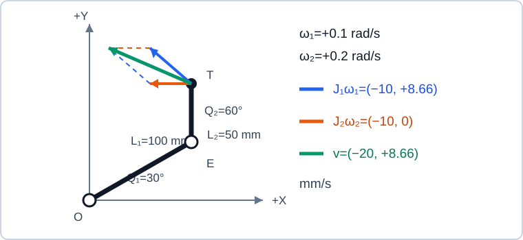

# 5. Вращение, линейная скорость и сингулярности

**Языки:** [en](../../en/notes/05-velocity-jacobian.md) · [fr](../../fr/notes/05-velocity-jacobian.md) · [de](../../de/notes/05-velocity-jacobian.md) · [it](../../it/notes/05-velocity-jacobian.md) · [es](../../es/notes/05-velocity-jacobian.md) · [pt](../../pt/notes/05-velocity-jacobian.md) · [zh](../../zh/notes/05-velocity-jacobian.md) · [ja](../../ja/notes/05-velocity-jacobian.md) · [nb](../../nb/notes/05-velocity-jacobian.md) · [ru](05-velocity-jacobian.md) · [ko](../../ko/notes/05-velocity-jacobian.md) · [fi](../../fi/notes/05-velocity-jacobian.md) · [pl](../../pl/notes/05-velocity-jacobian.md)

**Единицы этой темы (объяснены до примеров):** `mm` — миллиметр = 0.001 m; `mm/s` — миллиметр / секунда — линейная скорость; `rad` — радиан; `rad/s` — радиан / секунда — угловая скорость; `mm/rad` — миллиметр / радиан — коэффициент Якобиана (длина на единицу угла); `°` — градус. [Полный справочник единиц](../UNITS.md).

[README](../README.md) · [Trigonometry](../TRIGONOMETRY.md#unit-circle-values) · [Coordinate frames](04-coordinate-frames.md) · [Calculus foundations](00-calculus-foundations.md)

> Только идеальная учебная модель; не использовать для управления оборудованием.

Конец вращающегося звена движется по дуге окружности. Его мгновенная скорость направлена по касательной, а не вдоль звена. Сначала разберём геометрию, затем производные по времени и лишь после этого — необязательную матрицу Якоби (Jacobian matrix). В формулах производных угол измеряется в радианах.

## Содержание

1. [От вращения звена к скорости по касательной](#section-1)
2. [Откуда берутся производные координат](#section-2)
3. [Примеры со скоростями и знаками](#section-3)
4. [Два звена: относительные и абсолютные углы](#section-4)
5. [Сложенная и выпрямленная сингулярности](#section-5)
6. [Три разных смещения вблизи складывания](#section-6)
7. [Дополнительно: матрица Якоби и решённые задачи](#section-7)

## 1. От вращения звена к скорости по касательной

Рассмотрим жёсткое звено длиной $L$, которое вращается вокруг неподвижной точки $O$. Пусть за промежуток времени $\Delta t>0$ угол изменился на $\Delta Q$ **радиан**. Если за этот промежуток направление вращения не менялось, конец звена проходит по окружности дугу. Её **длина** точно равна $\Delta s=L|\Delta Q|$. Величина $L\Delta Q$ — **ориентированная длина дуги**: знак показывает направление вращения. Это не то же самое, что прямолинейное перемещение конца звена между начальным и конечным положениями (хорда).

$$
\Delta s=L\lvert\Delta Q\rvert,\qquad
\Delta s_{\mathrm{signed}}=L\Delta Q
$$

Чтобы получить **среднюю путевую скорость** на этом участке, делим пройденную длину дуги на затраченное время:

$$
\overline{v}=\frac{\Delta s}{\Delta t}
=L\left\lvert\frac{\Delta Q}{\Delta t}\right\rvert
$$

Теперь переходим к **мгновенной скорости**: берём предел при $\Delta t\to0$. Угловая скорость $\omega=\dot Q=\mathrm{d}Q/\mathrm{d}t$ измеряется в rad/s, поэтому модуль линейной скорости равен $v=L|\omega|$. Вектор скорости направлен **по касательной к окружности**, то есть перпендикулярно звену. При $Q=45^\circ$ и вращении против часовой стрелки ($\omega>0$) конец движется влево и вверх: горизонтальная составляющая отрицательная, вертикальная — положительная.

$$
v=L\lvert\dot Q\rvert
$$

*Звено и скорость конца по касательной: Q=45°, вращение против часовой стрелки, показаны знаки проекций.*

## 2. Откуда берутся производные координат

Координаты конца звена зависят от угла, а сам угол — от времени. Это ДВЕ зависимости. По правилу производной сложной функции (chain rule) мы умножаем изменение координаты на один радиан на число радиан за секунду. Дифференцируем синус и косинус, причём угол обязательно выражен в радианах:

$$
x(t)=L\cdot\cos\bigl(Q(t)\bigr),\qquad y(t)=L\cdot\sin\bigl(Q(t)\bigr)
$$

$$
v_x=\frac{\mathrm{d}x}{\mathrm{d}t}
=\frac{\mathrm{d}x}{\mathrm{d}Q}\cdot\frac{\mathrm{d}Q}{\mathrm{d}t}
=-L\cdot\sin(Q)\cdot\dot{Q}
$$

$$
v_y=\frac{\mathrm{d}y}{\mathrm{d}t}
=\frac{\mathrm{d}y}{\mathrm{d}Q}\cdot\frac{\mathrm{d}Q}{\mathrm{d}t}
=L\cdot\cos(Q)\cdot\dot{Q}
$$

Здесь $\dot Q=\mathrm{d}Q/\mathrm{d}t$ — угловая скорость в rad/s, а не сам угол. Если L задана в mm, то vx и vy имеют единицы mm/s. В производных тригонометрических функций Q выражают в радианах.

$$
\omega=\dot{Q},\qquad \omega_1=\dot{Q}_1,\qquad \omega_2=\dot{Q}_2
$$

## 3. Примеры со скоростями и знаками

Для Q=45°, L=150 mm и ω=+0.1 rad/s горизонтальная и вертикальная составляющие имеют одинаковый модуль: движение влево и вверх. При изменении ω на −0.1 rad/s обе составляющие меняют знак, но не модуль. Если Q=0°, горизонтальная скорость нулевая, вертикальная равна +15 mm/s. Точка над Q обозначает производную по времени, а не умножение на угол.

$$
Q=45^\circ:\quad v_x=-150\frac{\sqrt2}{2}\cdot0.1\approx-10.61\ \mathrm{mm/s}
$$

$$
v_y=+150\frac{\sqrt2}{2}\cdot0.1\approx+10.61\ \mathrm{mm/s}
$$

$$
\sqrt{v_x^2+v_y^2}=L\lvert\dot Q\rvert=15\ \mathrm{mm/s}
$$

## 4. Два звена: относительные и абсолютные углы

У двухзвенного плоского робота Q1 — абсолютный угол первого звена от мировой +X, а Q2 — ОТНОСИТЕЛЬНЫЙ угол второго шарнира. Поэтому абсолютный угол второго звена равен Q1+Q2, а его угловая скорость — ω₁+ω₂. Дифференцирование координат прямой кинематики даёт вклад каждого шарнира:

$$
X=L_1\cdot\cos(Q_1)+L_2\cdot\cos(Q_1+Q_2)
$$

$$
Y=L_1\cdot\sin(Q_1)+L_2\cdot\sin(Q_1+Q_2)
$$

$$
v_x=-L_1\cdot\sin(Q_1)\cdot\dot{Q}_1
-L_2\cdot\sin(Q_1+Q_2)\cdot(\dot{Q}_1+\dot{Q}_2)
$$

$$
v_y=L_1\cdot\cos(Q_1)\cdot\dot{Q}_1
+L_2\cdot\cos(Q_1+Q_2)\cdot(\dot{Q}_1+\dot{Q}_2)
$$

## 5. Сложенная и выпрямленная сингулярности

В идеальной модели без ограничений для L1=100 mm и L2=50 mm расстояние r лежит между 50 mm (звенья сложены, Q2=±180°) и 150 mm (выпрямлены, Q2=0°). В обоих коллинеарных положениях мгновенные скорости, создаваемые шарнирами, направлены поперёк линии звеньев: произвольную радиальную скорость в самой сингулярности нельзя получить конечными угловыми скоростями. Ограничения шарниров и столкновения уменьшают реальную рабочую область. Достижимость координаты не гарантирует нужную ориентацию инструмента.

$$
r^2=L_1^2+L_2^2+2L_1L_2\cos(Q_2)
$$

$$
\lvert L_1-L_2\rvert\le r\le L_1+L_2
$$

$$
\frac{\mathrm{d}r}{\mathrm{d}Q_2}
=-\frac{L_1L_2\sin(Q_2)}{r}
$$

Эта формула производной справедлива только при $r>0$. Если оба звена одинаковой длины ($L_1=L_2$), то при полном складывании к основанию ($Q_2=180^\circ$) получается $r=0$: в формуле возникает деление на нуль. В этой точке расстояние $r$ не имеет производной по **знаковому** отклонению угла локтя от сложенного положения. Для рассматриваемых здесь неравных длин $L_1=100$ mm и $L_2=50$ mm такой особой точки нет.

## 6. Три разных смещения вблизи складывания

Зафиксируем первое звено горизонтально. Второе первоначально направлено обратно вдоль первого. Обозначим через δ≥0 небольшой угол отклонения от полностью сложенного состояния в радианах. Продольное смещение вдоль НЕПОДВИЖНОЙ оси первого звена отличается от изменения расстояния от основания до инструмента. Точные формулы:

$$
\Delta x_{\mathrm{axis}}=L_2\bigl(1-\cos(\delta)\bigr)
\approx\frac{L_2\delta^2}{2}
$$

$$
\Delta y_{\mathrm{perp}}=L_2\cdot\sin(\delta)\approx L_2\delta
$$

$$
\Delta r=\sqrt{(L_1-L_2)^2+2L_1L_2\bigl(1-\cos(\delta)\bigr)}-(L_1-L_2)
$$

$$
L_1>L_2>0:\qquad
\Delta r\approx\frac{L_1L_2}{2(L_1-L_2)}\delta^2
$$

Квадрат и коэффициент 1/2 появляются из тождества 1−cosδ=2sin²(δ/2) и приближения sin(δ/2)≈δ/2. При наших неравных длинах изменение радиуса равно примерно 50δ² mm, а продольное смещение вдоль первого звена — 25δ² mm. Если уменьшить δ вдвое, оба квадратичных изменения уменьшатся вчетверо, а поперечное — вдвое. Приближения рассчитаны только для малых δ.

$$
1-\cos(\delta)=2\sin^2\left(\frac{\delta}{2}\right)
\approx2\left(\frac{\delta}{2}\right)^2=\frac{\delta^2}{2}
$$

*Три смещения при раскладывании робота: по оси первого звена, поперёк и по радиусу.*

Если потребовать постоянную ненулевую скорость удаления инструмента от основания, при приближении к сложенному состоянию требуемая угловая скорость локтевого шарнира возрастает. При δ=0 мгновенная радиальная скорость при любых конечных скоростях шарниров равна нулю. В идеальной обратной задаче скоростей требование расходится к бесконечности. Реальный робот может начать раскладываться с конечной скоростью, однако радиальная скорость сначала равна нулю и постепенно возрастает.

$$
\left.\frac{\mathrm{d}r}{\mathrm{d}\delta}\right|_{L_1=100,L_2=50}
=\frac{5000\sin(\delta)}{r}
\approx100\delta\ \mathrm{mm/rad}
$$

$$
v_r\approx(100\delta)\dot\delta\ \mathrm{mm/s},
\qquad
\dot\delta\approx\frac{1\ \mathrm{mm/s}}{100\ \mathrm{mm/rad}\cdot\delta}
$$

*Требуемая угловая скорость локтя для поддержания радиальной скорости 1 mm/s: рост возле сингулярности.*

## 7. Дополнительно: матрица Якоби и решённые задачи

Матрица Якоби (Jacobian matrix) собирает производные координат инструмента по углам шарниров. Она переводит мгновенные угловые скорости в линейную скорость инструмента, но не вычисляет абсолютную позицию из углов. В плоской идеальной модели её определитель обращается в нуль при sin Q2=0, то есть при полностью сложенных или выпрямленных звеньях. Рядом с этими положениями обратное преобразование скоростей становится плохо обусловленным. Реальная механика дополнительно ограничена ходами шарниров, инструментом, люфтами, упругостью и столкновениями.

$$
v_x=J_{11}\cdot\omega_1+J_{12}\cdot\omega_2
$$

$$
v_y=J_{21}\cdot\omega_1+J_{22}\cdot\omega_2
$$

| Коэффициент | Геометрический смысл преобразования скоростей |
| --- | --- |
| $J_{11}$ | $-L_1\sin(Q_1)-L_2\cdot\sin(Q_1+Q_2)$ |
| $J_{12}$ | $-L_2\cdot\sin(Q_1+Q_2)$ |
| $J_{21}$ | $L_1\cos(Q_1)+L_2\cdot\cos(Q_1+Q_2)$ |
| $J_{22}$ | $L_2\cdot\cos(Q_1+Q_2)$ |

**Вывод определителя.** Каждый коэффициент — частная производная координаты инструмента X или Y по углу шарнира Q1 или Q2 в радианах. Если длины заданы в mm, размерность коэффициентов — mm/rad; после умножения на rad/s получается mm/s.

$$
J_{11}=\frac{\partial X}{\partial Q_1},\qquad
J_{12}=\frac{\partial X}{\partial Q_2}
$$

$$
J_{21}=\frac{\partial Y}{\partial Q_1},\qquad
J_{22}=\frac{\partial Y}{\partial Q_2}
$$

$$
\det J=J_{11}J_{22}-J_{12}J_{21}
$$

$$
\det J=L_1L_2\bigl[\sin(Q_1+Q_2)\cos(Q_1)
-\sin(Q_1)\cos(Q_1+Q_2)\bigr]
$$

$$
\det J=L_1L_2\sin\bigl((Q_1+Q_2)-Q_1\bigr)
$$

При раскрытии двух произведений определителя слагаемые с квадратом L2 взаимно уничтожаются. Затем тождество синуса разности устраняет Q1.

$$
\det J=L_1L_2\sin(Q_2)
$$

*Вклады двух шарниров складываются как векторы и дают скорость инструмента.*

### Полностью решённые примеры

1. Одно звено длиной 150 mm направлено вправо (Q=0°). При ω=+0.1 rad/s: vx=0, vy=150·0.1=+15 mm/s. Конец движется вверх.
2. При Q=45° и ω=−0.1 rad/s (по часовой стрелке): vx=−150·sin45°·(−0.1)=+10.61 mm/s, vy=150·cos45°·(−0.1)=−10.61 mm/s. Конец движется вправо и вниз, модуль скорости остаётся 15 mm/s.
3. При L1=100 mm, L2=50 mm, Q1=30°, Q2=60°, ω₁=0.1 rad/s и ω₂=0.2 rad/s абсолютная угловая скорость второго звена равна 0.3 rad/s. Поэтому vx=−100·sin30°·0.1−50·sin90°·0.3=−20 mm/s; vy=100·cos30°·0.1+50·cos90°·0.3≈+8.66 mm/s.
4. При δ=0.02 rad от сложенного положения продольное смещение по неподвижной оси первого звена ≈25·0.02²=0.010 mm, поперечное ≈50·0.02=1.000 mm, прирост расстояния от основания ≈50·0.02²=0.020 mm. Не следует путать коэффициенты двух квадратичных изменений.

[Trigonometry](../TRIGONOMETRY.md) · [Coordinate frames](04-coordinate-frames.md) · [Calculus foundations](00-calculus-foundations.md)
