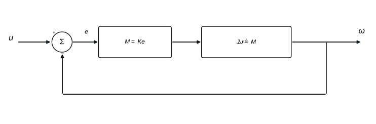

# 2. 一阶动力学与旋转运动

**切换此页语言:** [en](../../en/notes/02-first-order-dynamics.md) · [fr](../../fr/notes/02-first-order-dynamics.md) · [de](../../de/notes/02-first-order-dynamics.md) · [it](../../it/notes/02-first-order-dynamics.md) · [es](../../es/notes/02-first-order-dynamics.md) · [pt](../../pt/notes/02-first-order-dynamics.md) · [zh](02-first-order-dynamics.md) · [ja](../../ja/notes/02-first-order-dynamics.md) · [nb](../../nb/notes/02-first-order-dynamics.md) · [ru](../../ru/notes/02-first-order-dynamics.md) · [ko](../../ko/notes/02-first-order-dynamics.md) · [fi](../../fi/notes/02-first-order-dynamics.md) · [pl](../../pl/notes/02-first-order-dynamics.md)

**本页使用的单位（示例前先解释）:** `s` — 秒; `mm/s` — 毫米 / 秒 — 线速度; `kg` — 千克; `m` — 米; `rad/s` — 弧度 / 秒 — 角速度; `N` — 牛顿; `N·m` — 牛顿 · 米 — 转矩; `J` — 焦耳; `rpm` — 每分钟转数; `kg·m²` — 千克 · 米² — 转动惯量; `N·m·s/rad` — 牛顿 · 米 · 秒 / 弧度 — 速度增益; `%` — 百分比（百分之一）; `rad` — 弧度. [完整单位表](../UNITS.md).

**基础:** [0. 微积分基础：导数、微分与积分](00-calculus-foundations.md) · [积分公式表](../INTEGRAL_TABLE.md)

[README](../README.md) · [公式速查表](../CHEATSHEET.md) · [Python 练习](../exercises/README.md) · [运动、导数与积分](01-motion-calculus.md)

> **警告：** 本仓库是人工智能辅助编写的教学资料，可能存在事实错误、公式错误、翻译不准确或不成立的假设。使用者自行承担风险，必须独立验证计算结果。**切勿使用示例程序控制真实机器、电机或机器人。**

> **电机模型的假设：** 本章采用理想比例转矩控制，不考虑负载、摩擦、延迟、电压限制、饱和或更高阶的动态过程。这个模型不是所有电机的通用描述。

## 要点回顾

时间常数 $\tau$ 表征一阶系统接近新稳态的快慢。仿真步长 $dt$ 只影响数值计算，不会改变物理模型本身。在规定的理想模型中 $\tau=\frac{J}{K}$；响应相同不意味着扭矩或能量需求相同。

**英文术语：**

- 一阶系统 (first-order system)
- 时间常数 (time constant)
- 时间步长 (time step)
- 转动惯量 (moment of inertia)
- 扭矩 (torque)
- 控制器增益 (controller gain)
- 角加速度 (angular acceleration)
- 系统辨识 (system identification)
- 旋转动能 (rotational kinetic energy)

**单位说明（units）：** 时间常数用秒（s，second），角速度用弧度每秒（rad/s，radian per second），扭矩用牛顿米（N·m，newton meter）；完整单位表见[公式速查表](../CHEATSHEET.md)。

## 本页目录

- [1. 一阶系统响应](#section-1)
- [2. 扭矩与惯量](#section-2)
- [3. 数值步长与时间常数](#section-3)
- [4. 根据测量数据估计时间常数](#section-4)
- [5. 旋转动能](#section-5)
- [6. 动手试试](#section-6)
- [7. 进一步说明（选读）](#section-7)
  - [63.2 %、86.5 % 和 95.0 % 从哪里来？](#time-constant-derivation)
  - [欧拉法数值的计算过程](#euler-values-derivation)

[SI 单位与小数点说明](../SYMBOLS.md#si-notation)

## 1. 一阶系统响应

有关单位、推导和数值方法的限制，请参阅[进一步说明](#section-7)。

设目标速度 $u$ 恒定、实际速度为 $v$、$\tau>0$。该模型经过 $\tau$ 后完成约 $63.2\ \%$ 的速度变化，经过 $2\tau$ 后完成约 $86.5\ \%$，经过 $3\tau$ 后完成约 $95.0\ \%$。**这不表示在 $t=\tau$ 时完全达到目标。**

**符号说明：** $\varepsilon(t)=u-v(t)$ 表示速度误差（speed error，希腊字母 epsilon）。自然指数函数（exponential function）写作 $\exp(z)=\mathrm{e}^{z}$；其中 $\mathrm{e}\approx2.71828$ 是欧拉数（Euler’s number），**不是**速度误差。[查看推导及 63.2 % 的来源](#time-constant-derivation)。

$$
\frac{dv}{dt}=\frac{u-v}{\tau}.
$$

$$
v(t)=u+(v_0-u)\exp\!\left(-\frac{t}{\tau}\right).
$$

| 时间 | 变化完成比例 |
| --- | ---: |
| $\tau$ | 63.2 % |
| $2\tau$ | 86.5 % |
| $3\tau$ | 95.0 % |

[为什么恰好是这些百分比？查看推导。](#time-constant-derivation)

## 2. 扭矩与惯量

控制器计算电驱动指令；真正的机械扭矩 $M$ 由电机产生。在模型中，$J$ 表示转动惯量，$\omega$ 表示角速度，$K$ 为扭矩与速度误差之间的比例系数。若 $K$ 不变而 $J$ 加倍，则 $\tau$ 加倍；若 $J$ 和 $K$ 同时加倍，则 $\tau$ 不变，但相同速度误差下的扭矩加倍。此模型未包含摩擦、负载、延迟和电流限制。

$$
J\frac{d\omega}{dt}=M,\qquad M=K(u-\omega).
$$

$$
\frac{d\omega}{dt}=\frac{K}{J}(u-\omega),\qquad \tau=\frac{J}{K}.
$$

**单位:** $J$: $\mathrm{kg}\cdot\mathrm{m}^2$; $\omega,u$: $\mathrm{rad/s}$; $M$: $\mathrm{N}\cdot\mathrm{m}$; $K$: $\mathrm{N}\cdot\mathrm{m}\cdot\mathrm{s}/\mathrm{rad}$; $\tau$: s.

理想模型的符号反馈回路：控制器计算驱动命令，电机实际产生扭矩。

## 3. 数值步长与时间常数

欧拉法每隔 $dt$ 更新一次数值状态。减小 $dt$ 只改变近似误差，不会让模型中的电机加速。在 $u=10\ \mathrm{mm/s}$、$\tau=1\ \mathrm{s}$、总时间一秒的情况下，$dt=0.1$ 时欧拉法得 $6.513\ \mathrm{mm/s}$，$dt=0.01$ 时得 $6.340\ \mathrm{mm/s}$；精确值为 $6.321\ \mathrm{mm/s}$。

$$
v_{n+1}=v_n+\frac{u-v_n}{\tau}\ dt.
$$

| 方法 | $v(1\ \mathrm{s})$ (mm/s) |
| --- | ---: |
| Euler $dt=0.1\ \mathrm{s}$ | 6.513 |
| Euler $dt=0.01\ \mathrm{s}$ | 6.340 |
| 精确解 | 6.321 |

[查看这些数值的计算步骤。](#euler-values-derivation)

## 4. 根据测量数据估计时间常数

对从 0 到 1000 rpm 的阶跃命令，观察转速何时达到约 632 rpm。如果在 2 秒时达到，一阶模型估计为 $\tau\approx2\ \mathrm{s}$。如果初始转速不是零，应取**总变化量的 63.2 %**，而非目标值本身的 63.2 %。噪声、延迟和超调会影响这种初步系统辨识 (system identification)。

**程序实际返回什么：** [`estimate_tau`](../../../exercises/02_first_order_response.py) 要求测量值按时间戳**严格递增**排列，时间从目标阶跃开始计量。它返回**第一个观测到**达到总变化量 63.2 % 阈值的采样时刻，并允许已知测量分辨率的一半作为舍入容差。如果 2 s 时首次看到达到阈值，而上一个采样在 1 s，真正的阈值穿越可能发生在**两次采样之间**。因此 2 s 只是受采样间隔限制的估计值，并非精确拟合结果。重复、乱序或无效的测量即使出现在阈值之后也会被拒绝；未达到阈值则返回 `None`。

**测量分辨率很关键：**传给 `estimate_tau` 的 `resolution` 必须**小于总速度变化量的绝对值**。如果速度从 0 变到 10 rpm，但仪表显示只能按 10 rpm 递增，就无法可靠地估计到达 63.2 % 阈值的时刻。函数会拒绝这样的输入，而不会错误地报告第一笔采样已经越过阈值。即使分辨率足够细，估计值仍受到采样频率的限制。

## 5. 旋转动能

净扭矩与角加速度满足 $M=J\alpha$。当 $J=2\ \mathrm{kg}\cdot\mathrm{m}^2$ 且 $\omega=10\ \mathrm{rad/s}$ 时，旋转动能为 $100\ \mathrm{J}$；把 $J$ 加倍则为 $200\ \mathrm{J}$。把角速度加倍会使动能变为四倍。机械动能并非总电耗。

$$
M=J\alpha,\qquad \alpha=\frac{d\omega}{dt}.
$$

$$
E=\frac{1}{2}J\omega^2.
$$

## 6. 动手试试

在从 0 到 1000 转/分的理想阶跃响应中，若两秒时达到约 632 转/分，可估计 $\tau\approx2\ \mathrm{s}$。实际数据中的噪声和采样限制可能需要更稳健的系统辨识方法。运行练习对比欧拉近似与精确解。

[02_first_order_response.py](../../../exercises/02_first_order_response.py) · [03_rotation_energy.py](../../../exercises/03_rotation_energy.py) · [plot_models.py](../../../exercises/plot_models.py)

## 7. 进一步说明（选读）

### 欧拉方法的数值稳定性

每步**相对于目标速度的剩余误差**乘以 $1-\frac{dt}{\tau}$。对这个一阶模型，收敛条件是 $0<dt<2\tau$；若 $\tau<dt<2\tau$，数值结果会围绕目标交替变化。这是算法现象，并不代表真实电机在振荡。

### 模型的物理局限

更一般的力矩平衡为 $J\ \frac{d\omega}{dt}=M_{\text{电机}}-M_{\text{负载}}-M_{\text{摩擦}}$。$\tau=\frac{J}{K}$ 仅在特别假定 $M_{\text{合}}=K(u-\omega)$ 时成立；负载、摩擦、延迟及电流限制可能使它失效。

### 能量与功率

对固定的 $J$，$\Delta E=\frac{1}{2} J(\omega_2^2-\omega_1^2)$；瞬时机械功率 (mechanical power) 为 $P=M\omega$，不能据此直接计算电气总能耗。

### 63.2 %、86.5 % 和 95.0 % 从哪里来？

这些百分比与指数函数来自**同一个方程**。速度误差定义为 $\varepsilon(t)=u-v(t)$（它不是欧拉数）。目标速度 $u$ 不变时，$\frac{d\varepsilon}{dt}=-\frac{dv}{dt}$，因此：

$$
\varepsilon(t)=u-v(t),\qquad \frac{d\varepsilon}{dt}=-\frac{\varepsilon}{\tau}.
$$

$$
\frac{d\varepsilon}{\varepsilon}=-\frac{dt}{\tau}
\quad\Longrightarrow\quad
\ln\left\lvert\frac{\varepsilon(t)}{\varepsilon(0)}\right\rvert=-\frac{t}{\tau}
\quad\Longrightarrow\quad
\varepsilon(t)=\varepsilon(0)\exp\!\left(-\frac{t}{\tau}\right).
$$

分离变量时需要除以 $\varepsilon$，因此这一步假设初始误差不为零。如果 $u=v_0$，误差始终为零，直接由原微分方程可得常数解 $v(t)=u$。

$$
f(t)=\frac{v(t)-v_0}{u-v_0}=1-\exp\!\left(-\frac{t}{\tau}\right),\qquad (u\ne v_0).
$$

| $t$ | $f(t)$ |
| ---: | ---: |
| $\tau$ | $1-\exp(-1)=0.63212056\ldots\approx63.2\ \%$ |
| $2\tau$ | $1-\exp(-2)=0.86466472\ldots\approx86.5\ \%$ |
| $3\tau$ | $1-\exp(-3)=0.95021293\ldots\approx95.0\ \%$ |

例如目标从 0 变为每分钟 1000 转（rpm，revolutions per minute），经过一、二、三个时间常数后，速度分别约为 632、865、950 转/分。理想模型仅渐近接近目标值。

### 欧拉法数值的计算过程

$$
v_N=u+(v_0-u)\left(1-\frac{dt}{\tau}\right)^N,\qquad N=\frac{t}{dt}.
$$

$$
\begin{aligned}
u&=10,\quad v_0=0,\quad t=\tau=1;\\
v_{dt=0.1}&=10(1-0.9^{10})\approx6.5132;\\
v_{dt=0.01}&=10(1-0.99^{100})\approx6.3397;\\
v_{\mathrm{exact}}&=10(1-\exp(-1))\approx6.3212.
\end{aligned}
$$
