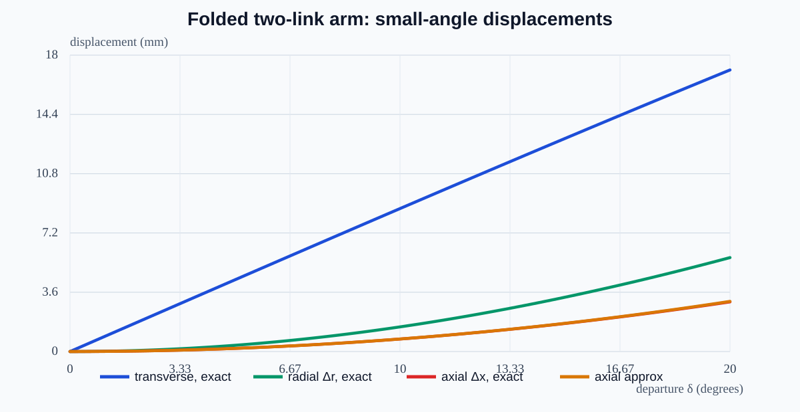

# 5. 旋转、线速度与奇异位形

**Languages:** [en](../../en/notes/05-velocity-jacobian.md) · [fr](../../fr/notes/05-velocity-jacobian.md) · [de](../../de/notes/05-velocity-jacobian.md) · [it](../../it/notes/05-velocity-jacobian.md) · [es](../../es/notes/05-velocity-jacobian.md) · [pt](../../pt/notes/05-velocity-jacobian.md) · [zh](05-velocity-jacobian.md) · [ja](../../ja/notes/05-velocity-jacobian.md) · [nb](../../nb/notes/05-velocity-jacobian.md) · [ru](../../ru/notes/05-velocity-jacobian.md) · [ko](../../ko/notes/05-velocity-jacobian.md) · [fi](../../fi/notes/05-velocity-jacobian.md) · [pl](../../pl/notes/05-velocity-jacobian.md)

**本页使用的单位（示例前先解释）:** `mm` — 毫米 = 0.001 m; `mm/s` — 毫米 / 秒 — 线速度; `rad` — 弧度; `rad/s` — 弧度 / 秒 — 角速度; `mm/rad` — 毫米 / 弧度 — 雅可比矩阵系数（长度与角度之比）; `°` — 度. [完整单位表](../UNITS.md).

[README](../README.md) · [Trigonometry](../TRIGONOMETRY.md#unit-circle-values) · [Coordinate frames](04-coordinate-frames.md) · [Calculus foundations](00-calculus-foundations.md)

> 仅用于学习的理想模型；不得用于控制真实机械。

旋转杆末端沿圆弧运动。其瞬时速度沿切线方向，而不是沿杆方向。本章先解释几何直觉，再推导时间导数，最后可选阅读雅可比矩阵（Jacobian matrix）。

## 目录

1. [旋转与切向速度](#section-1)
2. [坐标导数从哪里来](#section-2)
3. [速度与符号的算例](#section-3)
4. [双连杆：相对角与绝对角](#section-4)
5. [折叠和伸直时的奇异位形](#section-5)
6. [折叠附近的三种位移](#section-6)
7. [进阶：雅可比矩阵与完整例题](#section-7)

## 1. 旋转与切向速度

设长度为 $L$ 的刚性连杆绕固定点 $O$ 旋转。在时间间隔 $\Delta t>0$ 内，角度变化为 $\Delta Q$，**角度单位是弧度**。若这段时间内旋转方向不变，末端沿圆弧移动。经过的**弧长**严格等于 $\Delta s=L|\Delta Q|$；沿规定旋转正方向的**有符号弧长**为 $L\Delta Q$，其符号表示旋转方向。二者都不是末端两位置之间的直线位移（弦长）。

$$
\Delta s=L\lvert\Delta Q\rvert,\qquad
\Delta s_{\mathrm{signed}}=L\Delta Q
$$

将经过的弧长除以所用时间，得到这段时间内的**平均速率**：

$$
\overline{v}=\frac{\Delta s}{\Delta t}
=L\left\lvert\frac{\Delta Q}{\Delta t}\right\rvert
$$

要求**瞬时速率**，令 $\Delta t\to0$。角速度是 $\omega=\dot Q=\mathrm{d}Q/\mathrm{d}t$，单位 rad/s，因此线速度的大小为 $v=L|\omega|$。速度**方向沿圆周切线**，与连杆垂直。若 $Q=45^\circ$ 且逆时针旋转（$\omega>0$），末端向左上方运动：水平速度分量为负，竖直分量为正。

$$
v=L\lvert\dot Q\rvert
$$

*Q=45° 时的切向速度及其正负分量。*

## 2. 坐标导数从哪里来

坐标依赖角度 Q，而 Q 又依赖时间。链式法则（chain rule）将每弧度的坐标变化乘以每秒的角度变化。

$$
x(t)=L\cdot\cos\bigl(Q(t)\bigr),\qquad y(t)=L\cdot\sin\bigl(Q(t)\bigr)
$$

$$
v_x=\frac{\mathrm{d}x}{\mathrm{d}t}
=\frac{\mathrm{d}x}{\mathrm{d}Q}\cdot\frac{\mathrm{d}Q}{\mathrm{d}t}
=-L\cdot\sin(Q)\cdot\dot{Q}
$$

$$
v_y=\frac{\mathrm{d}y}{\mathrm{d}t}
=\frac{\mathrm{d}y}{\mathrm{d}Q}\cdot\frac{\mathrm{d}Q}{\mathrm{d}t}
=L\cdot\cos(Q)\cdot\dot{Q}
$$

角速度 $\dot Q=\mathrm{d}Q/\mathrm{d}t$ 的单位为 rad/s，它不是角度本身。L 使用 mm 时，vx、vy 的单位为 mm/s。三角函数求导要求使用弧度。

$$
\omega=\dot{Q},\qquad \omega_1=\dot{Q}_1,\qquad \omega_2=\dot{Q}_2
$$

## 3. 速度与符号的算例

L=150 mm、Q=45°、ω=+0.1 rad/s 时，速度分量等大、分别向左和向上。反转 ω 会使两个分量都变号。Q=0° 时 vy=15 mm/s、vx=0。

$$
Q=45^\circ:\quad v_x=-150\frac{\sqrt2}{2}\cdot0.1\approx-10.61\ \mathrm{mm/s}
$$

$$
v_y=+150\frac{\sqrt2}{2}\cdot0.1\approx+10.61\ \mathrm{mm/s}
$$

$$
\sqrt{v_x^2+v_y^2}=L\lvert\dot Q\rvert=15\ \mathrm{mm/s}
$$

$Q$ 上方的点表示对时间的**导数** $\dot Q$，不是把角度拿来相乘。将 $\omega$ 变为 $-\omega$ 会使两个速度分量的符号反转，但速率大小 $L|\omega|$ 不变。

## 4. 双连杆：相对角与绝对角

Q1 是相对于世界 +X 的绝对角，Q2 是第二关节的相对角。第二连杆的绝对角为 Q1+Q2，其角速度为 ω₁+ω₂。

$$
X=L_1\cdot\cos(Q_1)+L_2\cdot\cos(Q_1+Q_2)
$$

$$
Y=L_1\cdot\sin(Q_1)+L_2\cdot\sin(Q_1+Q_2)
$$

$$
v_x=-L_1\cdot\sin(Q_1)\cdot\dot{Q}_1
-L_2\cdot\sin(Q_1+Q_2)\cdot(\dot{Q}_1+\dot{Q}_2)
$$

$$
v_y=L_1\cdot\cos(Q_1)\cdot\dot{Q}_1
+L_2\cdot\cos(Q_1+Q_2)\cdot(\dot{Q}_1+\dot{Q}_2)
$$

两个关节都对末端速度作出贡献：第一连杆对应 $\dot Q_1$，第二连杆对应 $\dot Q_1+\dot Q_2$。第二关节的角度是相对于第一连杆定义的，因此不能只把 $\dot Q_2$ 当作第二连杆的绝对角速度。

## 5. 折叠和伸直时的奇异位形

对 L1=100 mm、L2=50 mm 的理想双连杆，末端距离范围为 50–150 mm。完全折叠（Q2=180°）和完全伸直（Q2=0°）均是奇异位形：有限关节速度不能产生该瞬间的径向速度。

$$
r^2=L_1^2+L_2^2+2L_1L_2\cos(Q_2)
$$

$$
\lvert L_1-L_2\rvert\le r\le L_1+L_2
$$

$$
\frac{\mathrm{d}r}{\mathrm{d}Q_2}
=-\frac{L_1L_2\sin(Q_2)}{r}
$$

上述导数公式要求 $r>0$。若两根连杆等长（$L_1=L_2$），在完全折叠到基座的位置（$Q_2=180^\circ$）有 $r=0$，公式会出现除以零。此处径向距离对肘部角度的**有符号偏差**不可微。本文使用的 $L_1=100$ mm、$L_2=50$ mm 两根不等长连杆不涉及这个特殊情况。

真实关节的角度限制和碰撞可能进一步缩小工作空间。能够到达某个位置，不代表工具方向正确或周围障碍物有足够间隙。

## 6. 折叠附近的三种位移

固定第一连杆，δ 表示第二连杆相对于完全折叠位置的小偏角（弧度）。沿固定杆轴的位移、横向位移和到基座的径向距离变化是不同量。

$$
\Delta x_{\mathrm{axis}}=L_2\bigl(1-\cos(\delta)\bigr)
\approx\frac{L_2\delta^2}{2}
$$

$$
\Delta y_{\mathrm{perp}}=L_2\cdot\sin(\delta)\approx L_2\delta
$$

$$
\Delta r=\sqrt{(L_1-L_2)^2+2L_1L_2\bigl(1-\cos(\delta)\bigr)}-(L_1-L_2)
$$

$$
L_1>L_2>0:\qquad
\Delta r\approx\frac{L_1L_2}{2(L_1-L_2)}\delta^2
$$

恒等式 1−cosδ=2sin²(δ/2) 与 sin(δ/2)≈δ/2 解释平方和 1/2 系数。此例中径向变化 ≈50δ² mm，而沿第一杆轴位移 ≈25δ² mm。

这些近似式仅在 $\delta$ 很小且以弧度计量时成立。若 $\delta$ 减半，轴向和径向两种**二次**变化都约变为原来的**四分之一**，而横向位移仅变为**二分之一**。

$$
1-\cos(\delta)=2\sin^2\left(\frac{\delta}{2}\right)
\approx2\left(\frac{\delta}{2}\right)^2=\frac{\delta^2}{2}
$$

*折叠附近的轴向、横向与径向位移。*

如果要求靠近折叠位形时仍保持非零恒定径向速度，δ 越接近零，所需关节角速度越大。在完全折叠点，有限关节速度无法瞬时产生非零径向速度。

$$
\left.\frac{\mathrm{d}r}{\mathrm{d}\delta}\right|_{L_1=100,L_2=50}
=\frac{5000\sin(\delta)}{r}
\approx100\delta\ \mathrm{mm/rad}
$$

$$
v_r\approx(100\delta)\dot\delta\ \mathrm{mm/s},
\qquad
\dot\delta\approx\frac{1\ \mathrm{mm/s}}{100\ \mathrm{mm/rad}\cdot\delta}
$$

*奇异位形附近所需的肘关节角速度。*

## 7. 进阶：雅可比矩阵与完整例题

雅可比矩阵（Jacobian matrix）由末端坐标对关节角的偏导数组成，把瞬时关节角速度映射为末端线速度；它不是直接根据角度计算绝对位置的正运动学。两根连杆完全伸直或折叠时行列式为零，附近的逆速度计算条件很差。真实系统还受到关节限位、工具偏置、间隙、柔性变形及碰撞的约束。这个模型仅用于学习。

$$
v_x=J_{11}\cdot\omega_1+J_{12}\cdot\omega_2
$$

$$
v_y=J_{21}\cdot\omega_1+J_{22}\cdot\omega_2
$$

| 系数 | 速度映射的几何表达式 |
| --- | --- |
| $J_{11}$ | $-L_1\sin(Q_1)-L_2\cdot\sin(Q_1+Q_2)$ |
| $J_{12}$ | $-L_2\cdot\sin(Q_1+Q_2)$ |
| $J_{21}$ | $L_1\cos(Q_1)+L_2\cdot\cos(Q_1+Q_2)$ |
| $J_{22}$ | $L_2\cdot\cos(Q_1+Q_2)$ |

**行列式的推导.** 每个系数都是末端坐标 X 或 Y 对关节角 Q1 或 Q2（弧度）的偏导数。杆长以 mm 表示时，系数的单位为 mm/rad；乘以关节角速度 rad/s 得到末端速度 mm/s。

$$
J_{11}=\frac{\partial X}{\partial Q_1},\qquad
J_{12}=\frac{\partial X}{\partial Q_2}
$$

$$
J_{21}=\frac{\partial Y}{\partial Q_1},\qquad
J_{22}=\frac{\partial Y}{\partial Q_2}
$$

$$
\det J=J_{11}J_{22}-J_{12}J_{21}
$$

$$
\det J=L_1L_2\bigl[\sin(Q_1+Q_2)\cos(Q_1)
-\sin(Q_1)\cos(Q_1+Q_2)\bigr]
$$

$$
\det J=L_1L_2\sin\bigl((Q_1+Q_2)-Q_1\bigr)
$$

展开行列式的两个乘积后，含 L2 平方的项相互抵消。再用正弦差角公式消去 Q1。

$$
\det J=L_1L_2\sin(Q_2)
$$

*两个关节的速度贡献按向量相加，得到末端速度。*

### 完整求解示例

1. 长度 $L=150$ mm 的连杆在 $Q=0^\circ$ 时向右。若 $\omega=+0.1$ rad/s，则 $\sin0^\circ=0$、$\cos0^\circ=1$，因此 $v_x=-150\cdot0\cdot0.1=0$，$v_y=150\cdot1\cdot0.1=+15$ mm/s，末端向上运动。
2. 在 $Q=45^\circ$、$\omega=-0.1$ rad/s 时旋转方向反转：$v_x=-150\sin45^\circ\cdot(-0.1)\approx+10.61$ mm/s，$v_y=150\cos45^\circ\cdot(-0.1)\approx-10.61$ mm/s。末端向右下方运动，但速率大小仍为 $L|\omega|=15$ mm/s。
3. 若 $L_1=100$ mm、$L_2=50$ mm、$Q_1=30^\circ$、$Q_2=60^\circ$、$\omega_1=0.1$ rad/s、$\omega_2=0.2$ rad/s，第二连杆的绝对方向是 $Q_1+Q_2=90^\circ$，其角速度为 $\omega_1+\omega_2=0.3$ rad/s。因此 $v_x=-100\sin30^\circ\cdot0.1-50\sin90^\circ\cdot0.3=-5-15=-20$ mm/s，$v_y=100\cos30^\circ\cdot0.1+50\cos90^\circ\cdot0.3\approx+8.66$ mm/s。
4. 从折叠位置偏离 $\delta=0.02$ rad 时，沿第一连杆**固定轴**的轴向变化约为 $25\delta^2=25\cdot0.02^2=0.010$ mm；横向位移约为 $50\delta=1.000$ mm，径向距离增加约为 $50\delta^2=0.020$ mm。不要混淆两个二次项的不同系数。

[三角函数](../TRIGONOMETRY.md) · [坐标系](04-coordinate-frames.md) · [微积分基础](00-calculus-foundations.md)
