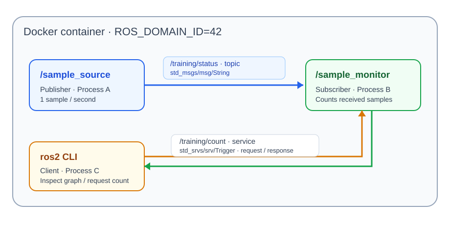

# ROS 2: synthetic topic, service and launch lab

**Conceptual system overview:** [Editable five-stage robot architecture diagram](ROBOT_ARCHITECTURE.md#one-editable-mermaid-diagram) connects the topic/TF/control concepts but does not describe the smaller telemetry lab as a motor controller.

**Simplest manual alternative:** [ROS 2 in plain Docker](PLAIN_DOCKER.md) starts an official image as a persistent container `ros` without Compose, custom Dockerfiles or host-side `ROS_DISTRO` configuration. This README documents the prepared Compose setup instead.

This example is **simulation-only**: no device drivers, motor commands, robot control or privileged Docker access. It complements the [ROS 2 foundations lesson](../docs/en/notes/06-ros2-foundations.md).

**Version choice (checked 2026-11-13):** ROS 2 **Jazzy Jalisco**, an LTS release supported to **May 2029**, on Ubuntu 24.04. Lyrical Luth (released May 2026, supported to May 2031) is also available, but this lab deliberately stays on Jazzy. See the [official ROS 2 release table](https://github.com/ros2/ros2_documentation/blob/rolling/source/Releases.rst). The base image uses the mutable `ros:jazzy-ros-base` tag, **and** `apt-get update` fetches moving Ubuntu/ROS package versions. Pinning a verified image digest freezes only the **base image**, not packages downloaded during `RUN`; it is therefore **insufficient for byte-for-byte reproducibility**. A controlled build also needs versioned or snapshotted dependency inputs, verification of the resulting artifacts and a plan to review security updates to pinned components. See [Docker's official build best practices](https://docs.docker.com/build/building/best-practices/). The lab intentionally keeps updatable learning dependencies rather than claiming a fully frozen distribution.

## Architecture



- **Process A, `/sample_source`:** publishes a fresh `std_msgs/msg/String` message on `/training/status` every 1.0 s.
- **Process B, `/sample_monitor`:** subscribes to `/training/status`, counts received messages, and serves `/training/count` using `std_srvs/srv/Trigger`.
- **CLI process:** introspects the graph, observes the topic, and calls the service. ROS graph discovery is decentralized; a message type is a wire contract, not a shared Python object.
- **Launch:** `demo.launch.py` starts both nodes, each as a separate executable/process, inside one container. A single-container lab avoids cross-host DDS multicast, interface and firewall complications.

The service returns a snapshot of the **monitor's received** count, not a global exactly-once delivery guarantee. Count starts at 0 on every container restart; an `echo` subscriber starts with live messages, not prior history.

## Prerequisites and boundaries

Install Docker Engine or Docker Desktop with the Compose v2 plugin. Run the following from the repository root. Downloading the ROS image and installing Ubuntu packages requires internet and may take time/disk space. Commands use Bash **inside Linux**, not the host's Python or ROS installation. Supports Linux AMD64 and ARM64 if the upstream image variant is available. No host services, exposed ports, physical devices or elevated privileges are needed.

**Trust and execution boundary:** `docker compose up --build` runs the supplied Dockerfile and pulls a base image and package dependencies. **Review the Dockerfile and Compose file before building**, especially after accepting a pull request; do not add credentials, Docker socket mounts or host directories to an untrusted build. Docker is not a malware sandbox, and Docker daemon access can carry substantial host privileges. See the [official Docker Engine security guidance](https://docs.docker.com/engine/security/). This repository has no private Docker configuration. Do not copy credentials or host mounts into this example. Python examples are published under the repository's [code license](../LICENSING.md). A live GitHub Actions job has exercised this synthetic single-container ROS graph; that result does not verify Docker on your computer, another network topology, or physical machinery.

## Learning order: installed examples → your own package → virtual joint

Work in this order:

1. **Standard ROS nodes**: `demo_nodes_cpp` talker and `demo_nodes_py` listener use the standard `/chatter` topic. These are provided by the ROS distribution; this repository's [Dockerfile](Dockerfile) explicitly installs their Debian packages during `docker build`.
2. **A custom package**: `telemetry_demo` lives in [demo package manifest](demo_pkg/package.xml), is copied into `/opt/training_ws/src/telemetry_demo`, and is built with `colcon` in the same image. Its launch file starts `/sample_source` and `/sample_monitor`, with `/training/status` and `/training/count`.
3. **A simulated hardware layer**: after the first two steps, follow the separate [headless `ros2_control` / TF2 lab](control_lab/README.md), which uses its own Dockerfile and a virtual joint. Do not confuse ROS topic publication with a closed-loop servo.

**Package names are not executables:** `ros-${ROS_DISTRO}-demo-nodes-cpp` is the Debian package; `demo_nodes_cpp` is the ROS package; `talker` is its executable. Likewise, the source directory `demo_pkg` contains the ROS package `telemetry_demo`, built by `colcon` rather than installed through APT.

## Start Docker once

From the repository root, on the **host**:

```bash
cd ros2
docker compose up --build -d
docker compose ps
docker compose logs --tail=20 demo
```

The container's `CMD` runs `source /opt/ros/${ROS_DISTRO}/setup.bash`, then `source /opt/training_ws/install/setup.bash`, then `ros2 launch telemetry_demo demo.launch.py`. This setup applies to **that launch process and its descendants**, not to every future `docker compose exec` process. Dockerfile `RUN` (image build), `CMD` (container start) and `exec` (separate process) are different phases. A new `exec bash` shell does not inherit shell-variable changes from `CMD`. The prepared image already adds the underlay and overlay to `/root/.bashrc`; **every new interactive Bash shell sources them automatically** in order. Only noninteractive scripts need explicit sourcing.

Open an interactive session from the host:

```bash
docker compose exec demo bash
```

Now **inside the container shell**, the environment is ready without manual `source`:

```bash
echo "$ROS_DISTRO"
ros2 --help
ros2 pkg prefix demo_nodes_cpp
ros2 pkg executables demo_nodes_cpp
ros2 pkg prefix demo_nodes_py
ros2 pkg executables demo_nodes_py
ros2 pkg executables telemetry_demo
```

The two demo packages were installed in the image at build time; `telemetry_demo` was built into the workspace. **Do not re-run `apt-get install` in this built image.** If using an unrelated bare Jazzy environment instead, install `ros-$ROS_DISTRO-demo-nodes-cpp` and `ros-$ROS_DISTRO-demo-nodes-py` from trusted configured ROS APT sources first. This optional manual installation is not a step in the Docker walkthrough. To perform it without a custom Dockerfile, follow the [plain Docker guide](PLAIN_DOCKER.md).

## Exercise A — the official demo talker and listener

Open two **host terminals** and start a container shell in each with `docker compose exec demo bash`. In **each** new container shell, the image's `~/.bashrc` automatically sources the two environments. Then:

**Terminal A, inside the container:**

```bash
ros2 run demo_nodes_cpp talker
```

**Terminal B, inside the same container (new exec shell):**

```bash
ros2 run demo_nodes_py listener
```

The C++ talker publishes `std_msgs/msg/String` messages to `/chatter`; the Python listener receives them. This shows typed cross-language ROS communication, independent of the repository's custom `/training/status` application. Use a third sourced shell for `ros2 topic info /chatter -v` or `ros2 node list` if desired. Stop both long-running commands with Ctrl+C; leave the Compose service running for the next exercise. One `source` per **shell**, not per command.

## Exercise B — inspect the built telemetry_demo

The [Dockerfile](Dockerfile) has already done `colcon build --packages-select telemetry_demo` during image build, and the container's `CMD` automatically launched the package. Do not run another copy of `ros2 launch` inside the same domain while the original is active: duplicate node names and publishers would make the observations misleading.

In an existing sourced container shell (or a newly sourced one):

```bash
ros2 pkg prefix telemetry_demo
ros2 pkg executables telemetry_demo
ros2 node list
ros2 node info /sample_source
ros2 topic list -t
ros2 topic info /training/status -v
ros2 interface show std_msgs/msg/String
ros2 param get /sample_source interval_s
ros2 service list -t
ros2 service call /training/count std_srvs/srv/Trigger "{}"
ros2 action list
```

Expected output includes `/sample_source`, `/sample_monitor`, `/training/status [std_msgs/msg/String]` and `/training/count [std_srvs/srv/Trigger]`. The source publishes incrementing strings; the monitor counts messages **received**, not necessarily all messages ever published. `ros2 param get` reports `Double value is: 1.0`; the service reports `success=True` with a varying count such as `received 12 samples`. The course does not launch an application action in this lab.

Watch messages in the sourced shell (Ctrl+C stops observing, not the publisher):

```bash
ros2 topic echo /training/status
```

For **automation** (where a separate shell for each operation is useful), the longer single-command form is intentional:

```bash
docker compose exec -T demo bash -lc 'source /opt/ros/${ROS_DISTRO}/setup.bash && source /opt/training_ws/install/setup.bash && ros2 node list'
```

The explicit `source` chain is needed **in that separate noninteractive process**. It is not the recommended beginner interactive format.

Leave the interactive session with `exit`. From the host, stop and clean up **after** completing the work:

```bash
docker compose down
```

## Optional end-to-end smoke test (requires Docker)

The ordinary Python CI job does **not** run ROS 2. For changes under `ros2/`, the separate [live Docker smoke-test GitHub Actions workflow](../.github/workflows/ros2-live-smoke.yml) attempts this same test **after the change is merged/pushed to `main`**, or when manually dispatched against `main`. It does **not** execute unmerged `pull_request` code on the host runner: PR authors must not claim a new ROS change passed live Docker tests before the postmerge job finishes. Review changes to the Bash smoke script, Dockerfile and Compose configuration independently before merging; this workflow is not a malware sandbox or a pre-merge approval gate. On a computer with Docker Compose v2, run the test yourself from the repository root:

```bash
bash ros2/smoke_test.sh
```

The script builds and starts the Compose service, uses a roughly 60-second discovery deadline with a per-command timeout (a final probe may overrun slightly), inspects the real topic type, receives one live message with `ros2 topic echo --once`, and calls the real `Trigger` service. It exits nonzero if discovery, message delivery or the service fails. A successful run ends with `PASS: live ROS 2 graph, typed topic and service responded inside Docker.` This checks the **single-container** configuration only, not multi-host DDS, deterministic latency or hardware behavior. It leaves the container running for inspection; clean up with `cd ros2 && docker compose down`. The script has been executed by the live GitHub Actions workflow; a successful CI run does not establish compatibility with every local Docker installation.

## How the package is built

`ros2/demo_pkg` is a conventional `ament_python` package:
- `package.xml`: package metadata and runtime dependencies.
- `setup.py` and `setup.cfg`: Python distribution, ROS executable entry points and launch-file installation.
- `resource/telemetry_demo`: ament package index marker.
- `telemetry_demo/publisher.py` and `subscriber.py`: independent nodes.
- `launch/demo.launch.py`: multi-process composition at launch time.

The Dockerfile copies it to `/opt/training_ws/src/telemetry_demo` and runs `colcon build --packages-select telemetry_demo`. `source /opt/ros/${ROS_DISTRO}/setup.bash` selects the underlay; `source /opt/training_ws/install/setup.bash` adds the workspace overlay. `colcon` builds packages; `ament` is the package/build integration layer, not a message transport.

## Troubleshooting

| Symptom | What to check |
| --- | --- |
| `docker compose` not found | Install/update Compose v2; check `docker compose version`. |
| Docker image pull/build failure | Network, registry rate limits, free disk space; `docker compose build --progress=plain`. |
| Package/launch file not found | Confirm `colcon build` succeeded in image; source both underlay and overlay; `ros2 pkg executables telemetry_demo`. |
| Nodes visible, no topic data | `ros2 topic info /training/status -v`; ensure compatible types and QoS; inspect `docker compose logs demo`. |
| No nodes visible from host ROS | This demo is intended for CLI **inside** the container. Host and Docker Desktop DDS discovery can differ; do not assume exposed TCP ports solve DDS multicast. |
| `ros2 node list` empty inside container | `docker compose ps`, logs, `printenv ROS_DOMAIN_ID`, `printenv RMW_IMPLEMENTATION`, source the environment, `ros2 daemon stop` and retry. |
| Service not ready yet | Wait for both nodes to appear using `ros2 node list`, then retry. |
| No historical topic messages | Default durability is volatile; subscribe to future messages and distinguish this from message loss. |
| Unexpected duplicate node names | Avoid launching extra demo instances in the same ROS domain; inspect `ros2 node list`. |

ROS 2 DDS discovery can use UDP multicast, dynamic unicast ports and interfaces; containers on multiple hosts, VPNs, firewalls, Docker Desktop's VM or mismatched `ROS_DOMAIN_ID` can prevent discovery even when TCP works. For this lab keep all components **in one container**. The publisher and subscriber use matching depth-10 QoS settings. `interval_s` is a startup-only parameter and must be a finite, positive number of seconds. For sensor streams, `best_effort` can trade reliability for fresh data; CLI echo may use different QoS settings from sensor publishers.

To stop and remove the demo:
```bash
docker compose down
```

## Next lab: a virtual joint with ros2_control

After the topic/service graph, try the separate [headless mock hardware lab](control_lab/README.md). It adds a URDF revolute joint, controller manager, state and command interfaces, `/joint_states`, TF2 and an ARM64 vendor-library troubleshooting path. It uses its **own Dockerfile** and does not modify this telemetry application. The new live controller smoke stage runs on trusted `main` pushes; ordinary PR validation is static and is not a substitute for successful post-merge Docker execution.

## Follow-on learning

The [ROS 2 lesson](../docs/en/notes/06-ros2-foundations.md) explains how this graph relates to services versus actions, parameters versus topics, tf2 frames, URDF, `robot_state_publisher`, `ros2_control`, QoS and DDS discovery. ROS middleware does **not** compute inverse kinematics or guarantee low-level real-time control. Compare the existing [coordinate frame lesson](../docs/en/notes/04-coordinate-frames.md) and [velocity/Jacobian lesson](../docs/en/notes/05-velocity-jacobian.md).

Further primary references: [ROS 2 Jazzy documentation](https://docs.ros.org/en/jazzy/), [ROS 2 release schedule](https://github.com/ros2/ros2_documentation/blob/rolling/source/Releases.rst), [ROS 2 QoS overview](https://docs.ros.org/en/jazzy/Concepts/Intermediate/About-Quality-of-Service-Settings.html) and [ros2_control](https://control.ros.org/jazzy/).
