# ROS 2 robot architecture: five functional stages

**Localized explanations:** [en](../docs/en/notes/08-ros2-robot-architecture.md) · [fr](../docs/fr/notes/08-ros2-robot-architecture.md) · [de](../docs/de/notes/08-ros2-robot-architecture.md) · [it](../docs/it/notes/08-ros2-robot-architecture.md) · [es](../docs/es/notes/08-ros2-robot-architecture.md) · [pt](../docs/pt/notes/08-ros2-robot-architecture.md) · [zh](../docs/zh/notes/08-ros2-robot-architecture.md) · [ja](../docs/ja/notes/08-ros2-robot-architecture.md) · [nb](../docs/nb/notes/08-ros2-robot-architecture.md) · [ru](../docs/ru/notes/08-ros2-robot-architecture.md) · [ko](../docs/ko/notes/08-ros2-robot-architecture.md) · [fi](../docs/fi/notes/08-ros2-robot-architecture.md) · [pl](../docs/pl/notes/08-ros2-robot-architecture.md)

**Scope:** A conceptual, illustrative robot that detects an object and plans motion. This is **not a runnable hardware system, wiring diagram or safety controller**. The names of the five stages below are deliberately stable; **a functional stage is not necessarily one ROS node or process**.

[ROS 2 foundations](../docs/en/notes/06-ros2-foundations.md) · [Virtual joint lab](control_lab/README.md) · [Repository home](../README.md)

## One editable Mermaid diagram

The **solid arrows** are commands, observations or ROS data paths. **Dashed arrows** carry model/configuration or a controller's direct read path, not a motor command. The five numbered subgraphs are functional stages; the URDF node below them is a **side input**, not a sixth stage. Arrow labels identify interfaces rather than claiming each box is its own process.

```mermaid
flowchart LR
  subgraph P["1. Perception"]
    direction TB
    camera["Camera driver<br/>sensor_msgs/Image"]
    detector["Object detector<br/>(application node)"]
    camera -->|"image + acquisition timestamp"| detector
  end

  subgraph CT["2. Coordinate Transformation"]
    direction TB
    tfbuf["tf2_ros Buffer / application lookup<br/>lookup_transform(base_link, camera_link, t)"]
  end

  subgraph MP["3. Motion Planning"]
    direction TB
    planner["Motion planner<br/>e.g. MoveIt 2"]
  end

  subgraph MC["4. Motion Control"]
    direction TB
    controller["ros2_control<br/>joint_trajectory_controller"]
    command["Hardware command interfaces<br/>driver / hardware plugin"]
    servo["Servo drive / firmware<br/>(local regulation)"]
    motor["Motor / joint"]
    controller -->|"position / velocity / effort setpoint"| command
    command -->|"drive command"| servo
    servo -->|"actuation"| motor
  end

  subgraph FB["5. Feedback"]
    direction TB
    encoder["Encoder / sensor"]
    state["Hardware state interfaces<br/>(measured joint state)"]
    broadcaster["joint_state_broadcaster"]
    rsp["robot_state_publisher"]
    encoder -->|"measurement via driver"| state
    state -->|"state interfaces"| broadcaster
    broadcaster -->|"/joint_states"| rsp
  end

  detector -->|"object pose in camera_link + acquisition time"| tfbuf
  tfbuf -->|"object pose in base_link"| planner
  planner -->|"FollowJointTrajectory action goal"| controller
  motor -->|"joint motion"| encoder
  encoder -->|"local feedback"| servo
  state -.->|"controller read, not /joint_states"| controller
  broadcaster -->|"/joint_states for planning"| planner
  rsp -->|"/tf (moving), /tf_static (fixed)"| tfbuf

  urdf[/"URDF / robot_description<br/>links, joints, frames<br/>optional ros2_control config"/]
  urdf -.->|"robot geometry + limits"| planner
  urdf -.->|"robot_description"| rsp
  urdf -.->|"hardware interface declarations"| command
```

**Time convention:** The camera image's acquisition timestamp (the stamp in its message header) is used to look up the transform from `camera_link` into `base_link`. Looking up a transform at message *arrival* time can mix poses from different times. A lookup requires a connected TF tree, compatible clocks and transforms still available for that timestamp. Camera mounting/extrinsic transforms must be published as well: a fixed camera joint may be in the URDF/`robot_state_publisher` tree, or a separate static transform publisher may supply it.

## Exactly five stages, with concrete responsibilities

| Stage (same name as the diagram) | ROS 2 mapping, input and output |
| --- | --- |
| **1. Perception** | Camera driver publishes `sensor_msgs/msg/Image` with acquisition time; application detector estimates an object pose in `camera_link`. An object detector is **application code**, not a universal ROS node. |
| **2. Coordinate Transformation** | Application invokes `tf2_ros.Buffer.lookup_transform(target=base_link, source=camera_link, time=t)` and transforms the detected pose. TF2 **reads** transforms; it does not move a joint or publish joint commands. |
| **3. Motion Planning** | A planner such as MoveIt 2 uses the object goal, current robot state, robot model and constraints to produce a joint trajectory; collision/environment modeling is an additional concern, not implied by TF2 alone. |
| **4. Motion Control** | A trajectory execution client uses `control_msgs/action/FollowJointTrajectory` when a configured `joint_trajectory_controller` provides it. The controller (managed by `controller_manager`) writes hardware **command interfaces**; a drive/firmware may implement the local servo loop. Neither a trajectory nor ROS networking alone guarantees safe movement. |
| **5. Feedback** | Encoder/drive state is read through hardware **state interfaces**, directly available to appropriate controllers; `joint_state_broadcaster` also publishes `sensor_msgs/msg/JointState` on `/joint_states`. With URDF, `robot_state_publisher` publishes moving joint transforms on `/tf` and fixed joints on `/tf_static`, which feed the TF2 buffer. The encoder's local firmware loop can run independently of ROS topic publication. |

### Do not confuse these paths

- **Description is not motion:** URDF defines links/joints and may declare `ros2_control` hardware interfaces. It does not send motor commands. A robot model is also used by the planner; it cannot alone prove a robot's measured position or safety.
- **Request is not feedback:** A command interface conveys the requested joint value, whereas a state interface conveys the measured/estimated value supplied by the hardware driver. `/joint_states` is a broadcast for other consumers, **not** necessarily the path through which the active controller reads state.
- **TF is not a controller:** `robot_state_publisher` combines URDF and joint states to publish transforms. A TF2 buffer consumes these to answer timestamped spatial queries.
- **Different controllers:** This **conceptual trajectory** shows `joint_trajectory_controller`. The separate [running mock lab](control_lab/README.md) instead tests `forward_position_controller` (`ForwardCommandController`) → `mock_components/GenericSystem` → `/joint_states` → TF2. That lab proves no camera detection, MoveIt 2 execution, servo firmware, encoder measurements or hardware actuation.
- **Failure and safety:** A missing `/joint_states` topic does not by itself prove a local servo loop has stopped; conversely, a surviving local loop does not prove that higher-level motion remains safe. Safety supervision, stale data handling and fault responses require separate engineering and verification.

## Extension points (not implemented in this diagram)

Future incremental versions can add **safety/watchdog/fault handling**, DDS/QoS and discovery boundaries, clock synchronization and sensor latency, diagnostics and real-time scheduling, or simulation/digital twins. Add only the components and edges whose responsibilities can be explained accurately. Keep the **five stage names and their numbering stable**; explain each new term in the accompanying text. Because the diagram is one Mermaid source block in this file, translations link here rather than maintaining independent copies.

## References

- [ROS 2 TF2 concepts](https://docs.ros.org/en/jazzy/Concepts/Intermediate/About-Tf2.html)
- [robot_state_publisher: URDF, joint_states, tf and tf_static](https://github.com/ros/robot_state_publisher)
- [ros2_control: controller manager and hardware interfaces](https://control.ros.org/jazzy/doc/ros2_control/controller_manager/doc/userdoc.html)
- [Jazzy joint_trajectory_controller and FollowJointTrajectory](https://control.ros.org/jazzy/doc/ros2_controllers/joint_trajectory_controller/doc/userdoc.html)
